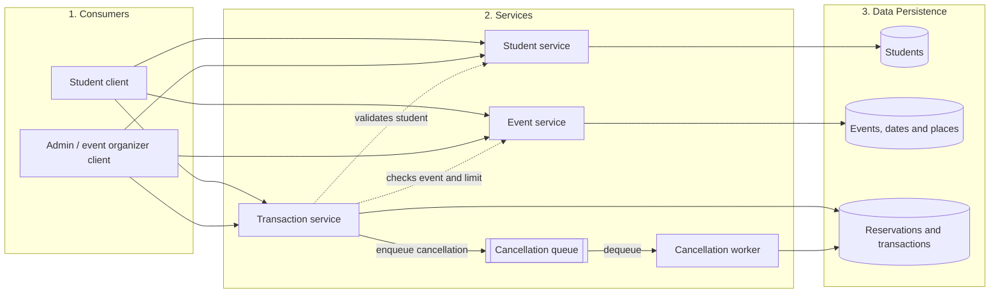
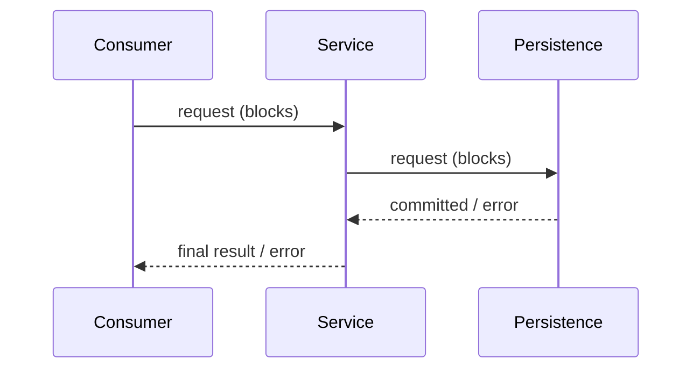
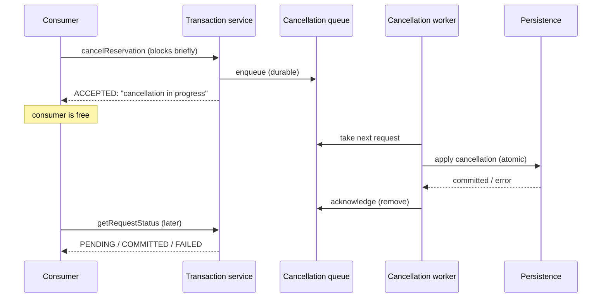
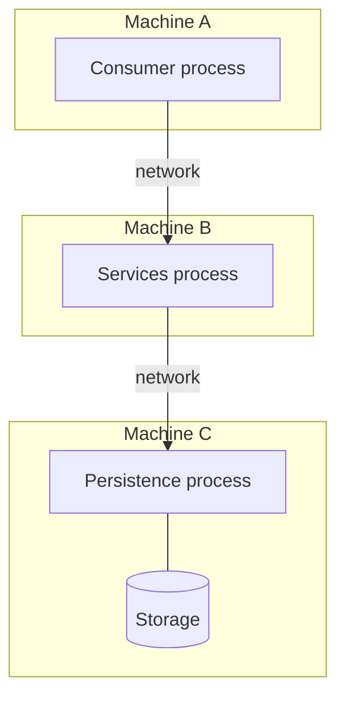

# Architecture

## Overview

The system follows a strict three-layer architecture. Each layer only talks to
the layer directly below it:

| Layer | Role | Knows about |
|---|---|---|
| **Consumers** | Entry point for users. Builds requests, shows results. No business rules. | Services layer API only |
| **Services** | Business logic: student and event/place CRUD, monthly event listing, reserving / modifying / cancelling spots, availability and balance checks, transactions. | Persistence layer API only |
| **Data Persistence** | Stores and retrieves `Student`, `Place`, `Event`, `EventDate`, `Reservation` and `Transaction` records durably. No business rules. | Its own storage |

Rules:

1. A consumer **never** talks directly to persistence.
2. Persistence **never** calls up into services or consumers.
3. Services may call other services (e.g. the transaction service asks the
   student service whether a student exists).

## Communication

Each layer runs as its own process (possibly on different machines), so every
arrow above is a network call.

### Synchronous operations (everything except cancellation)

The caller blocks until the layer below answers. A chain looks like this:

When the response arrives, the change is already committed (or definitely not
applied).

### Asynchronous operation: cancellation

Cancelling a reservation does **not** wait for the data layer. The transaction
service validates the request, stores it in a durable **cancellation queue** and
answers immediately with `ACCEPTED` ("your cancellation is being processed").
A **cancellation worker**, running in the services layer, later takes the
request from the queue and applies it to the data layer.

Both the queue and the worker belong to the services layer; the consumer still
only talks to services, and only services talk to persistence.

**(proposal)** Use TCP sockets, RPC (gRPC / Java RMI / Python `xmlrpc`) or
HTTP+JSON. Whatever is chosen, every message should carry:

| Field | Purpose |
|---|---|
| `requestId` | Unique ID used for idempotency and log correlation |
| `operation` | Name of the action, e.g. `CREATE_TRANSACTION` |
| `payload` | Operation-specific data |
| `timestamp` | When the request was produced |

Responses carry `requestId`, a `status` (`OK` / `ERROR`, or `ACCEPTED` for an
asynchronous cancellation), and either a `result`
or an `error` with a code and message.

## Deployment view

For development, all three processes can run on one machine on different ports.
Addresses and ports should come from configuration, never be hard-coded.
