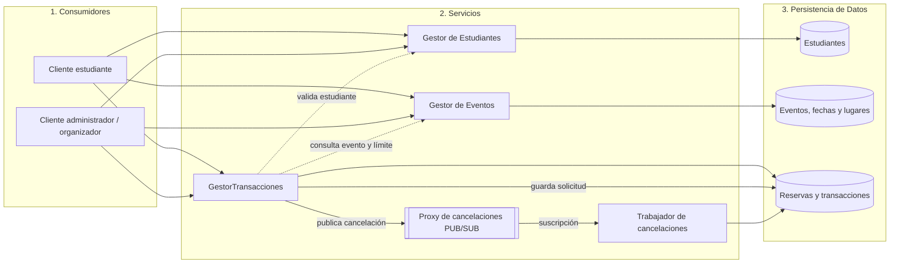
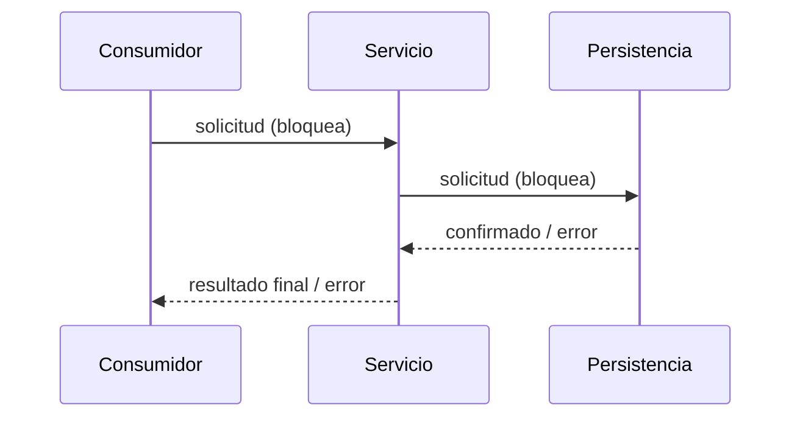
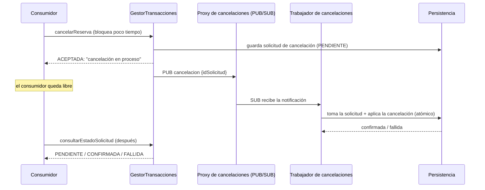
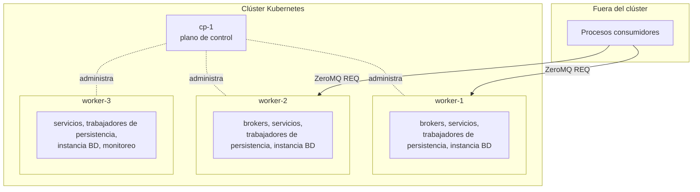

# Arquitectura

## Visión general

El sistema sigue una arquitectura estricta de tres capas. Cada capa solo se
comunica con la capa que está directamente debajo:

| Capa | Rol | Conoce |
|---|---|---|
| **Consumidores** | Punto de entrada de los usuarios. Arma las solicitudes y muestra los resultados. Sin reglas de negocio. | Solo la API de la capa de servicios |
| **Servicios** | Lógica de negocio: CRUD de estudiantes, eventos y lugares, listado de eventos por mes, reservar / modificar / cancelar cupos, verificación de disponibilidad y saldo, transacciones (`GestorTransacciones`). | Solo la API de la capa de persistencia |
| **Persistencia de Datos** | Guarda y recupera de forma durable los registros de `Estudiante`, `Lugar`, `Evento`, `FechaEvento`, `Reserva`, `Transaccion` y `SolicitudCancelacion`. Sin reglas de negocio. | Su propio almacenamiento |

Reglas:

1. Un consumidor **nunca** habla directamente con la persistencia.
2. La persistencia **nunca** llama hacia arriba a servicios o consumidores.
3. Los servicios pueden llamar a otros servicios (por ejemplo, `GestorTransacciones`
   le pregunta al Gestor de Estudiantes si un estudiante existe).

## Comunicación

Cada capa corre como su propio proceso (posiblemente en máquinas distintas), así
que cada flecha de arriba es una llamada por la red.

### Operaciones síncronas (todo excepto la cancelación)

Quien llama queda bloqueado hasta que la capa de abajo responde. Una cadena se ve así:

Cuando llega la respuesta, el cambio ya está confirmado (o definitivamente no
se aplicó).

### Operación asíncrona: cancelación

Cancelar una reserva **no** espera a que la cancelación se aplique.
`GestorTransacciones` valida la solicitud, la **guarda** en la capa de datos como
una solicitud de cancelación `PENDIENTE`, responde de inmediato con `ACEPTADA`
("tu cancelación está en proceso") y **publica** una notificación. Un
**trabajador de cancelaciones** suscrito a esas notificaciones toma la solicitud
y aplica la cancelación en la capa de datos.

PUB/SUB puede perder notificaciones, así que los trabajadores también revisan la
capa de datos buscando solicitudes pendientes: la solicitud guardada es la
garantía y la notificación es el camino rápido. El proxy y el trabajador
pertenecen a la capa de servicios; el consumidor sigue hablando solo con
servicios, y solo los servicios hablan con persistencia.

### Tecnología: ZeroMQ

Todos los enlaces usan ZeroMQ ([comunicacion-zeromq.md](comunicacion-zeromq.md)):

| Enlace | Patrón |
|---|---|
| Consumidores → Servicios | `REQ` → broker Majordomo (`ROUTER`/`ROUTER`) → trabajadores de servicio `DEALER` |
| Servicios → Persistencia | Igual, a través de un broker interno de persistencia |
| GestorTransacciones → Trabajadores de cancelaciones | `PUB` → proxy `XSUB`/`XPUB` → `SUB` |

La tolerancia a fallos usa los patrones de confiabilidad de ZeroMQ (Lazy Pirate,
Paranoid Pirate, Majordomo, Binary Star); ver
[tolerancia-fallos-escalabilidad.md](tolerancia-fallos-escalabilidad.md).

Todo mensaje de solicitud lleva:

| Campo | Propósito |
|---|---|
| `idSolicitud` | ID único usado para idempotencia y para correlacionar logs |
| `operacion` | Nombre de la acción, p. ej. `reservar` |
| `token` | Token de sesión firmado (identidad y rol) |
| `datos` | Datos propios de la operación |
| `marcaTiempo` | Momento en que se creó la solicitud |
| `traceparent` | Contexto de traza para trazabilidad distribuida |

Las respuestas llevan `idSolicitud`, un `estado` (`OK` / `ERROR`, o `ACEPTADA`
para una cancelación asíncrona), y un `resultado` o un `error` con código y
mensaje.

## Vista de despliegue

El sistema corre en **Kubernetes con 4 máquinas: 1 plano de control y 3 nodos
worker** ([despliegue-kubernetes.md](despliegue-kubernetes.md)). Los
consumidores corren fuera del clúster.

Para desarrollo, todos los procesos pueden correr en una sola máquina (o en un
Kubernetes local como k3d/kind) en puertos distintos. Las direcciones y puertos
salen de la configuración, nunca quedan escritos en el código.
