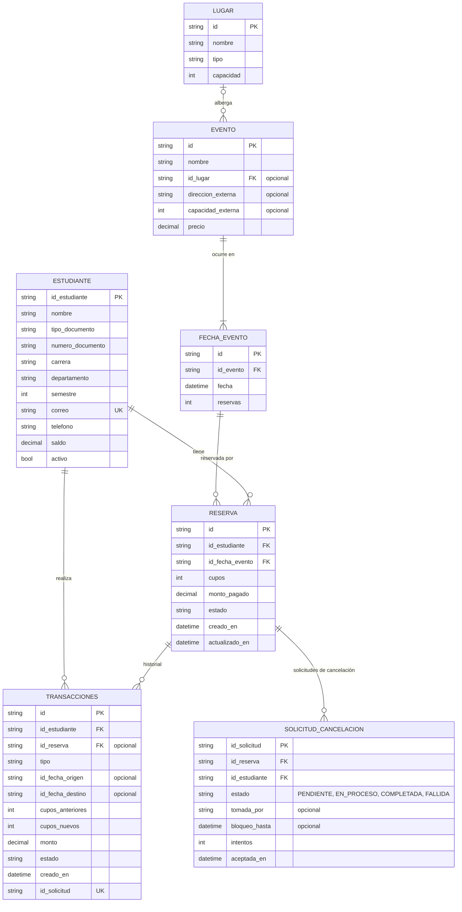

# Capas

## 1. Consumidores

Los consumidores son los clientes del sistema: un cliente para estudiantes y un
cliente para administradores/organizadores (CLI, escritorio o web).

**Responsabilidades**

- Recoger lo que ingresa el usuario y convertirlo en solicitudes a los servicios.
- Generar un `idSolicitud` para cada operación de escritura y reutilizarlo en los reintentos.
- Esperar la respuesta de cada solicitud síncrona y mostrar el resultado o el error.
- En una cancelación, mostrar el mensaje "cancelación en proceso" apenas llegue
  `ACEPTADA`, y después mostrar el resultado final consultando
  `consultarEstadoSolicitud`.
- Manejar los timeouts reintentando con el mismo `idSolicitud`.

**No debe**

- Tener reglas de negocio (verificación de disponibilidad, de saldo, etc.).
- Acceder directamente a la persistencia.

**Operaciones que usa**

| Actor | Operación |
|---|---|
| Estudiante | Registrar / actualizar su información de estudiante |
| Estudiante | Consultar los eventos de un mes |
| Estudiante | Consultar las reservas de los cupos de un evento (por fecha) |
| Estudiante | Reservar N cupos en una fecha de un evento |
| Estudiante | Modificar una reserva (cantidad de cupos y/o fecha) |
| Estudiante | Cancelar una reserva (asíncrono) |
| Estudiante | Consultar el estado de una cancelación |
| Estudiante | Consultar sus reservas |
| Estudiante | Ver su historial de transacciones |
| Administrador | CRUD de eventos y sus fechas |
| Administrador | CRUD de lugares (edificios, teatros) |
| Administrador | CRUD de estudiantes |
| Administrador | Recargar el saldo de un estudiante |
| Administrador | Listar todas las transacciones / reservas de un evento |
| Administrador | Ver los indicadores de desempeño |

## 2. Servicios

La capa de lógica de negocio. Expone una API de red a los consumidores y usa la
API de persistencia por debajo. Las operaciones síncronas responden solo después
de que la persistencia confirma el cambio; la cancelación responde apenas la
solicitud de cancelación queda guardada en la capa de datos. Todas las llamadas
pasan por brokers Majordomo de ZeroMQ ([comunicacion-zeromq.md](comunicacion-zeromq.md)).

### Gestor de Estudiantes (servicio `estudiantes`)

| Operación | Entrada | Salida |
|---|---|---|
| `crearEstudiante` | datos del estudiante | `Estudiante` |
| `obtenerEstudiante` | `idEstudiante` | `Estudiante` |
| `actualizarEstudiante` | `idEstudiante`, campos | `Estudiante` |
| `eliminarEstudiante` | `idEstudiante` | — (solo si no tiene reservas activas; si tiene, se pone `activo = false`) |
| `listarEstudiantes` | filtros (opcional) | `Estudiante[]` |

### Gestor de Eventos (servicio `eventos`)

| Operación | Entrada | Salida |
|---|---|---|
| `crearEvento` | nombre, `idLugar` **o** (`direccionExterna`, `capacidadExterna`), precio, `fechas[]` (≥ 1) | `Evento` con sus `FechaEvento` |
| `obtenerEvento` | `idEvento` | `Evento` con `reservas`, `limite` y `disponibles` de cada fecha |
| `actualizarEvento` | `idEvento`, campos | `Evento` |
| `eliminarEvento` | `idEvento` | — (antes cancela y reembolsa todas las reservas) |
| `agregarFechaEvento` | `idEvento`, fecha | `FechaEvento` |
| `actualizarFechaEvento` | `idFechaEvento`, nueva fecha | `FechaEvento` |
| `eliminarFechaEvento` | `idFechaEvento` | — (cancela y reembolsa sus reservas; un evento debe conservar ≥ 1 fecha) |
| `obtenerFechaEvento` | `idFechaEvento` | `FechaEvento` + `Evento` (límite y precio) |
| `listarEventosPorMes` | `anio`, `mes` | fechas de eventos de ese mes, cada una con nombre del evento, lugar, precio, `disponibles` |
| `crearLugar` / `obtenerLugar` / `actualizarLugar` / `eliminarLugar` / `listarLugares` | datos del lugar | `Lugar` |

### GestorTransacciones (servicio `transacciones`)

La clase **`GestorTransacciones`** administra las reservas y crea una
`Transaccion` por cada cambio.

| Operación | Entrada | Salida |
|---|---|---|
| `reservar` | `idSolicitud`, `idEstudiante`, `idFechaEvento`, `cupos` | `Reserva` + `Transaccion` |
| `modificarReserva` | `idSolicitud`, `idReserva`, `cuposNuevos` (opcional), `idFechaNueva` (opcional) | `Reserva` + `Transaccion` |
| `cancelarReserva` | `idSolicitud`, `idReserva` | **Asíncrona.** `ACEPTADA` + `idSolicitud` + mensaje "cancelación en proceso" |
| `consultarEstadoSolicitud` | `idSolicitud` | `PENDIENTE` / `CONFIRMADA` / `FALLIDA` (+ `Transaccion` y motivo cuando termina) |
| `recargarSaldo` | `idSolicitud`, `idEstudiante`, `monto` | `Transaccion` |
| `listarReservasEstudiante` | `idEstudiante` | `Reserva[]` con nombre del evento, fecha, lugar |
| `obtenerTransaccion` | `idTransaccion` | `Transaccion` |
| `listarTransacciones` | `idEstudiante` y/o `idReserva` (opcional) | `Transaccion[]` |

### Proxy y trabajadores de cancelaciones

Parte de la capa de servicios ("guardar primero y luego publicar",
[comunicacion-zeromq.md](comunicacion-zeromq.md#4-cancelaciones-guardar-primero-y-luego-publicar)).

| Componente | Responsabilidad |
|---|---|
| proxy-cancelaciones | Reenviador ZeroMQ `XSUB`/`XPUB`: los pods de gestor-transacciones publican, los trabajadores de cancelaciones se suscriben. No guarda nada. |
| Trabajador de cancelaciones | Se suscribe a las notificaciones `cancelacion`; **toma** la solicitud en la capa de datos (solo un trabajador gana) y llama a `aplicarCancelacion`. Un **barrido** cada 2 s toma las solicitudes `PENDIENTE` con más de 2 s y las `EN_PROCESO` cuyo bloqueo venció (30 s), cubriendo notificaciones perdidas y trabajadores caídos. Tras 5 intentos, o si la cancelación ya no aplica, la solicitud termina `FALLIDA`. |

**En `cancelarReserva`**, `GestorTransacciones`: verifica la idempotencia
(`idSolicitud` ya guardado → devuelve la misma respuesta), valida que la reserva
exista, sea del estudiante, esté `ACTIVA`, que la fecha no haya pasado y que no
tenga otra cancelación pendiente. Luego llama a `aceptarCancelacion` para guardar
la solicitud como `PENDIENTE`, responde `ACEPTADA` y publica `cancelacion {idSolicitud}`.

### Gestor de Métricas (servicio `metricas`)

| Operación | Entrada | Salida |
|---|---|---|
| `obtenerMetricas` | `desde`, `hasta`, operación (opcional) | Indicadores de [indicadores-desempeno.md](indicadores-desempeno.md): percentiles de latencia, % < 1 s, throughput, errores, cancelaciones pendientes, verificaciones de consistencia |

Cada capa escribe un registro de tiempo por solicitud (`idSolicitud`, capa,
operación, inicio, fin, resultado). La capa de servicios los reúne para calcular
los indicadores.

**Validaciones que se hacen aquí**

- El estudiante existe y está `activo`; la reserva es del estudiante.
- La fecha del evento existe y no ha pasado (tanto la actual como la nueva al modificar).
- `cupos >= 1`.
- Hay suficientes cupos disponibles en la fecha destino:
  - misma fecha: `reservas + (cuposNuevos − cuposAnteriores) <= limite`
  - fecha nueva: `reservas + cuposNuevos <= limite` en la fecha nueva
- La fecha nueva pertenece al mismo evento.
- El estudiante no tiene otra reserva activa para ese evento (en `reservar`).
- Si el evento es pago y el cambio cuesta dinero, `saldo >= costo`.
- La modificación realmente cambia algo.
- El `idSolicitud` no se ha procesado antes (si ya se procesó, se devuelve el
  resultado original en lugar de aplicar el cambio otra vez).
- En actualizaciones de eventos, fechas o lugares: reglas de lugar y límites (ver
  [modelo-dominio.md](modelo-dominio.md#invariantes)).

### Códigos de error

| Código | Significado |
|---|---|
| `ESTUDIANTE_NO_ENCONTRADO` | `idEstudiante` desconocido |
| `ESTUDIANTE_YA_EXISTE` | `idEstudiante`, correo o documento duplicado |
| `ESTUDIANTE_INACTIVO` | El estudiante no tiene permitido reservar |
| `EVENTO_NO_ENCONTRADO` / `FECHA_EVENTO_NO_ENCONTRADA` | Evento o fecha desconocidos |
| `FECHA_EVENTO_PASADA` | La fecha ya pasó |
| `FECHA_DE_OTRO_EVENTO` | La fecha nueva pertenece a otro evento |
| `CUPOS_INSUFICIENTES` | Los cupos pedidos superan los disponibles |
| `CUPOS_INVALIDOS` | `cupos < 1` |
| `RESERVA_NO_ENCONTRADA` | Reserva desconocida |
| `RESERVA_AJENA` | La reserva pertenece a otro estudiante |
| `RESERVA_CANCELADA` | Se intenta modificar una reserva cancelada |
| `YA_RESERVADO` | El estudiante ya tiene una reserva activa para el evento |
| `SIN_CAMBIOS` | La modificación tiene los mismos cupos y la misma fecha |
| `CANCELACION_PENDIENTE` | La reserva ya tiene una cancelación en proceso (al modificar o cancelar de nuevo) |
| `SOLICITUD_NO_ENCONTRADA` | `idSolicitud` desconocido en `consultarEstadoSolicitud` |
| `LUGAR_NO_ENCONTRADO` | `idLugar` desconocido |
| `LUGAR_EN_USO` | El lugar tiene eventos, no se puede eliminar |
| `UBICACION_INVALIDA` | Se definieron ambos o ninguno de `idLugar` / `direccionExterna` |
| `LIMITE_MENOR_A_RESERVAS` | La nueva capacidad es menor que las reservas actuales |
| `SALDO_INSUFICIENTE` | El saldo es menor que el costo |
| `PERSISTENCIA_NO_DISPONIBLE` | La capa de abajo no respondió |
| `NO_AUTENTICADO` | Token ausente, inválido o vencido |
| `PROHIBIDO` | Autenticado, pero el rol no permite la operación |
| `LIMITE_SOLICITUDES` | Demasiadas solicitudes del mismo estudiante |

## 3. Persistencia de Datos

Guarda los datos de forma durable y expone operaciones simples, sin lógica.

**Responsabilidades**

- CRUD de `Estudiante`, `Lugar`, `Evento`, `FechaEvento`, `Reserva`,
  `Transaccion` y `SolicitudCancelacion`.
- Ejecutar **atómicamente** los cambios que afectan varios registros.
- Hacer cumplir las restricciones: `Estudiante.correo` único,
  (`tipoDocumento`, `numeroDocumento`) único, `Transaccion.idSolicitud` único,
  llaves foráneas, `reservas <= limite` en cada fecha.

**Operaciones**

| Operación | Notas |
|---|---|
| `obtener<Entidad>(id)` | Devuelve el registro o "no encontrado" |
| `listar<Entidad>(filtro)` | |
| `insertar<Entidad>(registro)` | Falla si la llave está duplicada |
| `actualizar<Entidad>(id, campos, versionEsperada)` | Bloqueo optimista (propuesta) |
| `eliminar<Entidad>(id)` | Falla si está referenciado (FK) |
| `listarFechasEventoEntre(desde, hasta)` | Para "eventos de un mes" |
| `listarReservasPorEstudiante(idEstudiante)` | Reservas activas unidas con evento y fecha |
| `buscarTransaccionPorIdSolicitud(idSolicitud)` | Para la idempotencia y `consultarEstadoSolicitud` |
| `aceptarCancelacion(idSolicitud, idReserva, idEstudiante)` | Inserta una `solicitud_cancelacion` con estado `PENDIENTE`. Falla si el `idSolicitud` está duplicado (devuelve la existente) o si la reserva ya tiene una solicitud pendiente (`CANCELACION_PENDIENTE`). |
| `tomarCancelacion(idSolicitud, idTrabajador)` / `tomarCancelacionesPendientes(idTrabajador, limite)` | Pasa atómicamente de `PENDIENTE` (o `EN_PROCESO` con bloqueo vencido) a `EN_PROCESO` con `tomada_por` y `bloqueo_hasta`; indica si este trabajador ganó. |
| `aplicarCancelacion(tx, idSolicitud)` | La llama el trabajador. Una sola unidad atómica: si la reserva sigue `ACTIVA`, la pone `CANCELADA`, resta sus `cupos` de su fecha, reembolsa `montoPagado`, inserta la transacción `CONFIRMADA` y marca la solicitud `COMPLETADA`. Si ya existe una transacción con ese `idSolicitud`, no hace nada (así los reintentos son seguros). Si no aplica, registra una transacción `FALLIDA` y marca la solicitud `FALLIDA`. |
| `obtenerSolicitudCancelacion(idSolicitud)` | La usa `consultarEstadoSolicitud` |
| `aplicarCambioReserva(tx, reserva, deltasFechas[], deltaSaldo)` | Una sola unidad atómica: inserta la transacción, crea/actualiza la reserva, suma/resta cupos en una o dos fechas (cada una condicionada a `reservas + delta <= limite`) y ajusta el saldo. Falla completa si alguna condición falla. |

### Tablas (propuesta relacional)

Un índice único parcial en `solicitud_cancelacion(id_reserva) WHERE estado IN ('PENDIENTE','EN_PROCESO')`
garantiza como máximo una cancelación en proceso por reserva.

Almacenamiento: **PostgreSQL**, corriendo en Kubernetes con el operador
CloudNativePG ([despliegue-kubernetes.md](despliegue-kubernetes.md)). Los
trabajadores de persistencia son workers ZeroMQ `DEALER` registrados como el
servicio `persistencia` en el broker-persistencia.
