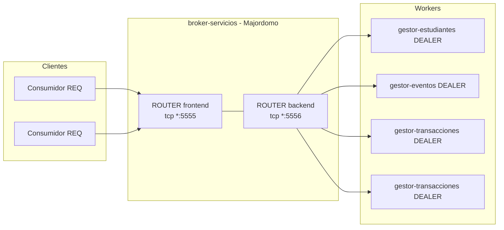
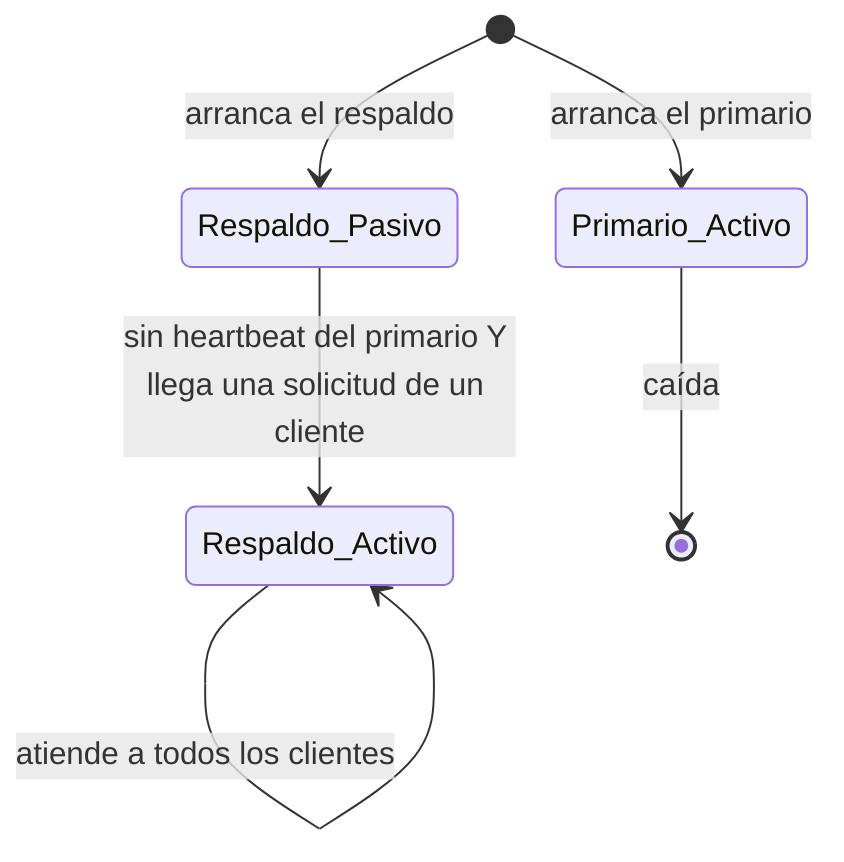
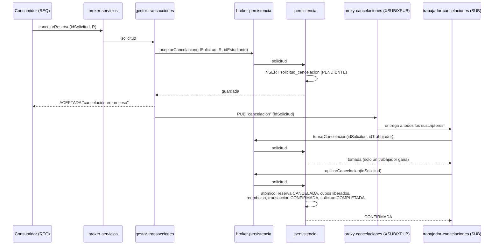

# Comunicación con ZeroMQ

> **Entrega 1:** lo implementado (solo consulta y reserva) usa al `GestorTransacciones` como broker con balanceo de carga (`ROUTER`↔`DEALER` con latidos) y `REQ`/`REP` con Lazy Pirate hacia persistencia. Los mensajes son texto `clave=valor` (clase `Mensaje`), no JSON. PUB/SUB para cancelaciones, el broker Majordomo, Binary Star y CurveZMQ quedan para entregas siguientes. Ver [implementacion.md](implementacion.md).

Toda la comunicación entre procesos usa [ZeroMQ](https://zeromq.org/) (ØMQ).
Este documento define qué patrones y sockets de ZeroMQ usa cada enlace, el
formato de los mensajes, y los **patrones de confiabilidad de ZeroMQ** que hacen
al sistema tolerante a fallos y escalable.

| Enlace | Operaciones | Patrón ZeroMQ | Patrón de confiabilidad |
|---|---|---|---|
| Consumidores → Servicios | Reservar, modificar, consultar, CRUD, cancelar (aceptación), estado, métricas | **Petición–respuesta a través de un broker** (cliente `REQ` → broker `ROUTER` … `ROUTER` ← worker `DEALER`) | Broker **Majordomo** + cliente **Lazy Pirate** + heartbeats de workers **Paranoid Pirate** + par de brokers **Binary Star** |
| Servicios → Persistencia | Todas las operaciones de persistencia | Igual, a través de un segundo broker interno | Igual |
| GestorTransacciones → Trabajadores de cancelaciones | "Se aceptó una cancelación" | **Publicación–suscripción** (`PUB` → proxy `XSUB`/`XPUB` → `SUB`) | **Guardar primero y luego publicar**: la base de datos es el registro durable; PUB/SUB es la notificación rápida; un barrido recupera los mensajes perdidos |

---

## 1. Por qué estos patrones

### 1.1 Operaciones de reserva: petición–respuesta con `ROUTER`

`REQ`/`REP` simple funciona para un cliente y un servidor, pero:

- `REP` atiende una solicitud a la vez, y un socket `REQ` queda bloqueado para
  siempre si su respuesta se pierde (alternancia estricta enviar/recibir);
- no hay balanceo de carga entre varias instancias del servicio ni forma de
  detectar un servidor caído.

Por eso los consumidores mantienen un socket `REQ` (simple y síncrono: RNF-02),
pero se conectan a un **broker** que usa sockets `ROUTER`. Un socket `ROUTER`
puede hablar con muchos pares a la vez y devuelve cada respuesta usando el sobre
de identidad, así el broker puede atender miles de clientes y repartir el
trabajo entre muchos workers de servicio (sockets `DEALER`).



### 1.2 Cancelaciones: publicación–suscripción

La cancelación es asíncrona (RF-19a). `GestorTransacciones` solo tiene que
anunciar que se aceptó una cancelación, y cualquier trabajador de cancelaciones
puede aplicarla, así que `PUB`/`SUB` encaja: quien publica no espera y no
necesita saber cuántos trabajadores hay.

ZeroMQ `PUB`/`SUB` **no guarda mensajes**: un mensaje se pierde si no hay
suscriptores conectados, si un suscriptor se está reiniciando, si se une tarde
("slow joiner"), o si su buffer (high-water mark) está lleno. Para cumplir de
todas formas RNF-06 ("una cancelación aceptada nunca se pierde"), la cancelación
se **guarda en la base de datos antes** de responder `ACEPTADA` y de publicar
(sección 4).

---

## 2. Petición–respuesta: broker Majordomo

Implementamos el **Protocolo Majordomo** (MDP, RFC 7 de ZeroMQ) de la Guía de ZeroMQ.
Hay dos brokers:

| Broker | Clientes | Workers (nombres de servicio) | Expuesto a |
|---|---|---|---|
| **broker-servicios** | Consumidores | `estudiantes`, `eventos`, `transacciones`, `metricas` | Fuera del clúster (estudiantes, administrador) |
| **broker-persistencia** | Workers de servicios, trabajadores de cancelaciones | `persistencia` | Solo dentro del clúster |

Usar dos brokers mantiene separadas las tres capas (RNF-01): un consumidor nunca
puede llegar al servicio `persistencia`, porque no está registrado en el broker
al que el consumidor tiene acceso.

### 2.1 Cómo funciona el broker

1. Cada worker conecta su `DEALER` al backend del broker y envía `READY` con su
   nombre de servicio (p. ej. `transacciones`).
2. El broker mantiene, por servicio, una lista de **workers libres** (el usado
   hace más tiempo primero).
3. Un cliente envía una solicitud para el servicio `transacciones`. El broker se
   la entrega al primer worker libre de `transacciones`; si no hay ninguno
   libre, guarda la solicitud en una lista de espera de ese servicio.
4. El worker responde; el broker devuelve la respuesta al cliente correcto usando
   el sobre de identidad del `ROUTER`; el worker vuelve a la lista de libres.

**Escalabilidad:** agregar un pod worker significa un worker `READY` más; el
broker empieza a enviarle solicitudes de inmediato. No hay que cambiar ninguna
configuración. El **balanceo de carga** es por solicitud (el usado hace más
tiempo), no por conexión.

### 2.2 Lazy Pirate (lado del cliente)

Todo cliente (consumidor → servicios, servicios → persistencia) sigue el patrón
**Lazy Pirate**:

```
intento = 0
mientras intento < MAX_REINTENTOS:
    enviar(solicitud)                     # el mismo idSolicitud en cada intento
    si poll(socket, TIMEOUT) tiene respuesta:
        devolver respuesta
    cerrar socket (LINGER = 0)            # el socket REQ quedó bloqueado; se descarta
    intento += 1
    si intento == REINTENTOS_ANTES_DE_CAMBIAR:
        cambiar al broker de respaldo     # Binary Star
    reabrir socket y reconectar
devolver ERROR "resultado desconocido"
```

Reintentar es seguro porque toda escritura lleva el mismo `idSolicitud` y las
capas de servicios y persistencia son idempotentes (RNF-04).

### 2.3 Paranoid Pirate (lado del worker): heartbeats

El broker y los workers intercambian **heartbeats** para que ambos detecten un
par caído aunque no haya tráfico:

| Parámetro | Valor (propuesta) |
|---|---|
| Intervalo de heartbeat | 1 s |
| Liveness | 3 heartbeats perdidos → el par se considera caído (3 s) |
| Espera de reconexión del worker | 1 s, 2 s, 4 s … máx. 16 s |

- **El broker detecta un worker caído:** lo quita de la lista de libres; las
  solicitudes van a otros workers. Una solicitud que estaba en curso en el worker
  caído no recibe respuesta, así que el reintento Lazy Pirate del cliente la
  reenvía y otro worker la atiende (idempotente).
- **El worker detecta un broker caído:** cierra su socket, reconecta con espera
  creciente y vuelve a enviar `READY` (al broker de respaldo si el primario no está).

### 2.4 Binary Star (alta disponibilidad del broker)

Un solo broker sería un punto único de fallo. Cada broker corre como un par
**Binary Star**:



- El primario y el respaldo intercambian su estado por un par `PUB`/`SUB` cada 1 s.
- Clientes y workers conocen **ambos** endpoints. Usan el primario; cuando los
  reintentos Lazy Pirate fallan, cambian al respaldo.
- El respaldo se activa solo si (a) dejó de escuchar al primario **y** (b) un
  cliente realmente está intentando usarlo. La condición (b) evita el "cerebro
  dividido" (split brain) cuando solo falla el enlace entre los dos brokers.
- Los brokers no guardan datos de negocio, solo estado de conexión, así que el
  cambio no pierde nada: los clientes reintentan las solicitudes en curso.

**Alternativa más simple (fase 1):** correr una sola réplica del broker y dejar
que Kubernetes la reinicie (unos segundos); los clientes Lazy Pirate reintentan
hasta que vuelva. Binary Star es la fase 2
([tolerancia-fallos-escalabilidad.md](tolerancia-fallos-escalabilidad.md#6-fases-de-implementación)).

### 2.5 Tramas de los mensajes

Solicitud de cliente Majordomo (`REQ` agrega el delimitador vacío automáticamente):

| Trama | Contenido |
|---|---|
| 0 | `MDPC01` (id del protocolo) |
| 1 | Nombre del servicio: `transacciones` |
| 2 | Cuerpo (JSON, UTF-8) |

Cuerpo:

```json
{
  "idSolicitud": "6f1c…",
  "operacion": "reservar",
  "token": "<token de sesión firmado>",
  "marcaTiempo": "2026-10-22T15:04:05.123Z",
  "traceparent": "00-7f3a…-01",
  "datos": { "idFechaEvento": "fe-17", "cupos": 2 }
}
```

Cuerpo de la respuesta:

```json
{ "idSolicitud": "6f1c…", "estado": "OK", "resultado": { … } }
{ "idSolicitud": "6f1c…", "estado": "ERROR", "error": { "codigo": "CUPOS_INSUFICIENTES", "mensaje": "…" } }
{ "idSolicitud": "9a2e…", "estado": "ACEPTADA", "mensaje": "Tu cancelación está en proceso" }
```

Las tramas de los workers siguen MDP (`MDPW01` + comando: `READY`, `REQUEST`,
`REPLY`, `HEARTBEAT`, `DISCONNECT`; son nombres del protocolo y no se traducen).
**(propuesta)** JSON por legibilidad; cambiar a MessagePack si la serialización
aparece en las mediciones de latencia.

### 2.6 Operaciones por servicio

| Nombre del servicio | Operaciones |
|---|---|
| `estudiantes` | `crearEstudiante`, `obtenerEstudiante`, `actualizarEstudiante`, `eliminarEstudiante`, `listarEstudiantes` |
| `eventos` | CRUD de eventos/fechas/lugares, `obtenerEvento`, `obtenerFechaEvento`, `listarEventosPorMes` |
| `transacciones` (`GestorTransacciones`) | `reservar`, `modificarReserva`, `cancelarReserva`, `consultarEstadoSolicitud`, `recargarSaldo`, `listarReservasEstudiante`, `listarTransacciones` |
| `metricas` | `obtenerMetricas` |
| `persistencia` | Todas las operaciones de [capas.md](capas.md#3-persistencia-de-datos) |

---

## 3. Timeouts y opciones de socket

| Ajuste | Consumidor → servicios | Servicios → persistencia |
|---|---|---|
| Timeout por intento | 1 000 ms | 300 ms |
| Máximo de intentos | 3 | 2 |
| Intentos antes de cambiar al broker de respaldo | 2 | 1 |

Con esto el caso normal queda muy por debajo de 1 s (RNF-07); los reintentos solo
ocurren cuando algo falló, y el consumidor recibe entonces el resultado guardado
del primer intento exitoso.

| Opción de socket | Valor | Por qué |
|---|---|---|
| `ZMQ_LINGER` | 0 en sockets cliente | Cerrar un `REQ` bloqueado no debe quedarse esperando |
| `ZMQ_SNDHWM` / `ZMQ_RCVHWM` | 1 000 (brokers), 10 000 (PUB) | Limitar la memoria; por encima se descartan mensajes (PUB/SUB) o el emisor se bloquea (REQ) |
| `ZMQ_IMMEDIATE` | 1 en clientes | No encolar mensajes hacia un par que aún no está conectado |
| `ZMQ_TCP_KEEPALIVE` | 1 | Detectar conexiones TCP medio abiertas |
| `ZMQ_RECONNECT_IVL` / `_MAX` | 100 ms / 5 s | Reconexión rápida después del reinicio de un pod |
| `ZMQ_ROUTER_MANDATORY` | 1 en brokers | Error en vez de descarte silencioso cuando un par ya no está |

---

## 4. Cancelaciones: guardar primero y luego publicar



### 4.1 Pasos

1. **Guardar.** `GestorTransacciones` valida y le pide a la persistencia insertar
   una fila en `solicitud_cancelacion` con estado `PENDIENTE`. El `idSolicitud`
   único hace seguros los reintentos; una restricción única de "una solicitud
   pendiente por reserva" produce `CANCELACION_PENDIENTE`.
2. **Responder.** Solo después de guardar la fila el estudiante recibe `ACEPTADA`.
   Si la persistencia no responde → `PERSISTENCIA_NO_DISPONIBLE` y no se acepta nada.
3. **Publicar.** `GestorTransacciones` publica `["cancelacion", {idSolicitud}]` en
   su socket `PUB`, conectado al **proxy-cancelaciones** (`XSUB` de entrada,
   `XPUB` de salida). El proxy permite que muchos publicadores (todos los pods de
   gestor-transacciones) lleguen a muchos suscriptores sin que se conozcan entre sí.
4. **Tomar.** Todos los trabajadores de cancelaciones están suscritos a
   `cancelacion` y reciben la notificación. Cada uno intenta **tomarla** en la
   base de datos:

   ```sql
   UPDATE solicitud_cancelacion
   SET estado = 'EN_PROCESO', tomada_por = :trabajador,
       bloqueo_hasta = now() + interval '30 seconds', intentos = intentos + 1
   WHERE id_solicitud = :id
     AND (estado = 'PENDIENTE' OR (estado = 'EN_PROCESO' AND bloqueo_hasta < now()));
   ```

   Exactamente un trabajador actualiza 1 fila y continúa; los demás actualizan 0
   filas e ignoran el mensaje.
5. **Aplicar.** El ganador llama a `aplicarCancelacion`, una sola transacción
   atómica que cancela la reserva, libera los cupos, reembolsa, escribe la
   transacción `CANCELACION` (`CONFIRMADA`) y marca la solicitud `COMPLETADA`. Si
   la reserva ya no se puede cancelar, escribe una transacción `FALLIDA` y marca
   la solicitud `FALLIDA`.

### 4.2 Recuperar notificaciones perdidas (barrido)

Como PUB/SUB puede perder mensajes, cada trabajador también corre un **barrido**
cada 2 s:

```sql
SELECT id_solicitud FROM solicitud_cancelacion
WHERE (estado = 'PENDIENTE' AND aceptada_en < now() - interval '2 seconds')
   OR (estado = 'EN_PROCESO' AND bloqueo_hasta < now())
ORDER BY aceptada_en
LIMIT 50;
```

y las toma y aplica exactamente como en los pasos 4–5. Esto cubre:

| Se perdió porque… | Se recupera con |
|---|---|
| No había trabajadores suscritos / el proxy se estaba reiniciando | Barrido (≤ 2–4 s de demora) |
| Suscriptor tardío (el trabajador acababa de arrancar) | Barrido |
| El trabajador se cayó después de tomarla y antes de aplicarla | Vence el bloqueo (30 s) → el barrido la vuelve a tomar |
| El trabajador se cayó justo después de aplicarla | Ya está `COMPLETADA` (misma confirmación atómica); no hay nada que hacer |

Después de 5 intentos la solicitud se marca `FALLIDA` y se genera una alerta.

Así, **PUB/SUB da la velocidad** (normalmente la cancelación se aplica en
milisegundos) y **la base de datos da la garantía** (nada aceptado se pierde, y
la toma hace que se aplique exactamente una vez).

### 4.3 Opcional: notificaciones de resultado

Los trabajadores también pueden publicar `["cancelacion.terminada", {idSolicitud, estado}]`.
Un consumidor que quiera un aviso en lugar de consultar `consultarEstadoSolicitud`
podría suscribirse a través de la capa de servicios (decisión O15).

---

## 5. Seguridad: CurveZMQ

ZeroMQ no usa TLS; tiene su propio cifrado y autenticación: **CurveZMQ**
(ZMTP 3 + mecanismo CURVE, curva elíptica, secreto perfecto hacia adelante).

| Socket | Rol | Llaves |
|---|---|---|
| Frontend del broker-servicios | Servidor CURVE | Par de llaves del servidor; los consumidores conocen su llave pública |
| Backend del broker-servicios, broker-persistencia, proxy-cancelaciones | Servidor CURVE | Par de llaves del servidor |
| Todos los clientes/workers | Cliente CURVE | Su propio par de llaves |

- **Cifrado + integridad** en todos los enlaces (reemplaza "TLS en todos los
  canales" del modelo de seguridad).
- Un **manejador ZAP** en los sockets internos (backends, broker-persistencia,
  proxy) acepta solo las llaves públicas de nuestros propios pods → autenticación
  de los procesos internos (decisión O20).
- La identidad del estudiante/administrador sigue siendo el **token** firmado
  dentro del cuerpo de la solicitud; la capa de servicios lo valida.
- Las llaves se guardan en Secrets de Kubernetes, nunca en el repositorio.

---

## 6. Librerías

| Lenguaje | Binding de ZeroMQ | Majordomo / patrones |
|---|---|---|
| Python | `pyzmq` | Ejemplos de la Guía de ZeroMQ `mdbroker.py`, `mdcliapi.py`, `mdwrkapi.py`, `bstar.py` |
| Java | JeroMQ (Java puro) | Ejemplos de la Guía portados a Java (`mdbroker`, `mdcliapi2`, `mdwrkapi`, `bstarsrv`) |
| Node.js | `zeromq` (zeromq.js v6) | Implementar MDP sobre `Router`/`Dealer` |

---

## 7. Cómo se relaciona con el diseño anterior

| Antes (sin tecnología definida) | Ahora con ZeroMQ |
|---|---|
| RPC síncrono consumidor → servicios | `REQ` → `broker-servicios` Majordomo → workers `DEALER` |
| RPC síncrono servicios → persistencia | Cliente Lazy Pirate → `broker-persistencia` → trabajadores de persistencia |
| Cola durable de cancelaciones | Tabla `solicitud_cancelacion` (durable) + notificación `PUB`/`SUB` + barrido |
| Profundidad de la cola (Q-01) | `COUNT(*) WHERE estado IN ('PENDIENTE','EN_PROCESO')` |
| Par de balanceadores de carga | Broker Majordomo (LRU por solicitud) + par Binary Star |
| Health checks | Heartbeats Majordomo (entre procesos) + HTTP `/healthz` para las sondas de Kubernetes |
| TLS | CurveZMQ |
