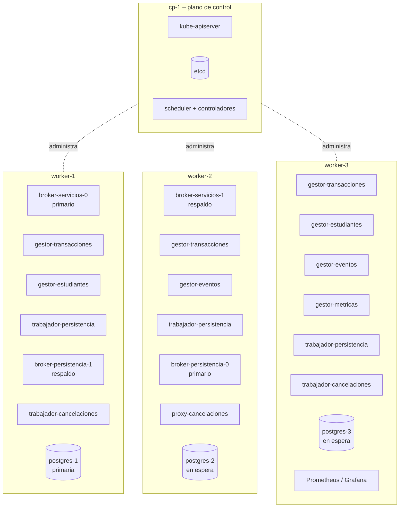

# Despliegue en Kubernetes

El sistema corre en un **clúster de Kubernetes de 4 máquinas**: **1 plano de
control** y **3 nodos worker**. La comunicación entre procesos usa ZeroMQ
([comunicacion-zeromq.md](comunicacion-zeromq.md)).

---

## 1. Clúster

| Máquina | Rol en Kubernetes | Corre |
|---|---|---|
| `cp-1` | **Plano de control** | kube-apiserver, etcd, scheduler, controller-manager. Con taint `NoSchedule`: no corre pods de la aplicación. |
| `worker-1` | Nodo worker | Pods de aplicación, datos y monitoreo |
| `worker-2` | Nodo worker | Pods de aplicación, datos y monitoreo |
| `worker-3` | Nodo worker | Pods de aplicación, datos y monitoreo |

| Componente | Elección (propuesta) |
|---|---|
| Distribución | **k3s** (liviano, fácil de instalar) o kubeadm |
| Plugin de red (CNI) | **Calico** (soporta NetworkPolicies) |
| Acceso externo | **NodePort** (simple) o **MetalLB** (IPs externas estables) |
| Almacenamiento | Provisionador `local-path` (disco de cada nodo worker) |
| PostgreSQL | Operador **CloudNativePG** (failover automático, copias de seguridad) |
| Monitoreo | **kube-prometheus-stack** (Prometheus, Grafana, Alertmanager, node-exporter) |
| Imágenes | Construidas con Docker y subidas a un registro local (o GitHub Container Registry) |

### Namespaces

| Namespace | Contenido |
|---|---|
| `eventos-app` | Brokers, gestores (servicios), proxy de cancelaciones, trabajadores de cancelaciones, trabajadores de persistencia |
| `eventos-datos` | Clúster de PostgreSQL |
| `monitoreo` | Prometheus, Grafana, Alertmanager, Jaeger |

---

## 2. Cargas de trabajo

| Carga | Tipo | Réplicas | Puertos | Distribución |
|---|---|---|---|---|
| `broker-servicios` | StatefulSet (par Binary Star) | 2 | 5555 frontend (ROUTER), 5556 backend (ROUTER), 5557 estado Binary Star, 8080 `/healthz` | Nodos distintos (anti-afinidad) |
| `gestor-estudiantes` | Deployment | 2 | 8080 `/healthz`, 9100 `/metrics` | Repartidos entre nodos |
| `gestor-eventos` | Deployment | 2 | igual | Repartidos |
| `gestor-transacciones` | Deployment + HPA | 3 (máx. 9) | igual | Uno por nodo |
| `gestor-metricas` | Deployment | 1 | igual | Cualquiera |
| `broker-persistencia` | StatefulSet (par Binary Star) | 2 | 5565 frontend, 5566 backend, 5567 estado, 8080 | Nodos distintos |
| `trabajador-persistencia` | Deployment + HPA | 3 (máx. 6) | 8080, 9100 | Uno por nodo |
| `proxy-cancelaciones` | Deployment (XSUB/XPUB) | 1 | 5570 XSUB, 5571 XPUB, 8080 | Cualquiera (reinicia rápido; el barrido cubre el hueco) |
| `trabajador-cancelaciones` | Deployment + HPA | 2 (máx. 6) | 8080, 9100 | Nodos distintos |
| `postgres` | `Cluster` de CloudNativePG | 3 (1 primaria + 2 en espera, replicación síncrona por quórum) | 5432 | **Una por nodo** |
| Prometheus / Grafana / Alertmanager | kube-prometheus-stack | 1 cada uno | — | Cualquiera |
| node-exporter | DaemonSet | 1 por nodo | — | Todos los nodos |

Cada Deployment usa **una imagen por servicio**, así cada servicio se puede
escalar y actualizar de forma independiente.

### Ubicación



El scheduler decide la ubicación exacta; las **reglas de anti-afinidad** de abajo
garantizan que perder cualquier nodo worker nunca elimina todas las réplicas de
un componente.

```yaml
# ejemplo: no poner dos pods de gestor-transacciones en el mismo nodo si se puede
affinity:
  podAntiAffinity:
    preferredDuringSchedulingIgnoredDuringExecution:
      - weight: 100
        podAffinityTerm:
          topologyKey: kubernetes.io/hostname
          labelSelector: { matchLabels: { app: gestor-transacciones } }
# los brokers y postgres usan requiredDuringScheduling… (regla obligatoria)
```

---

## 3. Red

### 3.1 Services de Kubernetes

| Service | Tipo | Destino | Lo usan |
|---|---|---|---|
| `broker-servicios-0`, `broker-servicios-1` | **NodePort** 30555 / 30565 (o LoadBalancer con MetalLB) | Frontend 5555 de cada pod broker | Consumidores fuera del clúster (conocen ambos endpoints para Binary Star) |
| `broker-servicios-0-backend`, `-1-backend` | ClusterIP | Backend 5556 | Gestores (workers de servicio) |
| `broker-persistencia-0`, `-1` | ClusterIP | 5565 / 5566 | Gestores, trabajadores de cancelaciones, trabajadores de persistencia |
| `proxy-cancelaciones` | ClusterIP | 5570 / 5571 | gestor-transacciones (PUB), trabajador-cancelaciones (SUB) |
| `postgres-rw` | ClusterIP (creado por CloudNativePG) | Primaria actual | Trabajadores de persistencia (escrituras) |
| `postgres-ro` | ClusterIP (creado por CloudNativePG) | Réplicas en espera | Trabajadores de persistencia (listados, opcional) |

Cada pod broker tiene su **propio** Service (gracias a los nombres estables del
StatefulSet), porque en Binary Star los clientes deben elegir explícitamente
entre primario y respaldo; un solo Service que balancee conexiones rompería el
patrón.

Los sockets ZeroMQ son conexiones TCP de larga duración; el balanceo por
solicitud lo hace el broker Majordomo, no Kubernetes.

### 3.2 Políticas de red (aislamiento)

| Política | Permite |
|---|---|
| Frontend de `broker-servicios` | Desde fuera del clúster (consumidores) |
| Backend de `broker-servicios` | Solo desde `gestor-estudiantes`, `gestor-eventos`, `gestor-transacciones`, `gestor-metricas` |
| `broker-persistencia` | Solo desde los gestores y `trabajador-cancelaciones` (y su par) |
| `proxy-cancelaciones` | Solo desde `gestor-transacciones` y `trabajador-cancelaciones` |
| `postgres` | Solo desde `trabajador-persistencia` (y el operador) |
| Todo lo demás | Denegado por defecto |

Junto con CurveZMQ (cifrado + autenticación por llaves), esto hace cumplir "solo
la capa de arriba puede llamar a la capa de abajo".

---

## 4. Configuración y secretos

| Tipo | Nombre | Contenido |
|---|---|---|
| ConfigMap | `endpoints-zmq` | Direcciones de brokers y proxy (primario/respaldo), puertos |
| ConfigMap | `timeouts` | Timeouts por intento, reintentos, intervalo de heartbeat, liveness, intervalo del barrido, bloqueo |
| Secret | `llaves-curve` | Pares de llaves CurveZMQ de brokers/proxy, llaves públicas de clientes permitidas |
| Secret | `llave-firma-token` | Llave para validar los tokens de sesión |
| Secret | `postgres-app` | Usuario/contraseña de la base de datos (los crea CloudNativePG) |

Nada secreto se guarda en el repositorio.

---

## 5. Salud, sondas y actualizaciones

ZeroMQ no es HTTP, así que cada proceso también corre un pequeño servidor HTTP en
el puerto 8080:

| Sonda | Endpoint | Listo / vivo cuando |
|---|---|---|
| `readinessProbe` | `/ready` | Worker: conectado a su broker y registrado (`READY` enviado). Broker: en estado **activo** (el miembro pasivo de Binary Star no está listo, así que solo el activo recibe tráfico). Trabajador de persistencia: la BD responde. |
| `livenessProbe` | `/healthz` | El ciclo principal está corriendo (procesó heartbeats en los últimos 5 s) |
| `startupProbe` | `/healthz` | Permite un primer arranque lento (migraciones de BD) |

| Ajuste | Valor | Por qué |
|---|---|---|
| Actualización progresiva | `maxUnavailable: 0`, `maxSurge: 1` | Nunca menos réplicas de las configuradas durante una actualización |
| Hook `preStop` + `terminationGracePeriodSeconds: 20` | El worker envía `DISCONNECT` de MDP, termina las solicitudes en curso y luego sale | No se pierden solicitudes durante los despliegues |
| PodDisruptionBudget | `minAvailable: 1` para brokers, `minAvailable: 2` para gestor-transacciones y trabajador-persistencia, `maxUnavailable: 1` para postgres | El mantenimiento de un nodo (drain) nunca apaga todo |
| `tolerations` para `not-ready` / `unreachable` | `tolerationSeconds: 30` (por defecto 300) | Los pods de un nodo caído se reubican a los 30 s en lugar de 5 min |

---

## 6. Escalado

| Qué | Cómo |
|---|---|
| Gestores (workers de servicio) | **HorizontalPodAutoscaler** por CPU 70 % (o métrica personalizada: latencia p95 de Prometheus vía prometheus-adapter). Los pods nuevos se registran en el broker (`READY`) y reciben trabajo de inmediato. |
| Trabajadores de persistencia | HPA por CPU; limitado por las conexiones a la BD (cada pod tiene un pool pequeño) |
| Trabajadores de cancelaciones | HPA por la métrica personalizada `cancelaciones_pendientes` (filas `PENDIENTE`/`EN_PROCESO`) |
| Brokers | No se escalan horizontalmente (uno activo por par). Un solo broker Majordomo maneja decenas de miles de mensajes/s, muy por encima de nuestra carga. Si algún día hiciera falta: repartir los servicios entre varios brokers. |
| PostgreSQL | Vertical (más CPU/RAM en el nodo) + réplicas en espera de solo lectura para los listados |
| Clúster | Agregar nodos worker; el scheduler empieza a usarlos |

### Recursos (requests / limits, propuesta)

| Carga | CPU req / lím | Memoria req / lím |
|---|---|---|
| Brokers | 250m / 1 | 128Mi / 256Mi |
| Gestores | 250m / 1 | 256Mi / 512Mi |
| Trabajadores de persistencia | 250m / 1 | 256Mi / 512Mi |
| Trabajadores de cancelaciones | 100m / 500m | 128Mi / 256Mi |
| proxy-cancelaciones | 100m / 500m | 64Mi / 128Mi |
| PostgreSQL (cada una) | 1 / 2 | 1Gi / 2Gi |

Tamaño sugerido de cada nodo worker: **4 vCPU, 8 GB de RAM, SSD**.

---

## 7. Qué pasa cuando algo falla

| Fallo | Reacción de Kubernetes | Reacción de ZeroMQ / la aplicación | Efecto |
|---|---|---|---|
| Se cae un pod de un gestor | Se reinicia (segundos) | El broker nota los heartbeats faltantes (3 s) y deja de enviarle trabajo; los clientes reintentan | Algunas solicitudes necesitan un reintento |
| Se cae el pod del broker activo | Se reinicia | Clientes y workers cambian al broker de respaldo (Binary Star) | ~2–3 s de reintentos |
| Se cae el proxy-cancelaciones | Se reinicia | Las notificaciones de ese momento se pierden; el barrido aplica las cancelaciones pendientes | Cancelaciones unos segundos más lentas |
| Se cae un trabajador de cancelaciones | Se reinicia | Otro trabajador las toma con el barrido / al vencer el bloqueo | Demora ≤ bloqueo (30 s) en el peor caso |
| Falla el pod/nodo de la primaria de PostgreSQL | CloudNativePG promueve una réplica (~10–30 s) y mueve `postgres-rw` | Los trabajadores de persistencia reconectan; mientras tanto las escrituras devuelven `PERSISTENCIA_NO_DISPONIBLE`; las cancelaciones esperan en `solicitud_cancelacion` | No se pierde ningún dato confirmado (replicación síncrona) |
| Falla un nodo worker completo | Después de 30 s sus pods se reubican en los otros 2 nodos | Las réplicas en otros nodos siguen atendiendo de inmediato | Menos capacidad hasta la reubicación |
| **Falla el plano de control (`cp-1`)** | No hay scheduling, escalado ni auto-reparación mientras está caído | **Los pods que ya corren siguen funcionando**; el tráfico ZeroMQ no se afecta | El sistema sigue atendiendo; la recuperación de otros fallos queda en pausa. Copia de seguridad diaria de etcd. |

El plano de control es un punto único de fallo **para la administración**, no
para la aplicación en ejecución. Hacerlo altamente disponible requiere 3 nodos de
plano de control, lo que no permite el presupuesto de 4 máquinas (compromiso
documentado).

---

## 8. Pruebas de carga desde fuera del clúster

Para medir tiempos de extremo a extremo de forma realista, el generador de carga
debe correr **fuera** de los 3 nodos worker:

1. Preferible: una máquina adicional del laboratorio como consumidor/generador de carga.
2. Si no hay: correrlo en `cp-1` (permitido con una toleration), sabiendo que
   comparte la máquina con el plano de control.

Nunca correr el generador de carga en los nodos worker que se están midiendo.

---

## 9. Estructura del repositorio y pasos de despliegue

```
k8s/
  base/
    namespaces.yaml
    broker-servicios.yaml          # StatefulSet + Services
    broker-persistencia.yaml
    gestor-estudiantes.yaml  gestor-eventos.yaml  gestor-transacciones.yaml  gestor-metricas.yaml
    trabajador-persistencia.yaml
    proxy-cancelaciones.yaml
    trabajador-cancelaciones.yaml
    cluster-postgres.yaml          # Cluster de CloudNativePG
    politicas-red.yaml
    pdb.yaml  hpa.yaml
    configmaps.yaml
  overlays/
    local/      # 1 réplica de cada uno, para minikube/kind/k3d en un portátil
    laboratorio/  # el clúster de 4 máquinas
monitoreo/
  prometheus/  grafana/
```

Pasos:

1. Instalar el servidor k3s en `cp-1` (con `--node-taint node-role.kubernetes.io/control-plane:NoSchedule`) y unir `worker-1..3` como agentes.
2. Instalar Calico, el provisionador local-path, (MetalLB), el operador CloudNativePG y kube-prometheus-stack.
3. Crear los Secrets (llaves Curve, llave de tokens).
4. Construir y subir las imágenes (una por servicio).
5. `kubectl apply -k k8s/overlays/laboratorio`.
6. Verificar: todos los pods `Ready`, cada par de brokers con un miembro activo, el clúster `postgres` sano.
7. Correr el job de datos semilla y las pruebas de humo de [plan-pruebas.md](plan-pruebas.md).
