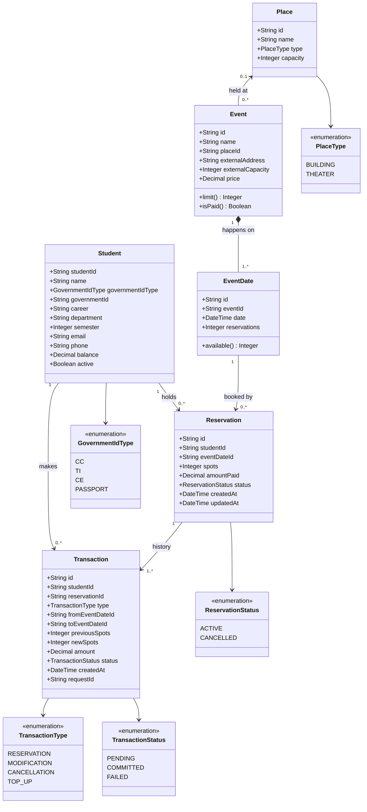
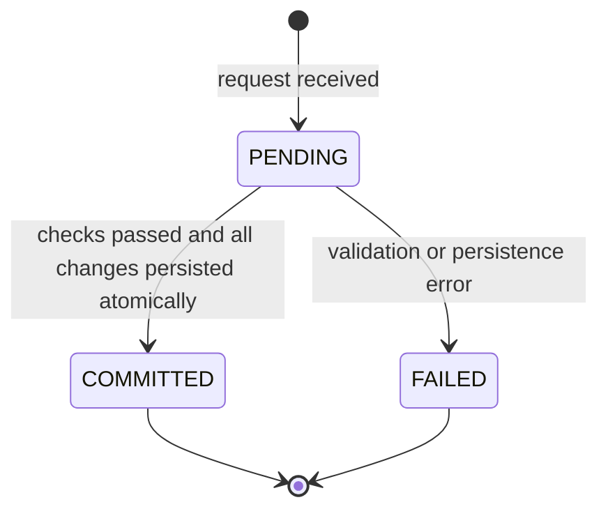
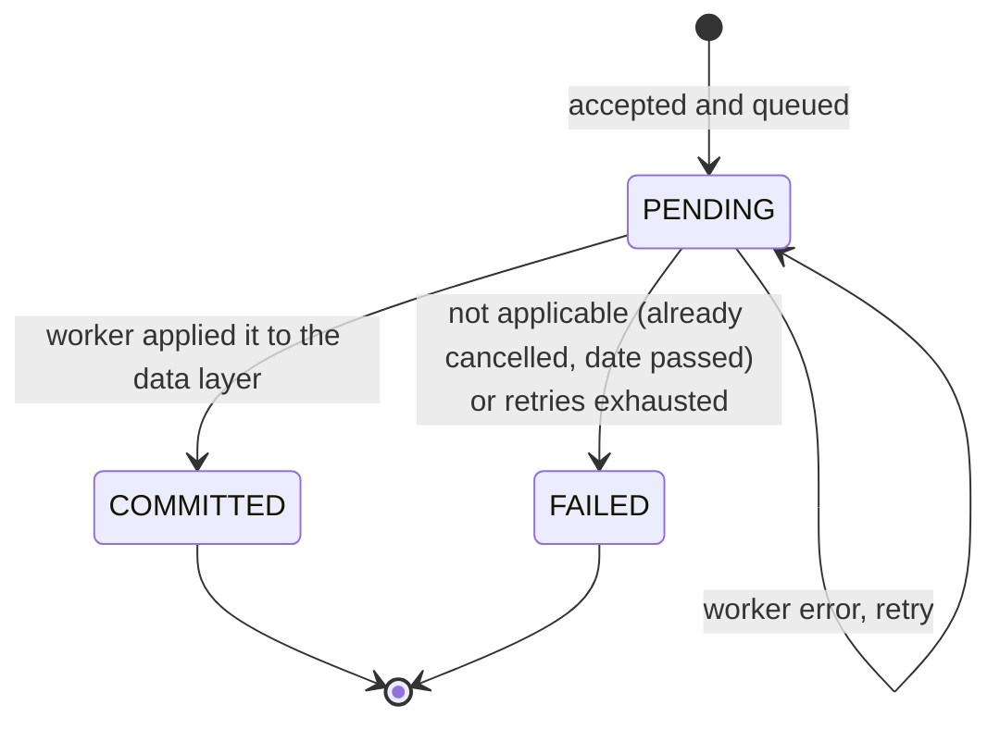

# Domain Model

The main classes are `Student`, `Event`, `EventDate`, `Place`, `Reservation` and
`Transaction`.

- An `Event` happens on one or more `EventDate`s.
- A `Reservation` is a student's current booking: **how many spots** on **which
  date**. It changes when the student modifies it.
- A `Transaction` is the immutable record of each change (reserve, modify,
  cancel, top up). The history of a reservation is its list of transactions.

## Student

| Attribute | Type | Notes |
|---|---|---|
| `studentId` | string | University student code. Primary key. |
| `name` | string | Full name |
| `governmentIdType` | enum | `CC`, `TI`, `CE`, `PASSPORT` |
| `governmentId` | string | Unique together with `governmentIdType` |
| `career` | string | Academic program, e.g. "Ingeniería de Sistemas" |
| `department` | string | Department the career belongs to |
| `semester` | integer | Current semester, ≥ 1 |
| `email` | string | Institutional email, unique |
| `phone` | string | Contact phone |
| `balance` | decimal | Credit used to pay for paid events. Never negative. |
| `active` | boolean | Inactive students cannot reserve |

## Place

University buildings and theaters. Only these are stored as records; external
places are free text on the event.

| Attribute | Type | Notes |
|---|---|---|
| `id` | string | Primary key |
| `name` | string | e.g. "Edificio José Gabriel Maldonado", "Teatro Ensueño" |
| `type` | enum | `BUILDING` or `THEATER` |
| `capacity` | integer | Max people. Used as the limit of every event held here. |

## Event

| Attribute | Type | Notes |
|---|---|---|
| `id` | string | Primary key |
| `name` | string | |
| `placeId` | string, nullable | FK → `Place.id`. Set when the event is at a university place. |
| `externalAddress` | string, nullable | Set when the event is outside the university |
| `externalCapacity` | integer, nullable | Limit for external events only |
| `price` | decimal | Price **per spot**. `0` for free events |

**Exactly one** of `placeId` or `externalAddress` is set.

Derived values:

- `limit()` = `Place.capacity` if `placeId` is set, otherwise `externalCapacity`.
  The same limit applies to **each** date of the event.
- `isPaid()` = `price > 0`.

## EventDate

One occurrence of an event. Spots are counted per date.

| Attribute | Type | Notes |
|---|---|---|
| `id` | string | Primary key |
| `eventId` | string | FK → `Event.id` |
| `date` | datetime | When this occurrence happens |
| `reservations` | integer | Spots currently taken on this date (sum of `spots` of active reservations) |

Derived: `available()` = `event.limit() - reservations`.

## Reservation

| Attribute | Type | Notes |
|---|---|---|
| `id` | string (UUID) | Primary key |
| `studentId` | string | FK → `Student.studentId` |
| `eventDateId` | string | FK → `EventDate.id`. Changes when the date is modified |
| `spots` | integer | Number of spots reserved, ≥ 1. Changes when modified |
| `amountPaid` | decimal | Total currently paid (`spots × price` at the time of each change) |
| `status` | enum | `ACTIVE` or `CANCELLED` |
| `createdAt` / `updatedAt` | datetime | UTC |

## Transaction

Immutable log entry for each change.

| Attribute | Type | Notes |
|---|---|---|
| `id` | string (UUID) | Primary key, generated by the services layer |
| `studentId` | string | FK → `Student.studentId` |
| `reservationId` | string, nullable | FK → `Reservation.id`. Empty for `TOP_UP` |
| `type` | enum | `RESERVATION`, `MODIFICATION`, `CANCELLATION`, `TOP_UP` |
| `fromEventDateId` | string, nullable | Date before the change (empty for `RESERVATION`) |
| `toEventDateId` | string, nullable | Date after the change (empty for `CANCELLATION`) |
| `previousSpots` / `newSpots` | integer | Spots before / after the change |
| `amount` | decimal, signed | Change to the student's balance: negative = charge, positive = refund/top-up |
| `status` | enum | `PENDING`, `COMMITTED`, `FAILED` |
| `createdAt` | datetime | UTC |
| `requestId` | string | Client-supplied idempotency key, unique |

### Effect of each transaction type

| Type | Reservation | Spots on dates | Balance |
|---|---|---|---|
| `RESERVATION` | created with `spots = N` on date D | D: `+N` | `- N × price` |
| `MODIFICATION` (spots only) | `spots: N → M` | D: `+(M − N)` | `- (M − N) × price` (refund if negative) |
| `MODIFICATION` (date, maybe spots) | `D1 → D2`, `spots: N → M` | D1: `−N`, D2: `+M` | `- (M − N) × price` |
| `CANCELLATION` | `status = CANCELLED` | D: `−N` | `+ amountPaid` |
| `TOP_UP` | — | — | `+ amount` |

### Transaction states

For synchronous operations (reserve, modify, top-up) the consumer only ever
receives `COMMITTED` or an error; `PENDING` exists only inside the service
while the request is in progress.

For **cancellations** (asynchronous) the consumer first receives `ACCEPTED`.
Until the worker processes it, the request is `PENDING` in the cancellation
queue; the `CANCELLATION` transaction is written to the data layer only when the
worker applies it (`COMMITTED`) or gives up (`FAILED`).

### CancellationRequest (queue message)

Lives in the cancellation queue, not in the data layer.

| Attribute | Type | Notes |
|---|---|---|
| `requestId` | string | Idempotency key; becomes the `CANCELLATION` transaction's `requestId` |
| `reservationId` | string | Reservation to cancel |
| `studentId` | string | Who asked |
| `acceptedAt` | datetime | When the service accepted it |
| `attempts` | integer | Times the worker has tried to apply it |

## Invariants

These must hold at all times, including under concurrent requests:

1. `Student.balance >= 0`
2. For every date: `0 <= EventDate.reservations <= Event.limit()`
3. `EventDate.reservations` = sum of `spots` of `ACTIVE` reservations on that date.
4. A student has at most one `ACTIVE` reservation per event (across all its dates).
   A reservation with a pending cancellation still counts as `ACTIVE` until the
   worker commits the cancellation; its spots are released only then.
5. `Reservation.spots >= 1`.
6. A reservation can only be moved to another date **of the same event**.
7. A given `requestId` produces at most one transaction.
8. `COMMITTED` transactions are never edited or deleted.
9. An event has either a `placeId` or an `externalAddress`, never both or neither.
10. A `Place` referenced by an event cannot be deleted, and its `capacity` cannot be
    lowered below the `reservations` of any event date held there.
