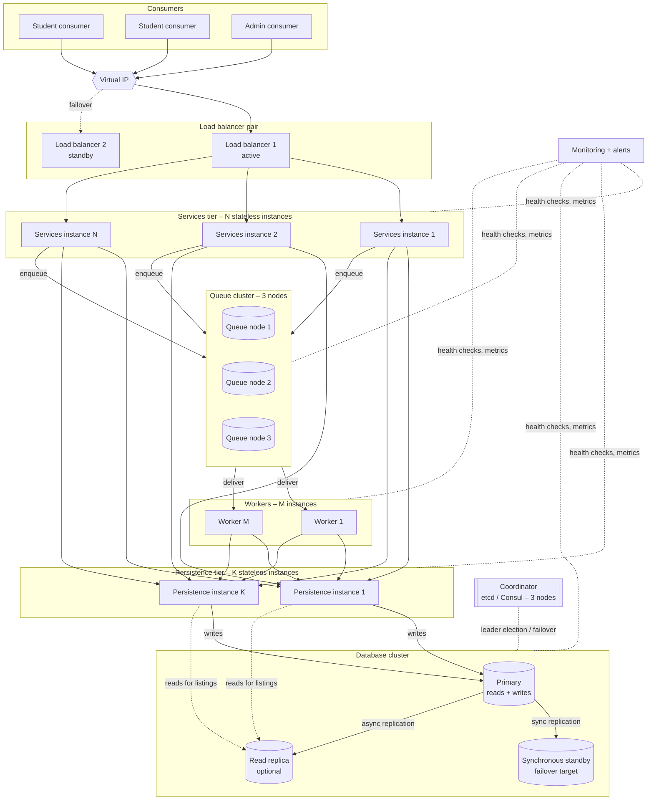

# Fault Tolerance and Scalability Design

This document describes the components we will add so the system:

- **tolerates failures:** if one process or machine fails, the system keeps
  working, or recovers quickly, without losing or duplicating data;
- **scales:** more students, events and requests can be handled by adding
  machines/processes, while keeping transaction time under 1 s (RNF-07).

It builds on the failure model in [system-models.md](system-models.md#3-failure-model)
and the indicators in [performance-indicators.md](performance-indicators.md).

---

## 1. Starting point and goals

The base design has a **single instance** of every process: one services
process, one queue, one worker, one persistence process, one database. Each of
them is a single point of failure (SPOF), and the services machine is the only
place to add capacity.

| Goal | Target (proposal) |
|---|---|
| Availability | ≥ 99 % during tests; no single process or machine failure stops the system |
| RPO (data that can be lost on a failure) | **0** committed transactions, **0** accepted cancellations |
| RTO (time to recover after a failure) | Services: < 5 s (automatic) · Database failover: < 30 s |
| Performance under failure | p95 < 1 s again within 1 minute after a failover |
| Scalability | Throughput grows ~linearly when adding service instances, until the database becomes the limit |

---

## 2. Target architecture

The three layers stay exactly the same (Consumers → Services → Data
Persistence). Fault tolerance and scalability are added **inside** each layer by
replicating its processes; the rules "only call the layer below" and "services
are stateless" do not change.

---

## 3. Components

### 3.1 Load balancer pair with virtual IP

| | |
|---|---|
| **What** | Two load balancers (e.g. HAProxy or Nginx) sharing one virtual IP with keepalived (VRRP). Consumers only know the virtual IP. |
| **Fault tolerance** | If the active LB dies, the standby takes the virtual IP in ~1–3 s. The LB itself is not a SPOF. |
| **Scalability** | Spreads requests across N services instances (least-connections). |
| **Health checks** | Calls `ping` on each services instance every 2 s; removes an instance after 3 failed checks, adds it back after 2 successful ones. |
| **Applies to project** | Consumers' configuration has a single address (the VIP). Retries after a timeout may land on another instance, which is safe because of `requestId` idempotency. |

### 3.2 Stateless services instances (N replicas)

| | |
|---|---|
| **What** | N identical processes running Student, Event, Transaction and Metrics services. |
| **Fault tolerance** | Any instance can serve any request because no state is kept in memory. If one crashes, in-flight requests time out and the consumer retries (same `requestId`) on another instance. |
| **Scalability** | Horizontal: add instances when CPU > 70 % (R-01) or p95 grows. Start with N = 2 (minimum for tolerance), N = 3 for load tests. |
| **Requirements** | Login tokens validated locally (signed token), no sticky sessions, configuration from file/env, idempotency stored in persistence (not in memory). |

### 3.3 Resilience patterns inside services

These patterns are implemented in the services code (and in the worker) when
calling persistence and the queue.

| Pattern | How we will use it | Protects against |
|---|---|---|
| **Timeouts** | 700 ms per persistence call, 1.5 s consumer→services | Waiting forever on a dead or slow process |
| **Retry with exponential backoff + jitter** | Only for idempotent calls (reads, writes with `requestId`): 100 ms, 200 ms, 400 ms + random 0–50 ms; max 3 tries within the 1 s budget | Transient network loss, failover in progress |
| **Circuit breaker** | If > 50 % of persistence calls fail in 10 s, "open" for 5 s: fail fast with `PERSISTENCE_UNAVAILABLE` instead of piling up requests | Cascading failure, threads stuck waiting |
| **Bulkhead** | Separate connection/thread pools for reads (listings) and writes (reserve/modify) | A flood of listings blocking reservations |
| **Rate limiting** | Per student and global limits at the LB/services (`RATE_LIMITED`) | Overload, DoS |
| **Graceful degradation** | If the read replica or cache fails, read from the primary; if the queue fails, reject cancellations (`QUEUE_UNAVAILABLE`) but keep reserving/modifying | Partial outages becoming total outages |
| **Graceful shutdown** | On deploy/stop: leave the LB pool, finish in-flight requests, then exit | Errors during planned restarts |

### 3.4 Persistence service instances (K replicas)

| | |
|---|---|
| **What** | K identical persistence processes in front of the database. They hold no business state, only connection pools. |
| **Fault tolerance** | Services instances have the list of persistence instances (or a second internal LB) and switch on failure. |
| **Scalability** | More instances = more connection pools; the real limit is the database. |
| **Routing** | Writes and "authoritative" reads (availability, balance checks inside a reservation) → **primary**. Listings (`listEventsByMonth`, history) → **read replica** if present. |

### 3.5 Database cluster: primary + synchronous standby (+ read replica)

| | |
|---|---|
| **What** | e.g. PostgreSQL with streaming replication: 1 primary, 1 **synchronous** standby, optionally 1 asynchronous read replica. Failover managed by Patroni (or repmgr) using the coordinator (3.7). |
| **Fault tolerance** | A commit is confirmed only after the standby also has it (**synchronous replication → RPO = 0**). If the primary dies, the coordinator promotes the standby (~10–30 s) and the persistence instances reconnect to the new primary. |
| **Split-brain protection** | Only the node holding the leader lock in the coordinator can be primary; the old primary is fenced (cannot accept writes) when it comes back. |
| **Scalability** | Read replicas take the read load (listings are the most frequent operation). Writes still go to one primary; that is enough for a university (see section 5). |
| **Trade-off** | Synchronous replication adds one network round trip to every commit (~1–5 ms on a LAN); acceptable within the 1 s budget. |
| **Consistency note** | Read replicas may be a few ms behind. They are only used for displays; every check that decides a reservation (spots, balance, ownership) runs on the primary inside the atomic commit. |
| **Backups** | Daily full backup + continuous WAL archiving, so the database can be restored to any point in time. Restore tested at least once. |

### 3.6 Queue cluster (3 nodes) and multiple workers

| | |
|---|---|
| **What** | e.g. RabbitMQ cluster with 3 nodes and a **quorum queue** for cancellations (replicated with Raft; a message is confirmed when a majority stores it). |
| **Fault tolerance** | Survives the loss of 1 of 3 nodes with no lost messages. The transaction service only replies `ACCEPTED` after the broker confirms (publisher confirms). |
| **Workers** | M worker instances consume from the queue (**competing consumers**). A message stays in the queue until a worker acks it; if a worker dies, the message is redelivered to another one. |
| **Ordering** | Messages are partitioned by `reservationId` (consistent hashing to one of P sub-queues, each with a single active consumer), so two requests for the same reservation are never processed in parallel. |
| **Poison messages** | After 5 failed attempts a message goes to a **dead-letter queue**, a `FAILED` transaction is recorded, and an alert is raised (Q-05). |
| **Scalability** | Add workers when queue depth (Q-01) or oldest message age (Q-02) grows. |

### 3.7 Coordinator (etcd / Consul, 3 nodes)

| | |
|---|---|
| **What** | Small replicated key-value store with consensus (Raft). 3 nodes tolerate 1 failure. |
| **Used for** | Leader election of the database primary; service discovery (which services/persistence instances are alive); shared configuration. |
| **Applies to project** | Without it, failover would be manual (an operator promotes the standby). For a course demonstration, manual failover with repmgr is an acceptable simpler option (see phases). |

### 3.8 Cache (optional)

| | |
|---|---|
| **What** | e.g. Redis, with a short TTL (5 s) for `listEventsByMonth` and event details. |
| **Benefit** | Reduces database reads at peaks (start of registration for a popular event). |
| **Rules** | Never used to decide a reservation; invalidated when an event, date or reservation count changes; if the cache is down, read from the database (degradation, not failure). |

### 3.9 Monitoring, failure detection and alerts

| | |
|---|---|
| **What** | Health-check endpoint per process, metrics collection (indicators from [performance-indicators.md](performance-indicators.md)), and alerts. |
| **Failure detector** | Heartbeat/health check every 2 s; a process is **suspected** after 3 missed checks (6 s). Used by the LB, the coordinator and the admin view. |
| **Alerts** | p95 > 1 s for 1 min · error rate > 1 % · queue age > 10 s · DB replication lag > 1 s · any consistency check K-01…K-05 ≠ 0 · node down. |

---

## 4. How each failure is handled

| Failure | Detection | Automatic reaction | Impact on students | RTO | Data lost |
|---|---|---|---|---|---|
| One services instance crashes | LB health check | Removed from the pool; retries go to other instances | Some requests retried (same `requestId`) | < 6 s | None |
| Active load balancer dies | VRRP heartbeat | Standby takes the virtual IP | Requests in flight time out and are retried | 1–3 s | None |
| One persistence instance crashes | Services timeout / health check | Services use another instance | Retries | < 6 s | None |
| Database primary dies | Coordinator (leader lease expires) | Standby promoted, persistence reconnects | Writes fail with `PERSISTENCE_UNAVAILABLE` during failover; cancellations wait in the queue | 10–30 s | None (sync replication) |
| Database standby dies | Replication monitor | Primary continues (alert: no failover target) | None | — | None |
| Read replica dies | Health check | Listings read from primary | Slightly slower listings | Immediate | None |
| One queue node dies | Raft in queue cluster | Remaining 2 nodes continue | None | Immediate | None |
| Two queue nodes die | Broker unreachable | Cancellations rejected (`QUEUE_UNAVAILABLE`), rest of system works | Cannot cancel temporarily | Until a node returns | None (messages on disk) |
| A worker crashes | Unacked messages | Redelivered to another worker | Cancellation takes a bit longer | Seconds | None (idempotent apply) |
| Network partition between services and DB | Timeouts, circuit breaker opens | Fail fast, retry after breaker closes | Errors during the partition | Partition duration | None |
| Whole data center / lab down | — | Restore from backups on new machines (manual) | System down | Hours | Since last WAL archive |

---

## 5. Scalability

### 5.1 Strategies per layer

| Layer / component | Strategy | Trigger to scale |
|---|---|---|
| Consumers | No server-side limit (each student runs their own) | — |
| Load balancer | Vertical (bigger machine) – one LB handles thousands of req/s | LB CPU > 70 % |
| Services | **Horizontal** (more stateless instances) | CPU > 70 %, p95 rising, T-02 reached |
| Workers | **Horizontal** (competing consumers) | Queue depth / oldest age rising |
| Persistence instances | Horizontal | Connection pool saturation (R-03) |
| Database reads | **Read replicas** + cache | DB CPU from reads, listing latency |
| Database writes | Vertical first; **partitioning** later if ever needed | Write latency > 300 ms p95 (L-04) |

### 5.2 Hot spot: a very popular event

When registration opens for a popular event, many students write to the **same
`event_date` row**. Horizontal scaling of services does not help here because
all requests contend on one row.

Mitigations, in order:

1. **Conditional update** (`reservations + N <= limit`) instead of
   read-then-write locks: short row lock, no deadlocks (decision O4).
2. **Fail fast when full:** once `available = 0`, reject in the service layer
   without touching the database (using a short-TTL cached counter, with the
   database still doing the final check).
3. **Admission queue (extension):** if contention is still too high, reservations
   for a hot event can be serialized through a dedicated queue/partition,
   trading some latency for no contention.

### 5.3 Data partitioning (future)

If one primary is ever not enough, data can be partitioned (sharded) **by
`eventId`**: all dates, reservations and transactions of an event live on the
same shard, so a reservation or modification (always within one event) stays a
local, single-shard atomic operation. Student data and balance would live on a
separate shard, which would require a distributed transaction (saga or 2PC)
for paid events, so this is only worth it at a much larger scale than a
university.

### 5.4 Capacity estimation (to validate with load tests)

| Assumption (proposal) | Value |
|---|---|
| Students | 20 000 |
| Peak concurrent users (registration opening) | 2 000 |
| Requests per user per minute at peak | 6 |
| Peak load | ~200 req/s (≈ 80 % reads) |
| Per services instance (to measure, T-02) | ~150 req/s at p95 < 1 s |
| Services instances needed at peak | 2 + 1 spare = **3** |
| DB writes at peak | ~40 writes/s → one primary is enough |

---

## 6. Implementation phases

| Phase | Components | Result |
|---|---|---|
| **0 – Base** (current design) | Single instance of everything; idempotency, atomic commits, durable queue, timeouts | Correct under retries and crashes, but with SPOFs |
| **1 – Minimum fault tolerance** (proposal for the course) | 2 services instances behind 1 load balancer · 2 workers · DB primary + standby with **manual** promotion · health checks · retries with backoff · circuit breaker | Survives loss of any services instance or worker; DB failover in minutes |
| **2 – Automatic failover** | LB pair + virtual IP · Patroni + etcd for automatic DB failover · 3-node quorum queue · dead-letter queue · alerts | No SPOF left; RTO < 30 s |
| **3 – Scale reads** | Read replica · cache for listings · bulkheads | Higher throughput for consults |
| **4 – Large scale** (only if needed) | Partitioning by `eventId`, admission queue for hot events | Beyond university scale |

### Verification for each phase

Run the failure scenarios F1–F5 ([system-models.md](system-models.md#35-failure-scenarios-to-test))
and the load scenarios S1–S7 ([performance-indicators.md](performance-indicators.md#load-test-scenarios))
plus these:

| # | Scenario | Expected |
|---|---|---|
| FT1 | Kill 1 of 2 services instances during load | p95 recovers < 1 s within 1 min; no errors after retries |
| FT2 | Kill the DB primary during load | Standby promoted; K-01…K-05 = 0; no committed transaction lost |
| FT3 | Kill 1 of 3 queue nodes while cancelling | No lost cancellations (K-05 = 0) |
| FT4 | Kill a worker repeatedly | All cancellations applied exactly once |
| FT5 | Double the load and add one services instance | Throughput ~doubles, p95 < 1 s |
| FT6 | 1 000 students reserving the last 100 spots of one date | Exactly 100 spots taken, K-01 = 0, p95 < 1 s |

---

## 7. Summary

| Need | Component(s) |
|---|---|
| No SPOF at the entry point | Load balancer pair + virtual IP |
| Survive a services crash | N stateless instances + health checks + idempotent retries |
| Survive a DB crash without losing data | Primary + synchronous standby + coordinator-driven failover + backups |
| Never lose an accepted cancellation | Replicated quorum queue + publisher confirms + ack after apply + dead-letter queue |
| Avoid cascading failures | Timeouts, backoff, circuit breaker, bulkheads, rate limiting, graceful degradation |
| Scale requests | Horizontal services and workers, read replicas, cache |
| Handle hot events | Conditional updates, fail-fast when full, admission queue |
| Know when something fails | Health checks, failure detector, metrics and alerts |
