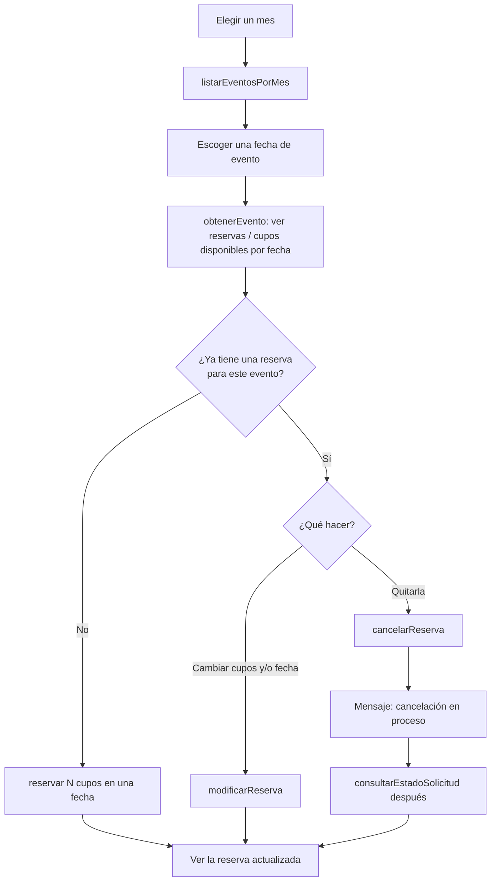
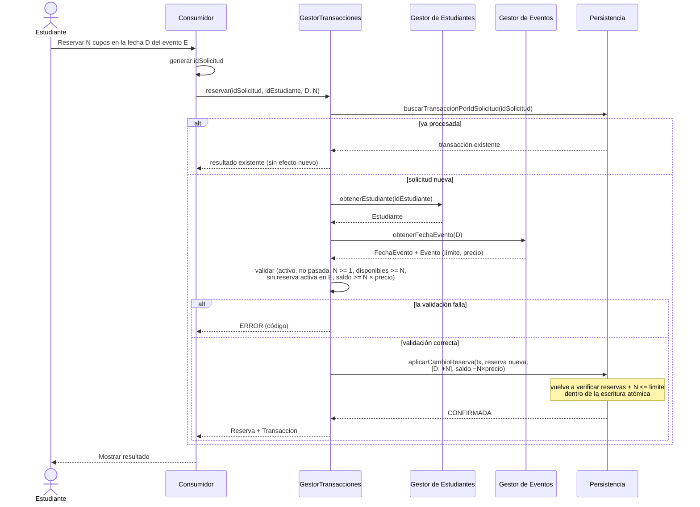
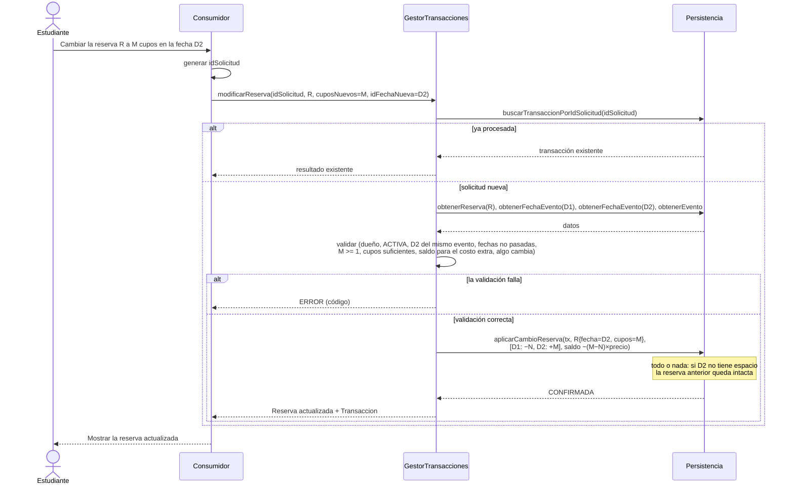
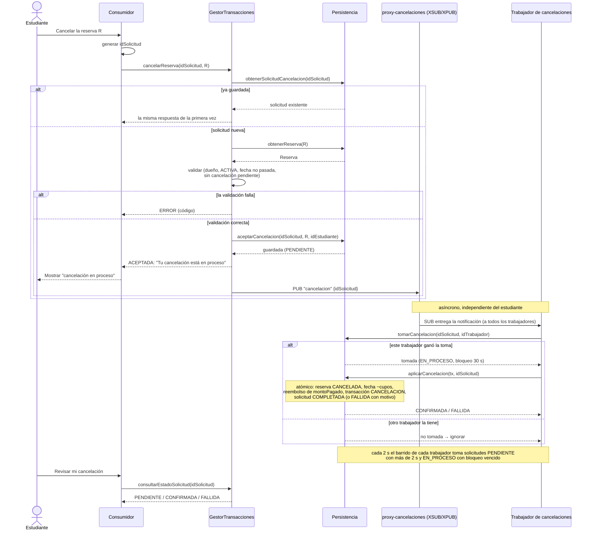

# Flujos

Todos los flujos son **síncronos** excepto **cancelar una reserva**: cada flecha
es una solicitud bloqueante, y el consumidor recibe el resultado final en la
respuesta. Una escritura solo se reporta como exitosa después de que la
persistencia la confirma.

La cancelación es **asíncrona**: el sistema la acepta, responde de inmediato que
la cancelación está en proceso, y la aplica en la capa de datos después.

## Recorrido del estudiante

## Consultar los eventos de un mes

1. El consumidor envía `listarEventosPorMes(anio, mes)`.
2. El Gestor de Eventos le pide a la persistencia todas las `FechaEvento` entre el
   primer y el último día del mes (`listarFechasEventoEntre`), unidas con su
   evento y su lugar.
3. Respuesta: una fila por fecha con nombre del evento, fecha, lugar (nombre del
   lugar o dirección externa), precio, `reservas`, `limite` y `disponibles`.

Solo lectura, no necesita `idSolicitud`.

## Consultar las reservas de los cupos

`obtenerEvento(idEvento)` devuelve cada fecha del evento con:

| Campo | Significado |
|---|---|
| `fecha` | Fecha y hora de esta ocurrencia |
| `reservas` | Cupos ya ocupados |
| `limite` | Capacidad del lugar o `capacidadExterna` |
| `disponibles` | `limite − reservas` |

Las reservas propias del estudiante salen de `listarReservasEstudiante(idEstudiante)`.

## Reservar cupos

Si el estudiante todavía no está en el sistema, el consumidor primero llama a
`crearEstudiante` con su información. Después:

## Modificar una reserva

El estudiante puede cambiar la cantidad de cupos, la fecha, o ambas. La fecha
nueva debe pertenecer al mismo evento.

Casos:

| Cambio | Cambios en las fechas | Saldo |
|---|---|---|
| Solo cupos, N → M en D | D: `+(M − N)` | `−(M − N) × precio` (reembolso cuando M < N) |
| Solo fecha, D1 → D2 | D1: `−N`, D2: `+N` | sin cambio |
| Ambos | D1: `−N`, D2: `+M` | `−(M − N) × precio` |

Si el cambio falla por cualquier motivo, la reserva original (fecha, cupos, monto
pagado) queda exactamente como estaba.

## Cancelar una reserva (asíncrono)

Usa "guardar primero y luego publicar" con ZeroMQ `PUB`/`SUB`
([comunicacion-zeromq.md](comunicacion-zeromq.md#4-cancelaciones-guardar-primero-y-luego-publicar)).

Pasos:

1. **Aceptar.** El servicio valida y **guarda** la solicitud como `PENDIENTE` en
   la capa de datos. Solo entonces responde.
2. **Responder.** El estudiante recibe de inmediato `ACEPTADA` con el mensaje de
   que la cancelación está en proceso. La reserva se sigue mostrando, marcada
   como "cancelación pendiente".
3. **Publicar.** El servicio publica una notificación `cancelacion`; todos los
   trabajadores de cancelaciones la reciben.
4. **Crear la cancelación.** Un trabajador toma la solicitud y la aplica en un
   solo paso atómico: reserva `CANCELADA`, cupos liberados en la fecha,
   reembolso en eventos pagos, transacción `CANCELACION` guardada como
   `CONFIRMADA`.
5. **Recuperar.** Si la notificación se perdió o un trabajador se cayó, el
   barrido toma la solicitud en pocos segundos.
6. **Resultado.** `consultarEstadoSolicitud(idSolicitud)` devuelve `CONFIRMADA`,
   o `FALLIDA` con el motivo.

Mientras la cancelación está pendiente, los cupos siguen ocupados, y modificar o
volver a cancelar la misma reserva se rechaza con `CANCELACION_PENDIENTE`.

## CRUD de eventos

| Operación | Flujo |
|---|---|
| Crear | Validar el lugar (exactamente uno de `idLugar` / `direccionExterna`; el lugar existe; `capacidadExterna > 0` si es externo) y al menos una fecha; crear el evento y sus fechas con `reservas = 0`. |
| Consultar | Devolver el evento con `reservas`, `limite` y `disponibles` de cada fecha. |
| Actualizar | Si cambia el lugar, el nuevo límite debe ser `>= reservas` de cada fecha. Cambiar el `precio` no afecta el `montoPagado` de las reservas existentes. |
| Agregar / cambiar una fecha | Insertar una fecha, o mover una fecha que no tenga reservas (propuesta). |
| Eliminar una fecha | Cancelar y reembolsar sus reservas; el evento debe conservar al menos una fecha. |
| Eliminar evento | Cancelar y reembolsar atómicamente todas las reservas activas, luego eliminar el evento y sus fechas. |

## Recargar saldo

1. El consumidor administrador envía `recargarSaldo(idSolicitud, idEstudiante, monto)`.
2. El servicio valida `monto > 0` y que el estudiante exista.
3. La persistencia inserta atómicamente una transacción `RECARGA` y aumenta el `saldo`.

## Consultar el historial

`listarTransacciones(idEstudiante)` o `listarTransacciones(idReserva)` es solo
lectura: Consumidor → GestorTransacciones → Persistencia.
