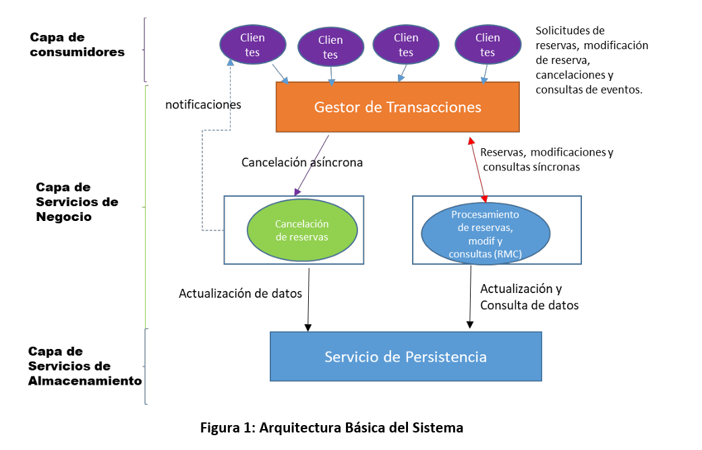
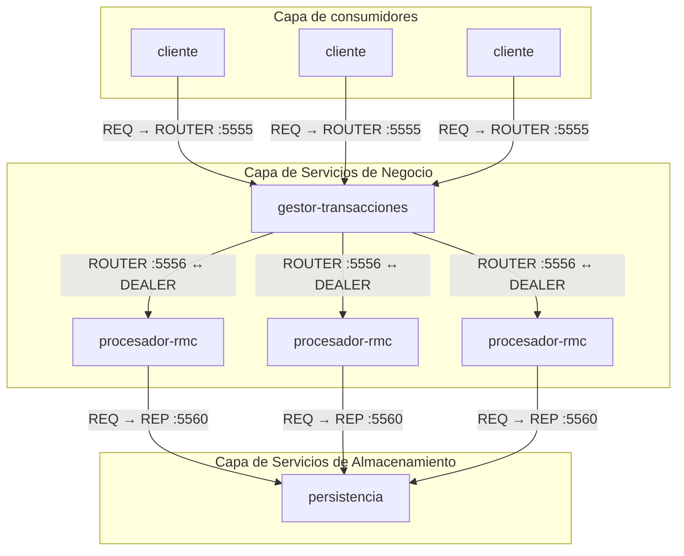
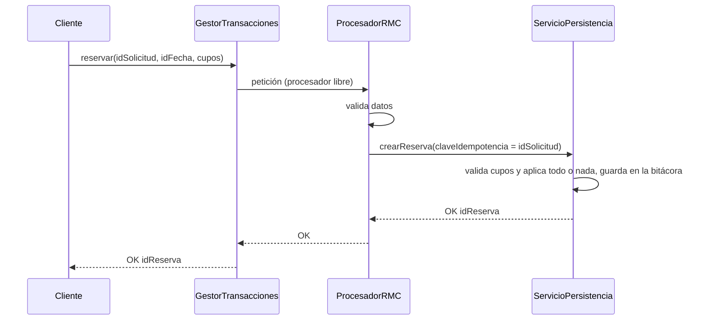
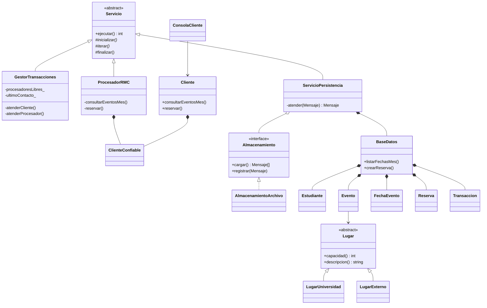

# Implementación – Entrega 1: consulta y reserva de eventos

Este documento describe lo que está **implementado** en `src/` (C++17 orientado a
objetos con ZeroMQ). Esta entrega cubre solo la **consulta de eventos de un mes**
y la **reserva de cupos**, sobre la parte síncrona de la **Figura 1: Arquitectura
Básica del Sistema**:



El resto de la carpeta `DOCS/` describe el **diseño objetivo** (modificación y
cancelación, brokers Majordomo, PostgreSQL, Kubernetes, CurveZMQ, métricas,
etc.). La sección [8](#8-pendiente-respecto-al-diseño-objetivo) resume qué falta.

---

## 1. Componentes

| Capa (Figura 1) | Caja | Proceso (`bin/`) | Clase principal |
|---|---|---|---|
| Capa de consumidores | Clientes | `cliente` | `Cliente`, `ConsolaCliente` |
| Capa de Servicios de Negocio | Gestor de Transacciones | `gestor-transacciones` | `GestorTransacciones` |
| Capa de Servicios de Negocio | Procesamiento de reservas y consultas (RMC) | `procesador-rmc` (1 o más) | `ProcesadorRMC` |
| Capa de Servicios de Almacenamiento | Servicio de Persistencia | `persistencia` | `ServicioPersistencia` |

La caja "Cancelación de reservas" de la Figura 1 no está en esta entrega.



## 2. Comunicación ZeroMQ

| Enlace | Sockets | Puerto | Patrón de confiabilidad |
|---|---|---|---|
| Cliente → Gestor | `REQ` → `ROUTER` | 5555 | **Lazy Pirate**: timeout 1 s, 3 intentos, se reabre el socket |
| Gestor ↔ Procesadores RMC | `ROUTER` ↔ `DEALER` | 5556 | **Load balancing broker** + latidos **Paranoid Pirate** (1 s, se descarta tras 3 s) |
| Procesador RMC → Persistencia | `REQ` → `REP` | 5560 | **Lazy Pirate**: timeout 300 ms, 3 intentos |

Todos los puertos se pueden cambiar con variables de entorno (sección 6).

### 2.1 Formato de los mensajes

Clase `Mensaje`: una sola trama de texto. La primera línea es el tipo; las
siguientes son `clave=valor`; `--` abre una fila nueva (para listas). Los valores
se escapan, así que nunca contienen saltos de línea.

```
reservar
cupos=2
idEstudiante=EST-1
idFecha=F-1
idSolicitud=S-5f3a9c0d12e4b7a1
```

```
OK
total=2
--
idFecha=F-1
evento=Concierto de bienvenida
disponibles=298
...
--
idFecha=F-2
...
```

Los errores son `ERROR` con `codigo` y `detalle`.

### 2.2 Tramas

| Enlace | Tramas |
|---|---|
| Cliente → Gestor (vistas por el `ROUTER`) | `[idCliente, "", petición]` |
| Gestor → Procesador | `[idProcesador, "", idCliente, "", petición]` |
| Procesador → Gestor | `["", LISTO]`, `["", LATIDO]` o `["", idCliente, "", respuesta]` |

## 3. Operaciones

| Operación del cliente | Campos | Operación en persistencia | Respuesta |
|---|---|---|---|
| `consultarEventosMes` | `mes` (AAAA-MM) | `listarFechasMes` | Filas con fecha, evento, lugar, precio, límite, reservas y disponibles |
| `reservar` | `idSolicitud`, `idFecha`, `cupos` | `crearReserva` (idempotente por `idSolicitud`) | `idReserva`, `cupos`, `monto`, `disponibles` |

Ambas llevan `idEstudiante`. Cada reserva lleva un `idSolicitud` nuevo; el cliente
lo reutiliza en los reintentos.

### 3.1 Códigos de error

| Código | Cuándo |
|---|---|
| `DATOS_INVALIDOS` | Falta un campo, mes con formato incorrecto, cupos ≤ 0 |
| `ESTUDIANTE_NO_REGISTRADO` | El estudiante no existe |
| `FECHA_NO_EXISTE` | La fecha no existe |
| `RESERVA_DUPLICADA` | Ya tiene una reserva en ese evento (máximo una por evento, RF-15) |
| `CUPOS_INSUFICIENTES` | La fecha no tiene cupos suficientes |
| `PERSISTENCIA_NO_DISPONIBLE` | Persistencia no respondió después de 3 intentos |
| `SIN_PROCESADORES` | El gestor no tiene procesadores RMC vivos |
| `SIN_RESPUESTA` | (Lo genera el cliente) el gestor no respondió después de 3 intentos |
| `OPERACION_DESCONOCIDA` | Tipo de mensaje desconocido |

## 4. Flujo de una reserva



La consulta sigue el mismo camino con `consultarEventosMes` → `listarFechasMes`.

## 5. Clases



Puntos de diseño orientado a objetos:

- **Herencia y método plantilla:** `Servicio::ejecutar()` define el ciclo de vida
  (señales, `inicializar`, `iterar`, `finalizar`) y cada proceso implementa sus pasos.
- **Polimorfismo:** `Lugar` define la capacidad del evento; `LugarUniversidad`
  (edificio o teatro registrado) y `LugarExterno` (dirección en texto libre) la
  implementan distinto.
- **Interfaz intercambiable:** `Almacenamiento` permite cambiar la bitácora en
  archivo por PostgreSQL sin tocar `ServicioPersistencia` ni `BaseDatos`.
- **Encapsulamiento:** las reglas de cupos viven en `FechaEvento` (`hayCupo`, `ocupar`).
- **Despacho por tabla:** el procesador RMC y persistencia buscan la operación en
  un mapa de punteros a métodos según el tipo del mensaje.

## 6. Tolerancia a fallos y escalabilidad

| Falla | Qué pasa | Mecanismo |
|---|---|---|
| Se pierde una petición o respuesta cliente ↔ gestor | El cliente reintenta con el mismo `idSolicitud` y no se reserva dos veces | Lazy Pirate + idempotencia en persistencia |
| Se cae un procesador RMC | El gestor lo descarta a los 3 s sin latidos; la petición que tenía se reintenta en otro | Paranoid Pirate + `ROUTER_MANDATORY` |
| Se reinicia el gestor | Los procesadores se vuelven a registrar con su siguiente latido | Identidad fija del `DEALER` |
| Se cae persistencia | Al volver reconstruye el estado con la bitácora; los procesadores reintentan | Bitácora de reservas (se guarda antes de responder) |
| Reservas concurrentes | Nunca superan el límite | Persistencia atiende una petición a la vez y valida antes de cambiar |

**Escalabilidad:** se agregan procesadores RMC y el gestor reparte la carga entre
los libres. `scripts/iniciar_sistema.sh base` levanta 1 procesador y
`scripts/iniciar_sistema.sh escalable` levanta 3.

### Configuración (variables de entorno)

| Proceso | Variable | Valor por defecto |
|---|---|---|
| `persistencia` | `PERSISTENCIA_BIND` | `tcp://*:5560` |
| | `ARCHIVO_DATOS` | `datos/bitacora.txt` |
| `gestor-transacciones` | `GESTOR_FRONTEND_BIND`, `GESTOR_BACKEND_BIND` | `tcp://*:5555`, `tcp://*:5556` |
| `procesador-rmc` | `GESTOR_BACKEND`, `PERSISTENCIA_ENDPOINT` | `tcp://localhost:5556`, `tcp://localhost:5560` |
| `cliente` | `GESTOR_ENDPOINT` | `tcp://localhost:5555` |

Para correr en varias máquinas basta con cambiar `localhost` por la IP del proceso correspondiente.

## 7. Datos de ejemplo

Persistencia arranca siempre con estos datos y luego aplica la bitácora:

| Fecha | Evento | Lugar | Límite | Precio |
|---|---|---|---|---|
| F-1, F-2 | Concierto de bienvenida | Teatro Mayor (L-1) | 300 | $0 |
| F-3, F-4 | Taller de ZeroMQ | Sala 301 (L-3) | 5 | $15.000 |
| F-5 | Feria de emprendimiento | Externo: Plaza de Bolívar | 50 | $0 |
| F-6, F-7 | Conferencia de sistemas distribuidos | Auditorio de Ingeniería (L-2) | 120 | $5.000 |

Estudiantes registrados: `EST-1`, `EST-2`, `EST-3`.

## 8. Pendiente respecto al diseño objetivo

| Diseño objetivo (resto de `DOCS/`) | Entrega 1 |
|---|---|
| Modificar y cancelar reservas (cancelación asíncrona por PUB/SUB) | No implementado |
| Registro de estudiantes, CRUD de eventos y lugares, saldo | Datos de ejemplo fijos |
| Broker Majordomo con servicios por nombre | El `GestorTransacciones` hace de broker con balanceo de carga |
| PostgreSQL con CloudNativePG | Bitácora en archivo + datos en memoria (`AlmacenamientoArchivo`) |
| Autenticación y CurveZMQ | El `idEstudiante` viaja en el mensaje; sin cifrado |
| Binary Star para el broker | Un solo gestor (se reinicia sin perder procesadores) |
| Kubernetes | Scripts para una máquina; direcciones configurables por variables de entorno |
| Métricas y escenarios de desempeño (Tabla 1) | No implementado |
