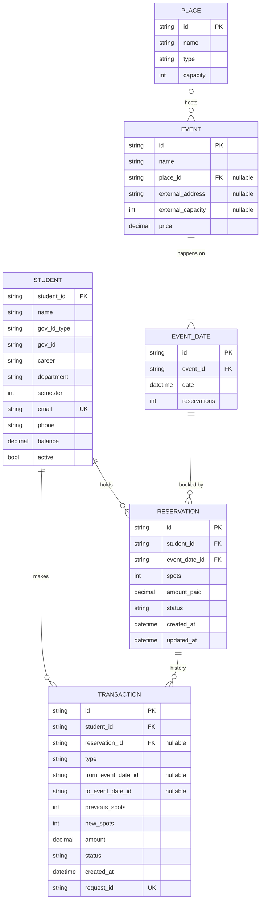

# Layers

## 1. Consumers

The consumers are the clients of the system: a student client and an
admin/organizer client (CLI, desktop, or web).

**Responsibilities**

- Collect user input and turn it into service requests.
- Generate a `requestId` for every write operation and reuse it on retries.
- Wait for the response of each synchronous request and display the result or
  error.
- For a cancellation, show the "cancellation in progress" message as soon as it
  is `ACCEPTED`, and later show the final result by consulting
  `getRequestStatus`.
- Handle timeouts by retrying with the same `requestId`.

**Must not**

- Contain business rules (availability checks, balance checks, etc.).
- Access persistence directly.

**Operations used**

| Actor | Operation |
|---|---|
| Student | Register / update own student information |
| Student | Consult events of a month |
| Student | Consult the reservations of spots of an event (per date) |
| Student | Reserve N spots on a date of an event |
| Student | Modify a reservation (number of spots and/or date) |
| Student | Cancel a reservation (asynchronous) |
| Student | Consult the status of a cancellation |
| Student | Consult own reservations |
| Student | View own transaction history |
| Admin | CRUD events and their dates |
| Admin | CRUD places (buildings, theaters) |
| Admin | CRUD students |
| Admin | Top up a student's balance |
| Admin | List all transactions / reservations of an event |
| Admin | View performance indicators |

## 2. Services

The business logic layer. Exposes a network API to consumers and uses the
persistence API underneath. Synchronous operations answer only after
persistence has confirmed the commit; cancellation answers as soon as the
request is safely queued.

### Student service

| Operation | Input | Output |
|---|---|---|
| `createStudent` | student data | `Student` |
| `getStudent` | `studentId` | `Student` |
| `updateStudent` | `studentId`, fields | `Student` |
| `deleteStudent` | `studentId` | — (only if no active reservations; otherwise set `active = false`) |
| `listStudents` | filters (optional) | `Student[]` |

### Event service

| Operation | Input | Output |
|---|---|---|
| `createEvent` | name, `placeId` **or** (`externalAddress`, `externalCapacity`), price, `dates[]` (≥ 1) | `Event` with its `EventDate`s |
| `getEvent` | `eventId` | `Event` with each date's `reservations`, `limit`, `available` |
| `updateEvent` | `eventId`, fields | `Event` |
| `deleteEvent` | `eventId` | — (cancels and refunds all reservations first) |
| `addEventDate` | `eventId`, date | `EventDate` |
| `updateEventDate` | `eventDateId`, new date | `EventDate` |
| `deleteEventDate` | `eventDateId` | — (cancels and refunds its reservations; an event must keep ≥ 1 date) |
| `listEventsByMonth` | `year`, `month` | event dates in that month, each with event name, spot, price, `available` |
| `createPlace` / `getPlace` / `updatePlace` / `deletePlace` / `listPlaces` | place data | `Place` |

### Transaction service

| Operation | Input | Output |
|---|---|---|
| `reserve` | `requestId`, `studentId`, `eventDateId`, `spots` | `Reservation` + `Transaction` |
| `modifyReservation` | `requestId`, `reservationId`, `newSpots` (optional), `newEventDateId` (optional) | `Reservation` + `Transaction` |
| `cancelReservation` | `requestId`, `reservationId` | **Asynchronous.** `ACCEPTED` + `requestId` + message "cancellation in progress" |
| `getRequestStatus` | `requestId` | `PENDING` / `COMMITTED` / `FAILED` (+ `Transaction` and reason when finished) |
| `topUp` | `requestId`, `studentId`, `amount` | `Transaction` |
| `listStudentReservations` | `studentId` | `Reservation[]` with event name, date, spot |
| `getTransaction` | `transactionId` | `Transaction` |
| `listTransactions` | `studentId` and/or `reservationId` (optional) | `Transaction[]` |

### Cancellation queue and worker

Part of the services layer.

| Component | Responsibility |
|---|---|
| Cancellation queue | Durable FIFO of `CancellationRequest`s. A message is removed only after the worker acknowledges it. |
| Cancellation worker | Takes the next request, calls `applyCancellation` on persistence, acknowledges the message. On a temporary error (persistence down) it retries with backoff; after N attempts, or if the cancellation no longer applies, it records a `FAILED` transaction. |

**On `cancelReservation`** the transaction service does only quick, read-only
checks before accepting: idempotency (`requestId` already queued or processed →
return the same answer), reservation exists, belongs to the student, is
`ACTIVE`, date not passed, no other cancellation pending for it. Then it
enqueues and replies `ACCEPTED`.

### Metrics

| Operation | Input | Output |
|---|---|---|
| `getMetrics` | `from`, `to`, operation (optional) | Indicators from [performance-indicators.md](performance-indicators.md): latency percentiles, % < 1 s, throughput, errors, queue state, consistency checks |

Every layer writes one timing record per request (`requestId`, layer,
operation, start, end, result). The services layer collects them to compute the
indicators.

**Validation done here**

- Student exists and is `active`; the reservation belongs to the student.
- Event date exists and has not happened yet (for both the current and the new
  date when modifying).
- `spots >= 1`.
- Enough spots available on the target date:
  - same date: `reservations + (newSpots − oldSpots) <= limit`
  - new date: `reservations + newSpots <= limit` on the new date
- New date belongs to the same event.
- Student has no other active reservation for that event (on `reserve`).
- If the event is paid and the change costs money, `balance >= cost`.
- The modification actually changes something.
- `requestId` has not already been processed (if it has, return the original
  result instead of applying the change again).
- On event/date/place updates: spot rules and limits (see
  [domain-model.md](domain-model.md#invariants)).

### Error codes

| Code | Meaning |
|---|---|
| `STUDENT_NOT_FOUND` | Unknown `studentId` |
| `STUDENT_ALREADY_EXISTS` | Duplicate `studentId`, email or government ID |
| `STUDENT_INACTIVE` | Student is not allowed to reserve |
| `EVENT_NOT_FOUND` / `EVENT_DATE_NOT_FOUND` | Unknown event or date |
| `EVENT_DATE_PAST` | Date already passed |
| `DATE_NOT_OF_EVENT` | New date belongs to a different event |
| `NOT_ENOUGH_SPOTS` | Requested spots exceed what is available |
| `INVALID_SPOTS` | `spots < 1` |
| `RESERVATION_NOT_FOUND` | Unknown reservation |
| `RESERVATION_NOT_OWNED` | Reservation belongs to another student |
| `RESERVATION_CANCELLED` | Trying to modify a cancelled reservation |
| `ALREADY_RESERVED` | Student already has an active reservation for the event |
| `NO_CHANGE` | Modification has the same spots and date |
| `CANCELLATION_PENDING` | The reservation already has a cancellation in progress (modify or cancel again) |
| `REQUEST_NOT_FOUND` | Unknown `requestId` in `getRequestStatus` |
| `QUEUE_UNAVAILABLE` | Cancellation could not be queued; nothing was accepted |
| `PLACE_NOT_FOUND` | Unknown `placeId` |
| `PLACE_IN_USE` | Place has events, cannot be deleted |
| `INVALID_SPOT` | Both or neither of `placeId` / `externalAddress` set |
| `LIMIT_BELOW_RESERVATIONS` | New capacity lower than current reservations |
| `INSUFFICIENT_BALANCE` | Balance lower than the cost |
| `PERSISTENCE_UNAVAILABLE` | Lower layer did not respond |

## 3. Data Persistence

Stores the data durably and exposes simple, logic-free operations.

**Responsibilities**

- CRUD for `Student`, `Place`, `Event`, `EventDate`, `Reservation` and
  `Transaction`.
- Execute multi-record changes **atomically**.
- Enforce constraints: unique `Student.email`, unique
  (`governmentIdType`, `governmentId`), unique `Transaction.requestId`, foreign
  keys, `reservations <= limit` for each date.

**Operations**

| Operation | Notes |
|---|---|
| `get<Entity>(id)` | Returns record or not-found |
| `list<Entity>(filter)` | |
| `insert<Entity>(record)` | Fails on duplicate key |
| `update<Entity>(id, fields, expectedVersion)` | Optimistic locking (proposal) |
| `delete<Entity>(id)` | Fails if referenced (FK) |
| `listEventDatesBetween(from, to)` | Used for "events of a month" |
| `listReservationsByStudent(studentId)` | Active reservations joined with event and date |
| `findTransactionByRequestId(requestId)` | Used for idempotency and `getRequestStatus` |
| `applyCancellation(tx, reservationId)` | Called by the worker. One atomic unit: if the reservation is still `ACTIVE`, set it `CANCELLED`, subtract its `spots` from its date, refund `amountPaid`, insert the `COMMITTED` transaction. If a transaction with that `requestId` already exists, do nothing (makes retries safe). |
| `applyReservationChange(tx, reservation, dateDeltas[], balanceDelta)` | One atomic unit: insert transaction, upsert reservation, add/subtract spots on one or two dates (each conditioned on `reservations + delta <= limit`), adjust balance. Fails entirely if any condition fails. |

### Tables (relational proposal)

**(proposal)** Storage options, from simplest to most robust: JSON/CSV files with
file locking, SQLite, PostgreSQL/MySQL. A relational database makes atomicity
and constraints much easier.
