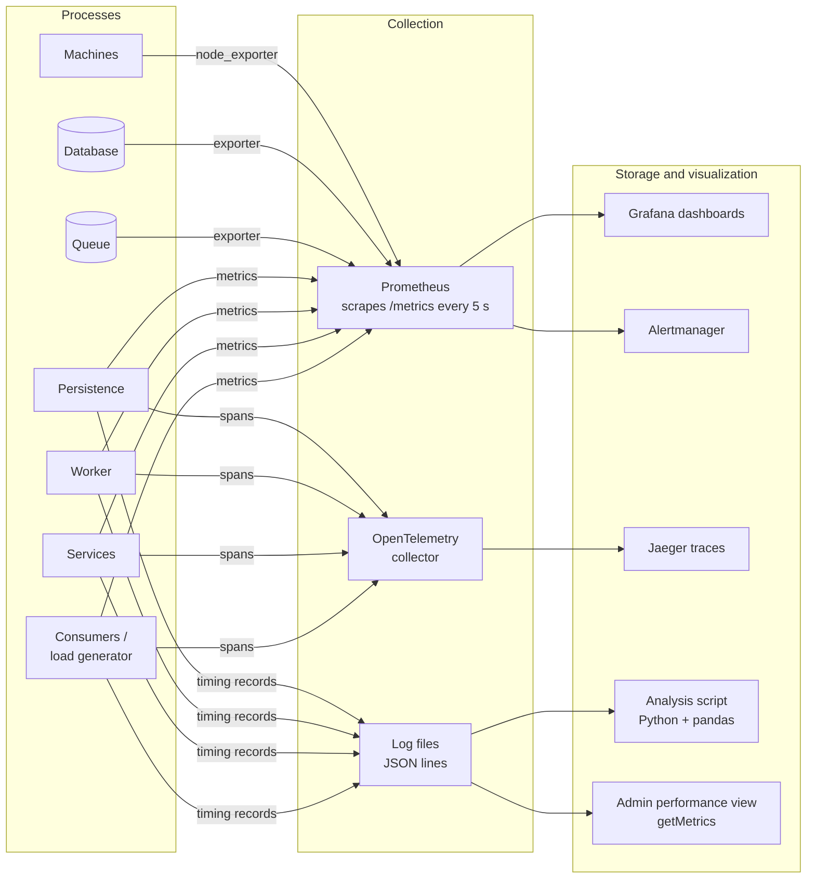

# Metrics Collection: Tools and Strategies

How we will **obtain** the indicators defined in
[performance-indicators.md](performance-indicators.md): what each process
records, which tools collect and show the data, and how the results are used in
the tests of [test-plan.md](test-plan.md).

---

## 1. Strategy overview

We collect three kinds of telemetry, all linked by the `requestId`:

| Kind | What it answers | Example |
|---|---|---|
| **Metrics** (numbers over time) | How fast, how many, how full? | p95 of `reserve`, requests/s, queue depth, CPU |
| **Logs** (one record per event) | What exactly happened to this request? | `reserve r-123 student=… result=NOT_ENOUGH_SPOTS 412 ms` |
| **Traces** (one request across layers) | Where did the time go? | consumer 420 ms = network 60 + services 180 + persistence 180 |



**Two tracks** (choose in decision O16):

| Track | Tools | When |
|---|---|---|
| **A – Lightweight (minimum, always)** | Timing records in JSON-lines files + Python analysis script + SQL consistency checks + `getMetrics` in the admin consumer | Required: it is enough to prove p95 < 1 s and produce the results tables |
| **B – Full observability (recommended)** | Track A + Prometheus + Grafana + Alertmanager + exporters + OpenTelemetry/Jaeger | Live dashboards during load and failure tests; alerts; needed for the fault-tolerance phases |

---

## 2. Instrumentation inside our code

### 2.1 One interceptor per layer

Every process wraps **every** incoming request (and every outgoing call) with a
small interceptor/middleware, so no operation is forgotten and business code
stays clean.

```
on request received:
    requestId = request.requestId  (or new one for reads)
    start = monotonic_clock()
    try:
        response = handle(request)
        result = response.status / error code
    finally:
        duration_ms = (monotonic_clock() - start) * 1000
        write timing record
        update metrics (histogram, counters)
```

| Layer | Where the interceptor goes |
|---|---|
| Consumer / load generator | Around each call to the services layer (measures **end-to-end** time) |
| Services | Around each API operation, and around each call to persistence and to the queue |
| Worker | Around processing of each queue message (+ time since `acceptedAt`) |
| Persistence | Around each persistence operation, and around each database transaction |

### 2.2 Timing record format

One JSON line per request per layer (written asynchronously, see 2.5):

```json
{"requestId":"r-123","traceId":"7f3a…","layer":"SERVICES","instance":"svc-1",
 "operation":"reserve","start":"2026-10-22T15:04:05.123Z","durationMs":182.4,
 "result":"OK","studentId":"20231234"}
```

- **Never** includes government ID, phone, email or names (security model 4.4).
- `start` is wall-clock (for ordering the timeline); `durationMs` is measured
  with the **monotonic** clock (immune to NTP adjustments).
- The same record shape is stored in the `TimingRecord` class
  ([diagrams/class.puml](diagrams/class.puml)).

### 2.3 Propagating the request across layers

Every message between layers carries `requestId` and, for tracing, a W3C
`traceparent` header (OpenTelemetry does this automatically for HTTP/gRPC). The
queue message carries both too, so the worker's processing is linked to the
original `cancelReservation`.

### 2.4 Metric types and names

Using Prometheus conventions:

| Metric | Type | Labels | Gives indicators |
|---|---|---|---|
| `request_duration_seconds` | Histogram | `layer`, `operation`, `result` | L-01…L-06, L-02 (% < 1 s), T-01 |
| `requests_total` | Counter | `layer`, `operation`, `result` | T-01, E-01, E-02 |
| `downstream_duration_seconds` | Histogram | `from`, `to`, `operation` | L-03…L-05 (time per hop) |
| `timeouts_total` | Counter | `from`, `to` | E-03 |
| `retries_total` | Counter | `operation` | E-04, Q-03 |
| `duplicate_requests_total` | Counter | `operation` | E-04, Q-04 |
| `cancellation_completion_seconds` | Histogram | `result` | L-07 |
| `cancellation_queue_depth` | Gauge | — | Q-01 |
| `cancellation_oldest_age_seconds` | Gauge | — | Q-02 |
| `lock_wait_seconds` / `optimistic_retries_total` | Histogram / Counter | `table` | C-01 |
| `circuit_breaker_state` | Gauge (0/1/2) | `target` | Fault tolerance |
| `consistency_violations` | Gauge | `check` (K-01…K-05) | K-01…K-05 |
| `event_date_occupancy_ratio` | Gauge | `eventDateId` (upcoming only) | U-01 |

**Histogram buckets** are chosen around the 1 s target so percentiles near it
are precise: `0.05, 0.1, 0.25, 0.5, 0.75, 0.9, 1.0, 1.5, 2.5, 5` seconds.

### 2.5 Keeping the measurement cheap

Instrumentation must not slow down what it measures (target: < 2 % overhead).

- Timing records go to an in-memory buffer and are written to disk by a
  background thread (asynchronous logging).
- Metric updates are in-memory counters; Prometheus pulls them every 5 s.
- Traces are **sampled**: 100 % during tests of single scenarios, 10 % during
  long load tests, always 100 % for errors.
- Overhead is checked once: run PERF-02 with and without instrumentation and
  compare.

### 2.6 Clock synchronization

All lab machines run **chrony/NTP** against the same server. Durations never mix
clocks of two machines (each duration is measured inside one process); wall-clock
`start` is only used to draw timelines, where a few ms of skew is acceptable.
Network time per hop is computed as *caller's duration − callee's duration*,
never as a difference of timestamps from two machines.

---

## 3. Tools

### 3.1 Libraries (inside our processes)

| Purpose | Python | Java | Node.js |
|---|---|---|---|
| Expose Prometheus metrics | `prometheus_client` | Micrometer + Prometheus registry | `prom-client` |
| Tracing | `opentelemetry-sdk` + auto-instrumentation | OpenTelemetry Java agent | `@opentelemetry/sdk-node` |
| Structured JSON logs | `structlog` / `logging` + JSON formatter | Logback + logstash encoder | `pino` |

(Final choice depends on the language, decision O1.)

### 3.2 Infrastructure tools

| Tool | Collects | Indicators |
|---|---|---|
| **Prometheus** | Scrapes `/metrics` of every process and exporter; stores time series | All metric-based indicators |
| **Grafana** | Dashboards on top of Prometheus (and Jaeger/Loki) | Visualization |
| **Alertmanager** | Sends alerts from Prometheus rules | Alerts in [fault-tolerance-scalability.md](fault-tolerance-scalability.md#39-monitoring-failure-detection-and-alerts) |
| **node_exporter** | CPU, memory, disk, network per machine | R-01, R-02, R-04 |
| **postgres_exporter** (or MySQL exporter) | Connections, transactions/s, locks, deadlocks, replication lag | R-03, C-01, C-02 |
| **RabbitMQ Prometheus plugin** (or Redis exporter) | Queue depth, publish/deliver/ack rates, redeliveries | Q-01, Q-03 |
| **HAProxy exporter** (if LB used) | Requests per backend, health status | E-05, T-01 |
| **OpenTelemetry Collector + Jaeger** | Distributed traces | L-03…L-05, slow-request analysis |
| **Loki** (optional) or plain files | Central log storage | Searching timing records |
| **Locust / k6 / JMeter** | Client-side end-to-end times, throughput, errors; CSV/JSON export | L-01, L-02, T-01, T-02 (cross-check) |
| **Blackbox exporter** or health-check script | `ping` of every process every 2 s | E-05 availability |
| **`tc netem`, Toxiproxy** | (Not metrics) inject delay/loss during failure tests | Used with F5, F6 |
| **Wireshark / tcpdump** | Traffic inspection | SEC-07, debugging latency |

All of these run as containers on machine A (or a 4th monitoring machine) so
they do not consume resources on the machines being measured.

### 3.3 Lightweight analysis script (Track A)

`tests/performance/analyze.py` (planned) reads the JSON-lines files of all
layers and produces the results table:

```
python analyze.py --logs results/2026-11-05/*.jsonl --from 15:00 --to 15:15
```

Steps:

1. Load all timing records into a pandas DataFrame.
2. Drop warm-up period.
3. Per `operation` and `layer`: count, p50, p95, p99, max, % < 1000 ms.
4. Join by `requestId`: network time per hop = caller duration − callee duration.
5. Error rate per error code; throughput per second.
6. Output: Markdown table (pasted into the results template), CSV, and PNG
   charts (latency over time with the 1 s line, histogram).

---

## 4. Indicator → source → tool

| Indicators | Source | Track A (minimum) | Track B (full) |
|---|---|---|---|
| L-01, L-02 end-to-end time, % < 1 s | Consumer / load generator interceptor | Timing records + script; Locust CSV | `request_duration_seconds{layer="consumer"}` in Grafana |
| L-03…L-05 time per layer and hop | Interceptors in every layer | Script joins by `requestId` | Histograms per layer + Jaeger traces |
| L-06, L-07 cancellation times | Services (accept), worker (complete) | Timing records | Histograms |
| T-01…T-04 throughput | Counters / load generator | Script (requests per second) | `rate(requests_total[1m])` |
| Q-01…Q-05 queue | Broker + worker | Broker CLI (`rabbitmqctl list_queues`) sampled every 5 s + worker logs | Broker exporter |
| E-01…E-06 errors, availability | Interceptors, health checks | Script + health-check log | Counters + blackbox exporter |
| C-01…C-03 concurrency | Persistence + DB | DB statistics views after each run | DB exporter |
| K-01…K-05 consistency | Database | SQL checks (section 5) after each run | Same SQL run every 1 min → `consistency_violations` gauge |
| R-01…R-04 resources | OS, DB | `vmstat 1` / `pidstat 1` to file | node_exporter, DB exporter |
| U-01…U-05 usage | Database | SQL queries (section 6) | Same queries as Grafana panels |

---

## 5. Consistency checks (SQL)

Run after every test run (and periodically in Track B). Every query must return
**0 rows**. (Table `transaction` is a reserved word in SQL; the physical table
is called `transactions`.)

```sql
-- K-01 Overbooked dates
SELECT ed.id
FROM event_date ed
JOIN event e      ON e.id = ed.event_id
LEFT JOIN place p ON p.id = e.place_id
WHERE ed.reservations > COALESCE(p.capacity, e.external_capacity);

-- K-02 Counter does not match active reservations
SELECT ed.id, ed.reservations, COALESCE(SUM(r.spots), 0) AS active_spots
FROM event_date ed
LEFT JOIN reservation r ON r.event_date_id = ed.id AND r.status = 'ACTIVE'
GROUP BY ed.id, ed.reservations
HAVING ed.reservations <> COALESCE(SUM(r.spots), 0);

-- K-03 Negative balances
SELECT student_id FROM student WHERE balance < 0;

-- K-04 Duplicated effects for one request
SELECT request_id, COUNT(*) FROM transactions
GROUP BY request_id HAVING COUNT(*) > 1;
```

**K-05 Lost cancellations** needs data from outside the database:

1. From the services timing records: all `requestId`s of `cancelReservation`
   with result `ACCEPTED`.
2. Remove those that have a `CANCELLATION` transaction in `transactions`.
3. Remove those still waiting in the queue.
4. What remains are lost cancellations → must be **0**.

The analysis script implements this check.

---

## 6. Usage indicators (SQL)

```sql
-- U-01 Occupancy of upcoming dates
SELECT e.name, ed.date, ed.reservations,
       COALESCE(p.capacity, e.external_capacity) AS lim,
       ROUND(100.0 * ed.reservations / COALESCE(p.capacity, e.external_capacity), 1) AS occupancy_pct
FROM event_date ed
JOIN event e      ON e.id = ed.event_id
LEFT JOIN place p ON p.id = e.place_id
WHERE ed.date >= CURRENT_DATE
ORDER BY occupancy_pct DESC;

-- U-02 Reservations per month
SELECT DATE_TRUNC('month', created_at) AS month, COUNT(*)
FROM transactions WHERE type = 'RESERVATION' AND status = 'COMMITTED'
GROUP BY 1 ORDER BY 1;

-- U-03 / U-04 Cancellation and modification rates
SELECT
  SUM(CASE WHEN type = 'CANCELLATION' THEN 1 ELSE 0 END) * 1.0
    / NULLIF(SUM(CASE WHEN type = 'RESERVATION' THEN 1 ELSE 0 END), 0) AS cancellation_rate,
  SUM(CASE WHEN type = 'MODIFICATION' THEN 1 ELSE 0 END) * 1.0
    / NULLIF(SUM(CASE WHEN type = 'RESERVATION' THEN 1 ELSE 0 END), 0) AS modification_rate
FROM transactions WHERE status = 'COMMITTED';

-- U-05 Revenue and refunds (amount < 0 = charge)
SELECT SUM(CASE WHEN amount < 0 THEN -amount ELSE 0 END) AS charged,
       SUM(CASE WHEN amount > 0 AND type <> 'TOP_UP' THEN amount ELSE 0 END) AS refunded
FROM transactions WHERE status = 'COMMITTED';
```

(`DATE_TRUNC` is PostgreSQL; with SQLite use `strftime('%Y-%m', created_at)`.)

---

## 7. Dashboards (Track B)

One Grafana dashboard per audience:

| Dashboard | Panels |
|---|---|
| **Performance** | p50/p95/p99 per operation with a red line at 1 s · % < 1 s (stat panel, green ≥ 95 %) · throughput · error rate by code · time per layer (stacked) |
| **Cancellations** | Queue depth · oldest message age · acceptance and completion p95 · retries · dead-letter count · failed cancellations by reason |
| **Infrastructure** | CPU / memory per machine and process · DB connections, locks, deadlocks, replication lag · health of every instance |
| **Consistency** | K-01…K-05 as big green/red numbers |
| **Usage** | Occupancy of upcoming dates · reservations per month · cancellation/modification rates · revenue |

Example PromQL:

```promql
# p95 end-to-end per operation (last 5 min)
histogram_quantile(0.95,
  sum by (le, operation) (rate(request_duration_seconds_bucket{layer="consumer"}[5m])))

# % of transactions under 1 s
sum(rate(request_duration_seconds_bucket{layer="consumer", le="1.0"}[5m]))
  / sum(rate(request_duration_seconds_count{layer="consumer"}[5m]))

# technical error rate (excludes business errors such as NOT_ENOUGH_SPOTS)
sum(rate(requests_total{layer="services", result=~"PERSISTENCE_UNAVAILABLE|QUEUE_UNAVAILABLE|TIMEOUT|INTERNAL"}[5m]))
  / sum(rate(requests_total{layer="services"}[5m]))
```

Example alert rule:

```yaml
- alert: TransactionTimeAboveTarget
  expr: histogram_quantile(0.95, sum by (le) (rate(request_duration_seconds_bucket{layer="services"}[1m]))) > 1
  for: 1m
  labels: { severity: warning }
  annotations: { summary: "p95 transaction time above 1 s" }
```

Dashboards and alert rules are stored as files in the repo
(`monitoring/grafana/*.json`, `monitoring/prometheus/*.yml`) so the whole
monitoring setup can be started with one `docker compose up`.

---

## 8. Admin performance view (`getMetrics`)

RNF-08 requires that the system itself shows its performance. The admin
consumer calls `getMetrics(from, to, operation?)` on the services layer:

- **Track A:** the metrics service reads the timing records (from the
  `TimingRepository` in persistence or from the log files) and computes the same
  numbers as the analysis script.
- **Track B:** the metrics service queries the Prometheus HTTP API and returns
  the results.

Either way the admin sees p50/p95/p99/max per operation, % < 1 s, throughput,
error rate, queue state and K-01…K-05, without needing access to Grafana.

---

## 9. Process during tests

| Step | Action |
|---|---|
| Before | Sync clocks; reset DB to seed; start monitoring stack; note versions/commit hash and configuration |
| During | Watch Grafana (Track B) or `tail` logs; take notes for the qualitative assessment |
| After | Stop load; export: timing records, load-tool CSV, Prometheus snapshot (or `vmstat` files), queue stats; run SQL checks K-01…K-05; run `analyze.py` |
| Store | `tests/performance/results/<date>-<scenario>/` with raw data, generated tables/charts and a short `notes.md` |
| Compare | Script compares with the previous run of the same scenario; p95 regression > 20 % must be explained |

### Retention

| Data | Kept |
|---|---|
| Prometheus time series | 15 days (default) |
| Raw timing records from tests | Until the end of the project (in `results/`) |
| Traces | 2 days |
| Generated reports | Forever (committed to the repo) |

---

## 10. Recommendation

- **Implement Track A from the start:** interceptors + JSON timing records +
  analysis script + SQL checks. It is simple, needs no extra infrastructure, and
  is enough to prove p95 < 1 s.
- **Add Track B before the failure and fault-tolerance tests**, because live
  dashboards and exporters make it much easier to see what happens during a
  failover or a spike.
- Use **Locust** (if Python) or **k6** as the load generator, and cross-check its
  numbers with the consumer-side timing records.
