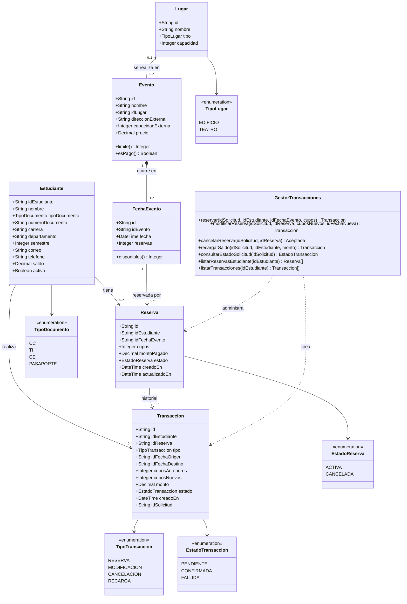
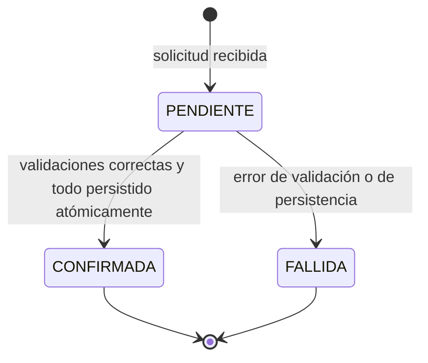
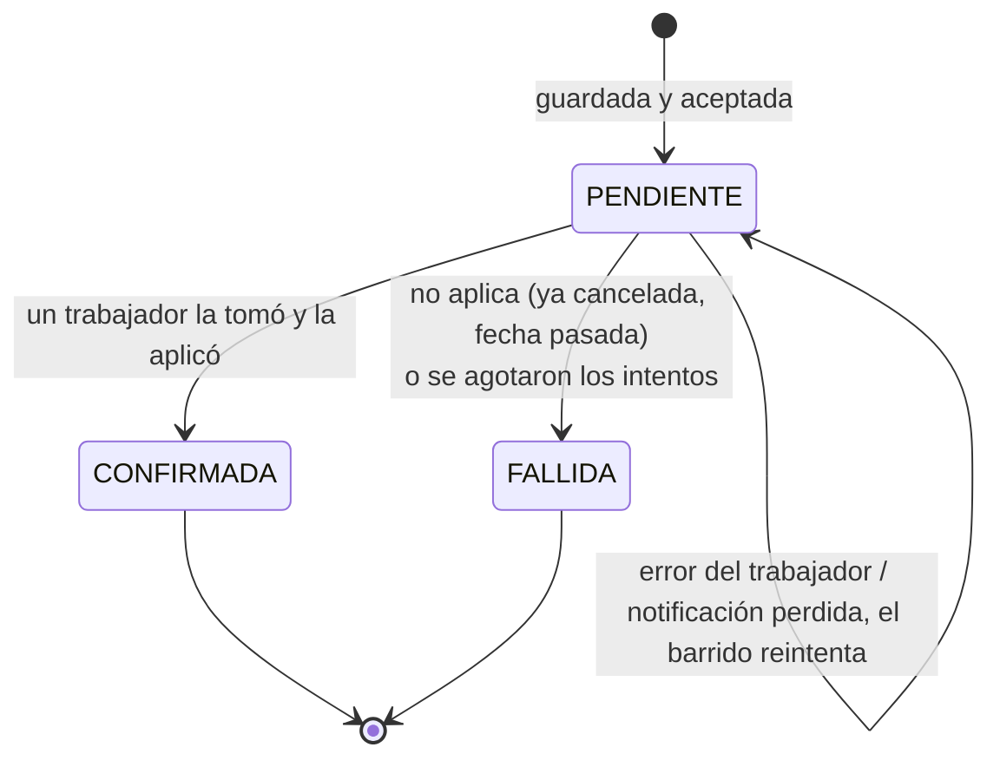

# Modelo de Dominio

Las clases principales son `Estudiante`, `Evento`, `FechaEvento`, `Lugar`,
`Reserva`, `Transaccion` y `SolicitudCancelacion`, y la clase de servicio
**`GestorTransacciones`**, que las administra.

- Un `Evento` ocurre en una o más `FechaEvento`.
- Una `Reserva` es la reserva actual de un estudiante: **cuántos cupos** en
  **qué fecha**. Cambia cuando el estudiante la modifica.
- Una `Transaccion` es el registro inmutable de cada cambio (reservar, modificar,
  cancelar, recargar saldo). El historial de una reserva es su lista de
  transacciones.
- `GestorTransacciones` es la clase de la capa de servicios que valida y ejecuta
  las reservas, modificaciones, cancelaciones y recargas, y crea las
  `Transaccion` correspondientes.

## Estudiante

| Atributo | Tipo | Notas |
|---|---|---|
| `idEstudiante` | texto | Código de estudiante de la universidad. Llave primaria. |
| `nombre` | texto | Nombre completo |
| `tipoDocumento` | enum | `CC`, `TI`, `CE`, `PASAPORTE` |
| `numeroDocumento` | texto | Único junto con `tipoDocumento` |
| `carrera` | texto | Programa académico, p. ej. "Ingeniería de Sistemas" |
| `departamento` | texto | Departamento al que pertenece la carrera |
| `semestre` | entero | Semestre actual, ≥ 1 |
| `correo` | texto | Correo institucional, único |
| `telefono` | texto | Teléfono de contacto |
| `saldo` | decimal | Crédito para pagar eventos pagos. Nunca negativo. |
| `activo` | booleano | Un estudiante inactivo no puede reservar |

## Lugar

Edificios y teatros de la universidad. Solo estos se guardan como registros; los
lugares externos son texto libre en el evento.

| Atributo | Tipo | Notas |
|---|---|---|
| `id` | texto | Llave primaria |
| `nombre` | texto | p. ej. "Edificio José Gabriel Maldonado", "Teatro Ensueño" |
| `tipo` | enum | `EDIFICIO` o `TEATRO` |
| `capacidad` | entero | Máximo de personas. Es el límite de todo evento que se realice aquí. |

## Evento

| Atributo | Tipo | Notas |
|---|---|---|
| `id` | texto | Llave primaria |
| `nombre` | texto | |
| `idLugar` | texto, opcional | FK → `Lugar.id`. Se define cuando el evento es en un lugar de la universidad. |
| `direccionExterna` | texto, opcional | Se define cuando el evento es fuera de la universidad |
| `capacidadExterna` | entero, opcional | Límite solo para eventos externos |
| `precio` | decimal | Precio **por cupo**. `0` para eventos gratuitos |

Se define **exactamente uno** de `idLugar` o `direccionExterna`.

Valores derivados:

- `limite()` = `Lugar.capacidad` si `idLugar` está definido; si no, `capacidadExterna`.
  El mismo límite aplica a **cada** fecha del evento.
- `esPago()` = `precio > 0`.

## FechaEvento

Una ocurrencia de un evento. Los cupos se cuentan por fecha.

| Atributo | Tipo | Notas |
|---|---|---|
| `id` | texto | Llave primaria |
| `idEvento` | texto | FK → `Evento.id` |
| `fecha` | fecha y hora | Cuándo ocurre esta fecha del evento |
| `reservas` | entero | Cupos ocupados en esta fecha (suma de `cupos` de las reservas activas) |

Derivado: `disponibles()` = `evento.limite() - reservas`.

## Reserva

| Atributo | Tipo | Notas |
|---|---|---|
| `id` | texto (UUID) | Llave primaria |
| `idEstudiante` | texto | FK → `Estudiante.idEstudiante` |
| `idFechaEvento` | texto | FK → `FechaEvento.id`. Cambia cuando se modifica la fecha |
| `cupos` | entero | Cantidad de cupos reservados, ≥ 1. Cambia al modificar |
| `montoPagado` | decimal | Total pagado actualmente (`cupos × precio` en el momento de cada cambio) |
| `estado` | enum | `ACTIVA` o `CANCELADA` |
| `creadoEn` / `actualizadoEn` | fecha y hora | UTC |

## Transaccion

Registro inmutable de cada cambio. La crea `GestorTransacciones`.

| Atributo | Tipo | Notas |
|---|---|---|
| `id` | texto (UUID) | Llave primaria, generada por la capa de servicios |
| `idEstudiante` | texto | FK → `Estudiante.idEstudiante` |
| `idReserva` | texto, opcional | FK → `Reserva.id`. Vacío para `RECARGA` |
| `tipo` | enum | `RESERVA`, `MODIFICACION`, `CANCELACION`, `RECARGA` |
| `idFechaOrigen` | texto, opcional | Fecha antes del cambio (vacío para `RESERVA`) |
| `idFechaDestino` | texto, opcional | Fecha después del cambio (vacío para `CANCELACION`) |
| `cuposAnteriores` / `cuposNuevos` | entero | Cupos antes / después del cambio |
| `monto` | decimal, con signo | Cambio en el saldo del estudiante: negativo = cobro, positivo = reembolso/recarga |
| `estado` | enum | `PENDIENTE`, `CONFIRMADA`, `FALLIDA` |
| `creadoEn` | fecha y hora | UTC |
| `idSolicitud` | texto | Llave de idempotencia enviada por el cliente, única |

### Efecto de cada tipo de transacción

| Tipo | Reserva | Cupos en las fechas | Saldo |
|---|---|---|---|
| `RESERVA` | se crea con `cupos = N` en la fecha D | D: `+N` | `- N × precio` |
| `MODIFICACION` (solo cupos) | `cupos: N → M` | D: `+(M − N)` | `- (M − N) × precio` (reembolso si es negativo) |
| `MODIFICACION` (fecha, y quizás cupos) | `D1 → D2`, `cupos: N → M` | D1: `−N`, D2: `+M` | `- (M − N) × precio` |
| `CANCELACION` | `estado = CANCELADA` | D: `−N` | `+ montoPagado` |
| `RECARGA` | — | — | `+ monto` |

### Estados de una transacción

En las operaciones síncronas (reservar, modificar, recargar) el consumidor solo
recibe `CONFIRMADA` o un error; `PENDIENTE` existe únicamente dentro del servicio
mientras la solicitud está en curso.

En las **cancelaciones** (asíncronas) el consumidor recibe primero `ACEPTADA`.
Antes de responder, la solicitud se guarda en la capa de datos como una
`SolicitudCancelacion` con estado `PENDIENTE`. La transacción `CANCELACION` se
escribe solo cuando un trabajador la aplica (`CONFIRMADA`) o se rinde (`FALLIDA`).

### SolicitudCancelacion

Se guarda en la capa de datos (tabla `solicitud_cancelacion`) **antes** de que el
estudiante reciba `ACEPTADA`, así una cancelación aceptada nunca se puede perder.
La notificación PUB/SUB de ZeroMQ solo avisa a los trabajadores que la revisen
([comunicacion-zeromq.md](comunicacion-zeromq.md#4-cancelaciones-guardar-primero-y-luego-publicar)).

| Atributo | Tipo | Notas |
|---|---|---|
| `idSolicitud` | texto | Llave de idempotencia; pasa a ser el `idSolicitud` de la transacción `CANCELACION` |
| `idReserva` | texto | Reserva a cancelar |
| `idEstudiante` | texto | Quién la pidió |
| `aceptadaEn` | fecha y hora | Cuándo la aceptó el servicio |
| `estado` | enum | `PENDIENTE` → `EN_PROCESO` (tomada) → `COMPLETADA` o `FALLIDA` |
| `tomadaPor` | texto, opcional | Pod del trabajador que la tomó |
| `bloqueoHasta` | fecha y hora, opcional | La toma vence a los 30 s; después otro trabajador puede tomarla |
| `intentos` | entero | Veces que un trabajador ha intentado aplicarla (máx. 5) |

## Invariantes

Deben cumplirse siempre, incluso con solicitudes concurrentes:

1. `Estudiante.saldo >= 0`
2. Para cada fecha: `0 <= FechaEvento.reservas <= Evento.limite()`
3. `FechaEvento.reservas` = suma de `cupos` de las reservas `ACTIVA` en esa fecha.
4. Un estudiante tiene como máximo una reserva `ACTIVA` por evento (sumando todas sus fechas).
   Una reserva con una cancelación pendiente sigue contando como `ACTIVA` hasta
   que el trabajador confirme la cancelación; solo entonces se liberan sus cupos.
5. `Reserva.cupos >= 1`.
6. Una reserva solo se puede pasar a otra fecha **del mismo evento**.
7. Un mismo `idSolicitud` produce como máximo una transacción.
8. Las transacciones `CONFIRMADA` nunca se editan ni se eliminan.
9. Un evento tiene `idLugar` o `direccionExterna`, nunca ambos ni ninguno.
10. Un `Lugar` referenciado por un evento no se puede eliminar, y su `capacidad`
    no puede bajar de las `reservas` de ninguna fecha de evento que se realice allí.
