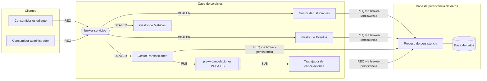

# Modelos del Sistema

Este documento describe el sistema usando los modelos clásicos de los sistemas
distribuidos y muestra cómo aplica cada uno al proyecto de eventos universitarios:

1. [Modelo arquitectónico](#1-modelo-arquitectónico): qué entidades existen, cómo se comunican, dónde corren.
2. [Modelo de interacción](#2-modelo-de-interacción): tiempos, retardos de mensajes, orden y semántica de invocación.
3. [Modelo de fallos](#3-modelo-de-fallos): qué puede fallar, cómo falla y cómo el sistema lo enmascara.
4. [Modelo de seguridad](#4-modelo-de-seguridad): qué se debe proteger, de quién y cómo.

---

## 1. Modelo arquitectónico

### 1.1 Estilo arquitectónico

| Concepto | Cómo aplica al proyecto |
|---|---|
| **Cliente–servidor** | Los consumidores son clientes; la capa de servicios es su servidor. A su vez, la capa de servicios es cliente de la capa de persistencia. |
| **Por capas (3 niveles)** | Consumidores → Servicios → Persistencia de Datos. Cada capa solo llama a la capa directamente debajo ([arquitectura.md](arquitectura.md)). |
| **Servicios sin estado** | Los servicios no guardan estado de sesión en memoria; todo el estado vive en la persistencia (incluidas las solicitudes de cancelación pendientes). Así los servicios se pueden reiniciar o replicar sin perder datos. |
| **Petición–respuesta con broker** | Los brokers Majordomo de ZeroMQ están entre clientes y workers: los clientes solo conocen el broker, los workers se registran en él y él balancea la carga por solicitud. |
| **Publicación–suscripción (comunicación indirecta)** | Las cancelaciones se anuncian con ZeroMQ `PUB`/`SUB` a través de un proxy. El publicador (`GestorTransacciones`) y los suscriptores (trabajadores de cancelaciones) están desacoplados en el **espacio** (no se conocen) y la solicitud guardada los desacopla en el **tiempo** (el trabajador puede aplicarla después). |
| **Almacenamiento único de referencia** | La persistencia es la única fuente de verdad de cupos, saldos y transacciones, lo que simplifica la consistencia. |

### 1.2 Entidades (procesos)

| Entidad | Rol | Estado que guarda |
|---|---|---|
| Consumidor estudiante | Cliente para estudiantes | Solo los `idSolicitud` pendientes que pueda necesitar reintentar |
| Consumidor administrador | Cliente para administrar eventos/lugares/estudiantes y ver desempeño | Ninguno |
| Gestores de Estudiantes / Eventos / `GestorTransacciones` | Lógica de negocio | Ninguno (sin estado) |
| broker-servicios / broker-persistencia | Brokers Majordomo: enrutan solicitudes a los workers, heartbeats | Solo estado de conexión |
| proxy-cancelaciones | Reenviador `XSUB`/`XPUB` de notificaciones de cancelación | Ninguno (las notificaciones no se guardan) |
| Trabajador de cancelaciones | Toma y aplica las cancelaciones aceptadas; barre las que se perdieron | Ninguno |
| Gestor de Métricas | Agrega los registros de tiempo en indicadores | Registros de tiempo (o los lee de los logs) |
| Persistencia | Lecturas/escrituras atómicas, restricciones | Todos los datos de negocio |

### 1.3 Paradigmas de comunicación

| Paradigma | Se usa para | Propiedades |
|---|---|---|
| **Petición–respuesta (ZeroMQ `REQ` → broker `ROUTER` → `DEALER`)** | Toda operación síncrona: consultar, reservar, modificar, CRUD, estado, métricas, aceptación de cancelaciones | Quien llama se bloquea; acoplado en el tiempo; el resultado viene en la respuesta |
| **Publicación–suscripción (ZeroMQ `PUB` → proxy → `SUB`)** | Notificación de cancelación: `GestorTransacciones` → trabajadores | El publicador no espera; desacoplado en el espacio; no es durable por sí solo, por eso la solicitud se guarda antes en la base de datos |

### 1.4 Ubicación (mapeo físico)

| Despliegue | Máquinas | Uso |
|---|---|---|
| Desarrollo | Todos los procesos en una máquina, puertos distintos | Programación y pruebas unitarias |
| Kubernetes (objetivo) | 4 máquinas: plano de control `cp-1` + `worker-1..3` con brokers, gestores, trabajadores y PostgreSQL replicados ([despliegue-kubernetes.md](despliegue-kubernetes.md)); consumidores fuera del clúster | Demostración, pruebas de carga y de fallos |

Las direcciones y puertos siempre vienen de la configuración.

---

## 2. Modelo de interacción

### 2.1 Sistema síncrono vs asíncrono

En la teoría de sistemas distribuidos un sistema es **síncrono** si hay cotas
superiores conocidas para el tiempo de ejecución de los procesos, el retardo de
los mensajes y la deriva de los relojes, y **asíncrono** si no existen esas cotas.

- La red de la universidad e Internet **no garantizan ninguna cota** al retardo de
  los mensajes, así que el proyecto corre sobre un **sistema asíncrono** en ese
  sentido teórico.
- Las "operaciones síncronas" del proyecto (RNF-02) se refieren al **estilo de
  interacción** (quien llama espera la respuesta), no a tiempos garantizados.
- Para poder actuar de todas formas, el sistema **asume cotas prácticas** con
  timeouts (1 s por intento consumidor→servicios, 300 ms por intento
  servicios→persistencia, heartbeats ZeroMQ cada 1 s) y una meta de desempeño de
  p95 < 1 s ([indicadores-desempeno.md](indicadores-desempeno.md)). Cuando se
  supera una cota, el resultado se trata como **desconocido**, nunca como "fallido".

### 2.2 Desempeño de los canales de comunicación

| Característica | Significado | Cómo lo maneja el proyecto |
|---|---|---|
| **Latencia** | Tiempo para que un mensaje llegue al otro lado | Se mide por salto (L-05). ZeroMQ mantiene las conexiones abiertas (sin un nuevo handshake TCP/CurveZMQ por solicitud), lo que ayuda a quedar bajo 1 s. |
| **Ancho de banda** | Datos por segundo | Los mensajes son pequeños (JSON). Las listas (eventos de un mes, historial) se paginan. |
| **Jitter** | Variación del retardo | Se ve como p99/máx vs p50 (L-01). Los timeouts se fijan por encima del p99 esperado. |

### 2.3 Relojes y orden de los eventos

- Cada máquina tiene su propio reloj; los relojes **derivan** y nunca son
  exactamente iguales.
- Las **duraciones** (indicadores de desempeño) siempre se miden con el reloj de
  una sola máquina (inicio y fin en el mismo proceso).
- Las **marcas de tiempo** guardadas en los datos (`creadoEn`, `aceptadaEn`)
  vienen de la máquina de persistencia (o de la de servicios, de forma
  consistente), sincronizadas con NTP. Son informativas, no se usan para decidir
  el orden.
- El **orden de las operaciones** sobre los mismos datos lo decide la capa de
  persistencia: el orden en que ocurren las confirmaciones atómicas sobre una
  fila de `FechaEvento` es el orden real. Dos estudiantes que compiten por el
  último cupo se ordenan por quién confirma primero, no por lo que diga su reloj.
- En el camino asíncrono hay como máximo una cancelación pendiente por reserva, y
  la toma en la base de datos decide qué trabajador la aplica, así que no se
  necesita orden entre trabajadores.
- Toda solicitud lleva un `idSolicitud`, que une los eventos de distintos
  procesos en los logs (una traza causal de una operación).

### 2.4 Protocolos de interacción

| Protocolo | Mensajes | Se usa para |
|---|---|---|
| **Petición–Respuesta (RR)** | solicitud → respuesta | Todas las operaciones síncronas |
| **Publicación + toma** | notificación `PUB` → los trabajadores intentan tomar la solicitud guardada → el ganador la aplica | Cancelación: PUB/SUB para velocidad, la toma en la base de datos para "exactamente una vez" |
| **Unidireccional + consulta de estado** | `cancelarReserva` → `ACEPTADA`; después `consultarEstadoSolicitud` | Lo que ve el estudiante de una cancelación asíncrona |

### 2.5 Semántica de invocación

| Semántica | Significado | Dónde |
|---|---|---|
| **Quizás (maybe)** | Sin reintentos; puede ejecutarse una vez o ninguna | No se usa para escrituras |
| **Al menos una vez** | Reintenta hasta tener respuesta; puede ejecutarse más de una vez | Reintentos Lazy Pirate tras un timeout; el barrido retoma tras la caída de un trabajador |
| **Como máximo una vez** | Reintenta, pero detecta duplicados y devuelve el resultado guardado | Se logra con `idSolicitud` + restricción única + resultado guardado |
| **Efectivamente exactamente una vez** | Entrega al menos una vez + procesamiento idempotente | Reservar, modificar, recargar y cancelar (RNF-04, RNF-06) |

| Operación | Estilo | Reintentos | Semántica |
|---|---|---|---|
| Lecturas (eventos de un mes, reservas, historial) | Síncrono | Se pueden reintentar libremente | Al menos una vez (inofensivo, solo lectura) |
| `reservar`, `modificarReserva`, `recargarSaldo`, escrituras CRUD | Síncrono | Mismo `idSolicitud` | Efecto exactamente una vez |
| `cancelarReserva` (aceptación) | Síncrono, corto | Mismo `idSolicitud` | Exactamente una solicitud de cancelación guardada |
| Aplicación de la cancelación (trabajador) | Asíncrono | Notificación PUB/SUB + barrido | Efecto exactamente una vez (toma + aplicación idempotente) |

---

## 3. Modelo de fallos

### 3.1 Clases de fallos

| Clase | Definición | ¿Posible en el proyecto? | Ejemplo |
|---|---|---|---|
| **Caída (fail-stop)** | Un proceso se detiene y no hace nada más | Sí | Se mata un pod de servicios; se apaga la máquina de persistencia |
| **Omisión – proceso** | Un proceso no envía o no recibe un mensaje | Sí | El trabajador se cae justo después de tomar una solicitud |
| **Omisión – canal** | Un mensaje se pierde en la red | Sí | Se pierde la respuesta de `reservar`; el consumidor agota el timeout |
| **Temporización / desempeño** | La respuesta llega, pero después de la cota | Sí | La persistencia tarda 2 s bajo carga; p95 > 1 s |
| **Arbitrario (bizantino)** | Un proceso o canal se comporta de forma incorrecta o maliciosa | Fuera del alcance de la corrección; lo cubre en parte el [modelo de seguridad](#4-modelo-de-seguridad) | Mensaje alterado, cliente con errores que envía datos incorrectos |

**Supuestos** (el modelo de fallos en el que se apoya el diseño):

1. Los procesos fallan **cayéndose** (nuestros propios procesos no tienen
   comportamiento arbitrario).
2. Los canales pueden **perder, retrasar o duplicar** mensajes pero no
   corromperlos sin que se detecte (checksums de TCP + cifrado autenticado de CurveZMQ).
3. La base de datos es **durable**: lo que confirma como escrito sobrevive a una
   caída. Los mensajes ZeroMQ (incluidas las notificaciones PUB/SUB) **no** son durables.
4. Desde afuera **no se puede distinguir una caída de la lentitud**; un timeout
   solo significa "desconocido".

### 3.2 Fallos por componente y cómo se enmascaran

| Componente | Fallo | Se detecta con | Efecto si no se maneja | Manejo (enmascaramiento) |
|---|---|---|---|---|
| Red consumidor→servicio | Se pierde la solicitud o la respuesta | Timeout del consumidor | El estudiante no sabe si reservó; un reintento podría reservar dos veces | Reintentar con el mismo `idSolicitud` → mismo resultado, sin duplicado |
| Consumidor estudiante | Se cae a mitad de una operación | — | Solicitud pendiente desconocida | Al reiniciar, `consultarEstadoSolicitud` / `listarReservasEstudiante` muestran el estado real |
| Proceso de servicios | Se cae antes de confirmar | Timeout del consumidor | No se aplicó nada | Reintentar; no hay nada que deshacer |
| Proceso de servicios | Se cae después de confirmar, antes de responder | Timeout del consumidor | Se aplicó, pero el estudiante no lo sabe | Reintentar con el mismo `idSolicitud` devuelve el resultado guardado |
| Proceso de servicios | Se cae después de `ACEPTADA`, antes de publicar | — | La cancelación aceptada nunca se anuncia | La solicitud ya está guardada como `PENDIENTE`; el barrido la aplica |
| proxy-cancelaciones | Caído / notificación perdida | — | Los trabajadores no se enteran | El barrido aplica las solicitudes pendientes en segundos |
| Broker | Caída | Heartbeats, timeouts de los clientes | No hay enrutamiento | Toma el control el respaldo Binary Star; reintentos Lazy Pirate |
| Trabajador de cancelaciones | Se cae después de tomarla, antes de confirmar | Vence el bloqueo (30 s) | Cancelación detenida | El barrido la retoma; se aplica una sola vez |
| Trabajador de cancelaciones | Se cae justo después de confirmar | — | — | La solicitud ya quedó `COMPLETADA` en la misma confirmación atómica; nada se repite |
| Persistencia | Se cae a mitad de una confirmación | Timeout / error del servicio | Reserva escrita a medias | Confirmación atómica (todo o nada); el servicio devuelve `PERSISTENCIA_NO_DISPONIBLE` |
| Persistencia | Caída un rato | Health check, errores | El sistema no puede escribir | Las operaciones síncronas fallan rápido con un error; las cancelaciones pendientes esperan en la base de datos y se aplican cuando vuelve |
| Persistencia | Lenta (fallo de temporización) | Indicadores de latencia | p95 > 1 s | Alerta desde los indicadores; optimizar consultas, índices, bloqueos (O4) |
| Relojes | Deriva entre máquinas | — | Duraciones u orden incorrectos | Duraciones medidas con un solo reloj; orden por confirmación, no por marcas de tiempo |

### 3.3 Puntos únicos de fallo

| Componente | Por qué es un punto único de fallo | Mitigación (dentro del alcance) | Mitigación (extensión) |
|---|---|---|---|
| Persistencia / base de datos | Única fuente de verdad | Almacenamiento durable, copias de seguridad, confirmaciones atómicas | Replicación primaria/respaldo con failover |
| Brokers | Todas las solicitudes pasan por ellos | Reinicio por Kubernetes + reintentos Lazy Pirate | Pares Binary Star |
| Proceso de servicios | Único punto de entrada | Sin estado → reinicio rápido | Varias réplicas registradas en el broker Majordomo |
| Plano de control de Kubernetes | Un solo `cp-1` | Los pods en ejecución siguen sin él; copias de seguridad de etcd | 3 nodos de plano de control (no es posible con 4 máquinas) |

### 3.4 Detección de fallos y recuperación

- **Heartbeats (Paranoid Pirate):** brokers y workers intercambian heartbeats
  cada 1 s; 3 perdidos → el par se considera caído.
- **Sondas de Kubernetes:** cada proceso expone `/healthz` y `/ready`; los pods
  caídos se reinician y los que no están listos no reciben tráfico. La
  disponibilidad por capa se muestra en las métricas (E-05).
- Los **timeouts** convierten el silencio en "desconocido" para que quien llama
  pueda reintentar o reportar.
- **Reintentos Lazy Pirate** con el mismo `idSolicitud`; los workers reconectan
  a un broker con espera exponencial (1 s, 2 s, 4 s… máx. 16 s).
- **Recuperación al reiniciar:**
  - Persistencia: la base de datos recupera su estado confirmado desde su log.
  - Trabajador de cancelaciones: el barrido toma las solicitudes `PENDIENTE` y los bloqueos vencidos.
  - Servicios y brokers: no hay nada que recuperar (sin estado); se vuelven a
    registrar en el broker (`READY`) o siguen como respaldo Binary Star.
- Las **verificaciones de consistencia** (K-01 … K-05) se corren después de la
  recuperación para confirmar que no hay sobrecupo, ni contadores descuadrados,
  ni cancelaciones perdidas o duplicadas.

### 3.5 Escenarios de fallo a probar

Corresponden a los escenarios de carga S5 y S6 de
[indicadores-desempeno.md](indicadores-desempeno.md), más:

| # | Escenario | Resultado esperado |
|---|---|---|
| F1 | Matar los servicios durante una ráfaga de `reservar`, reiniciar, los consumidores reintentan | Sin reservas duplicadas; K-01…K-04 = 0 |
| F2 | Perder la respuesta de `modificarReserva` (simulado) y reintentar | La modificación se aplica una vez |
| F3 | Matar el trabajador después de tomar una cancelación | La cancelación se aplica una vez (Q-04 > 0) |
| F4 | Detener la persistencia 30 s mientras se aceptan cancelaciones | Todas las cancelaciones aceptadas se aplican después (K-05 = 0) |
| F5 | Agregar 500 ms de retardo artificial en la red | Timeouts y p95 se comportan como se predijo |

---

## 4. Modelo de seguridad

### 4.1 Objetos a proteger

| Objeto | Por qué importa |
|---|---|
| Datos personales del estudiante: nombre, tipo y número de documento, teléfono, correo, carrera, departamento, semestre | Datos personales protegidos por ley (Colombia: Ley 1581 de 2012, habeas data) |
| `saldo` del estudiante | Dinero |
| Reservas y cupos | Recurso limitado; podrían robarse o bloquearse |
| Transacciones | Registro de auditoría de todo lo que pasó |
| Eventos y lugares | Datos incorrectos engañan a todos los estudiantes |
| Métricas de desempeño y logs | Pueden revelar la estructura interna y datos personales |

### 4.2 Principales y derechos de acceso

| Principal | Cómo se autentica (propuesta) |
|---|---|
| Estudiante | Credenciales de la universidad (inicio de sesión) → token de sesión |
| Administrador / organizador | Credenciales de la universidad con rol de administrador → token de sesión |
| Procesos internos (brokers, gestores, trabajadores, persistencia) | Pares de llaves CurveZMQ; un manejador ZAP acepta solo llaves públicas conocidas |

| Operación | Estudiante | Administrador | Servicios | Trabajador |
|---|---|---|---|---|
| Consultar eventos de un mes, cupos de un evento | ✔ | ✔ | | |
| Crear/actualizar **sus propios** datos de estudiante | ✔ (solo los suyos) | ✔ | | |
| Reservar / modificar / cancelar | ✔ (solo las suyas) | ✔ | | |
| Consultar reservas, historial, estado de solicitudes | ✔ (solo las suyas) | ✔ (todas) | | |
| CRUD de eventos, fechas, lugares | | ✔ | | |
| Recargar saldo | | ✔ | | |
| Ver indicadores de desempeño | | ✔ | | |
| Leer/escribir en persistencia | | | ✔ | ✔ (solo cancelaciones) |
| Publicar / suscribirse a notificaciones de cancelación | | | ✔ publicar | ✔ suscribirse |

**Regla de propiedad:** el `idEstudiante` usado en una operación siempre sale del
token autenticado, nunca del cuerpo de la solicitud. Actuar sobre la reserva de
otro estudiante devuelve `RESERVA_AJENA`.

### 4.3 Amenazas (el enemigo)

El enemigo puede enviar cualquier mensaje a cualquier proceso, y leer, copiar,
modificar o repetir mensajes en la red.

| Amenaza | Objetivo | Ejemplo en el proyecto |
|---|---|---|
| **Suplantación** | Procesos | Alguien llama a `cancelarReserva` haciéndose pasar por otro estudiante; un proceso de persistencia falso le responde a los servicios |
| **Escucha (eavesdropping)** | Canales | Leer números de documento o teléfonos del tráfico de red |
| **Alteración** | Canales | Cambiar `cupos: 1` por `cupos: 50` o el precio en tránsito |
| **Repetición (replay)** | Canales | Reenviar una solicitud capturada de `reservar` o `recargarSaldo` |
| **Denegación de servicio** | Procesos | Inundar `reservar` o `listarEventosPorMes`, o inundar con solicitudes de cancelación |
| **Elevación de privilegios** | Procesos | Un estudiante llamando operaciones de administrador (CRUD de eventos, recargas) |
| **Inyección** | Persistencia | Inyección SQL a través de nombres de eventos o campos del estudiante |
| **Fuga de datos** | Logs, métricas | Números de documento escritos en los logs |
| **Repudio** | Transacciones | Un estudiante afirma que nunca canceló |

### 4.4 Defensas

| Defensa | Mitiga | Cómo aplica |
|---|---|---|
| **CurveZMQ en todos los sockets** (consumidor↔broker-servicios, brokers↔workers, servicios↔broker-persistencia, proxy-cancelaciones) | Escucha, alteración | Cifrado + integridad en todos los saltos de red |
| **Autenticación** de usuarios (token) y de procesos internos (llaves CurveZMQ + ZAP) | Suplantación | El broker-persistencia y el proxy-cancelaciones solo aceptan las llaves de nuestros propios pods |
| **Autorización** (verificación de rol + propiedad) en la capa de servicios | Elevación de privilegios, actuar sobre datos ajenos | Tabla de 4.2; errores `NO_AUTENTICADO`, `PROHIBIDO`, `RESERVA_AJENA` |
| **Protección contra repetición** | Repetición | El `idSolicitud` es único por solicitud (una repetición devuelve el resultado guardado, sin efecto nuevo) + vencimiento del token + ventana de marca de tiempo de la solicitud (propuesta: 5 min) |
| **Aislamiento de red** | Ataques directos a los datos | NetworkPolicies de Kubernetes: solo el frontend del broker-servicios es accesible desde afuera; broker-persistencia, proxy-cancelaciones y PostgreSQL solo desde los pods que los necesitan |
| **Validación de entradas** + consultas parametrizadas | Inyección, alteración por un cliente con errores/malicioso | Validar tipos, rangos (`cupos ≥ 1`), longitudes; nunca armar SQL concatenando texto |
| **Límite de solicitudes y cuotas** | Denegación de servicio | Límite de solicitudes por minuto por estudiante; high-water marks de ZeroMQ; tamaño máximo de página |
| **Minimización y enmascaramiento de datos** | Fuga de datos | Mostrar el documento enmascarado (`****5678`) salvo a administradores; nunca escribirlo en logs; los logs solo llevan `idSolicitud` e `idEstudiante` |
| **Cifrado en reposo** (propuesta) | Robo de la base de datos/copias | Cifrar la columna del número de documento o todo el disco de la base de datos |
| **Registro inmutable de transacciones** | Repudio | Todo cambio es una `Transaccion` con `idEstudiante`, `idSolicitud` y hora; nunca se edita ni se borra |
| **Manejo de secretos** | Credenciales filtradas | Contraseñas de BD y llaves en Secrets de Kubernetes / archivos fuera del repositorio (nunca en commits) |

### 4.5 Seguridad vs desempeño

La seguridad agrega costo a cada solicitud, lo que importa para la meta de < 1 s:

- Los handshakes de CurveZMQ cuestan más que TCP plano → ZeroMQ mantiene
  **conexiones persistentes** entre capas, así el handshake ocurre una vez y no
  en cada solicitud.
- La validación del token debe ser local (token firmado) en lugar de llamar a un
  servidor de autenticación en cada solicitud.
- Medir el costo de la seguridad en las pruebas de carga (comparar corridas con y
  sin CurveZMQ durante el desarrollo).

---

## Resumen: cómo cada modelo da forma al diseño

| Modelo | Consecuencias principales en el proyecto |
|---|---|
| Arquitectónico | 3 capas, servicios sin estado, petición–respuesta ZeroMQ a través de brokers Majordomo para todo menos la cancelación, guardar-primero + PUB/SUB + trabajadores para la cancelación, almacenamiento único de referencia, despliegue en Kubernetes |
| De interacción | Red asíncrona → timeouts y resultados "desconocidos"; orden por confirmación en la persistencia; `idSolicitud` en todo; semántica efectivamente exactamente una vez |
| De fallos | Caídas y omisiones enmascaradas con Lazy/Paranoid Pirate + idempotencia + confirmaciones atómicas + solicitudes de cancelación guardadas + barrido; Binary Star y Kubernetes eliminan puntos únicos de fallo; escenarios F1–F5 |
| De seguridad | Autenticación de usuarios y procesos, autorización por propiedad, CurveZMQ, protección contra repetición, protección de datos personales, registro de auditoría inmutable |
