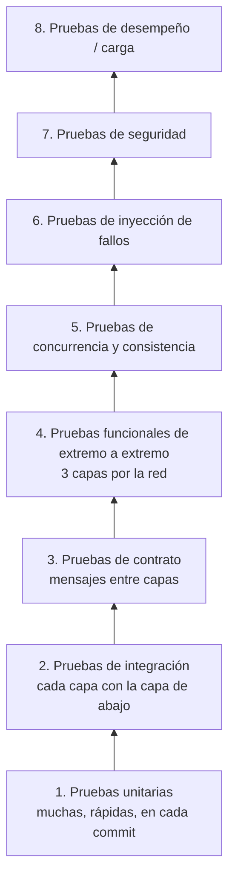

# Plan de Pruebas

Cómo vamos a verificar que el sistema **funciona** (requisitos funcionales),
**rinde** (tiempo de transacción < 1 s y los indicadores de
[indicadores-desempeno.md](indicadores-desempeno.md)) y **sobrevive a los fallos**
([modelos-sistema.md](modelos-sistema.md#3-modelo-de-fallos),
[tolerancia-fallos-escalabilidad.md](tolerancia-fallos-escalabilidad.md)).

---

## 1. Estrategia

| Nivel | Qué demuestra | Cuándo corre | Entorno |
|---|---|---|---|
| 1. Unitarias | Las reglas de negocio son correctas por separado | En cada commit (CI) | Máquina del desarrollador / CI |
| 2. Integración | Servicios ↔ persistencia y persistencia ↔ base de datos funcionan | En cada commit (CI) | Base de datos real en un contenedor |
| 3. Contrato | Cada capa envía/acepta exactamente los mensajes acordados | En cada commit (CI) | CI |
| 4. Extremo a extremo | Cada requisito funcional funciona a través de las 3 capas | En cada merge a `main` | Entorno local distribuido |
| 5. Concurrencia | Sin sobrecupo, sin doble cobro, sin interbloqueos | En cada merge a `main` | Igual que 4 |
| 6. Inyección de fallos | Las caídas y los mensajes perdidos se enmascaran | Antes de cada entrega | Clúster del laboratorio |
| 7. Seguridad | Autenticación, autorización, protección de datos | Antes de cada entrega | Igual que 6 |
| 8. Desempeño | p95 < 1 s, throughput, escalabilidad | Antes de cada entrega y después de cambios grandes | Clúster del laboratorio, siempre el mismo |

**Regla:** una funcionalidad está "terminada" cuando tiene pruebas unitarias + de
extremo a extremo y no rompe las líneas base de concurrencia y desempeño.

---

## 2. Entornos

| Nombre | Máquinas | Uso |
|---|---|---|
| **local** | 1 máquina: procesos en puertos distintos o un Kubernetes local (k3d/kind), PostgreSQL en un contenedor | Desarrollo, niveles 1–5 |
| **ci** | Runner de CI con contenedores | Niveles 1–3 automáticamente en cada push |
| **laboratorio** | El clúster Kubernetes de 4 máquinas (`cp-1` + `worker-1..3`, [despliegue-kubernetes.md](despliegue-kubernetes.md)); generador de carga fuera de los nodos worker | Niveles 6–8; **siempre las mismas máquinas** para que los resultados se puedan comparar |
| **laboratorio-tf** | laboratorio con las réplicas de la fase de tolerancia a fallos elegida (≥ 2 réplicas por worker, brokers Binary Star, réplicas de PostgreSQL) | Pruebas de tolerancia a fallos FT1–FT8 |

La configuración (direcciones, puertos, timeouts) viene de archivos por entorno,
nunca escrita en el código.

### Datos de prueba

Un **script de datos semilla** crea el mismo conjunto de datos cada vez:

| Datos | Cantidad (propuesta) |
|---|---|
| Lugares | 10 (edificios y teatros, capacidades de 30 a 500) |
| Eventos | 200 a lo largo de 6 meses (mezcla de gratuitos/pagos, universidad/externos, 1–5 fechas cada uno) |
| Estudiantes | 5 000 (generados, nombres/documentos falsos – nunca datos personales reales) |
| Saldos | Aleatorios entre 0 y 200 000 |
| Eventos especiales | 1 evento "popular" con una fecha de capacidad 100 (para pruebas de avalancha); 1 evento con fecha pasada |

La base de datos se reinicia a los datos semilla antes de cada corrida de extremo
a extremo, concurrencia, fallos y desempeño.

---

## 3. Pruebas unitarias

Prueban la lógica de negocio de la capa de servicios (en especial
`GestorTransacciones`) con la persistencia reemplazada por un simulador (mock).

| Área | Casos |
|---|---|
| `Evento.limite()` | Lugar de la universidad → capacidad del lugar; externo → `capacidadExterna`; ambos/ninguno → `UBICACION_INVALIDA` |
| `FechaEvento.disponibles()` | Exactamente lleno, queda un cupo, más cupos que los disponibles |
| Validación de `reservar` | Estudiante inactivo, fecha pasada, `cupos < 1`, ya tiene reserva en el evento, saldo insuficiente, evento gratuito con saldo 0 (permitido) |
| Validación de `modificarReserva` | No es el dueño, reserva cancelada, fecha de otro evento, sin cambios, más cupos sin espacio, menos cupos (reembolso), cambio de fecha con los mismos cupos (sin cambio de saldo) |
| Cálculo del costo | `(M − N) × precio` al aumentar, disminuir o cambiar de fecha; los eventos gratuitos siempre 0 |
| Aceptación de `cancelarReserva` | No es el dueño, ya cancelada, fecha pasada, cancelación ya pendiente |
| Idempotencia | El mismo `idSolicitud` devuelve el resultado guardado y no vuelve a confirmar |
| Autorización | `idEstudiante` tomado del token; estudiante llamando operaciones de administrador → `PROHIBIDO` |
| Enmascaramiento | El documento se muestra como `****5678` a quien no es administrador |
| Métricas | Cálculo de percentiles (p50/p95/p99) sobre muestras conocidas |

Meta de cobertura (propuesta): **≥ 80 %** de la lógica de negocio de la capa de servicios.

---

## 4. Pruebas de integración

Cada capa contra la capa real de abajo (base de datos real en un contenedor).

| ID | Prueba | Esperado |
|---|---|---|
| IT-01 | `aplicarCambioReserva` con espacio | Reserva, contador, saldo y transacción escritos |
| IT-02 | `aplicarCambioReserva` cuando falla la actualización condicional (sin espacio) | **Nada** escrito (rollback) |
| IT-03 | Lo mismo con saldo insuficiente | Nada escrito |
| IT-04 | Modificar entre dos fechas sin espacio en la nueva | Reserva original, ambos contadores y saldo sin cambios |
| IT-05 | Insertar dos transacciones con el mismo `idSolicitud` | La segunda falla por la restricción única |
| IT-06 | `aplicarCancelacion` dos veces con el mismo `idSolicitud` | Se aplica una vez; la segunda devuelve "ya aplicada" |
| IT-07 | Eliminar un lugar usado por un evento | Falla (`LUGAR_EN_USO`) |
| IT-08 | Bajar la capacidad de un lugar por debajo de las reservas de una fecha | Falla (`LIMITE_MENOR_A_RESERVAS`) |
| IT-09 | `listarFechasEventoEntre` para un mes | Solo fechas dentro del mes; los días límite incluidos |
| IT-10 | `aceptarCancelacion` y luego matar el trabajador antes de que reciba la notificación | La solicitud sigue `PENDIENTE`; el barrido la aplica después del reinicio |
| IT-11 | Un trabajador toma una solicitud y luego se detiene la persistencia | El bloqueo vence; la solicitud se retoma y se aplica una vez después del reinicio |
| IT-12 | Dos trabajadores toman la misma solicitud a la vez | Exactamente uno gana |
| IT-13 | Broker Majordomo con 2 workers; matar uno a mitad de una solicitud | El cliente (Lazy Pirate) reintenta y recibe la respuesta del otro |

---

## 5. Pruebas de contrato

La API de cada capa se describe una vez (p. ej. un archivo JSON Schema por
mensaje). Las pruebas verifican que:

- el consumidor envía solicitudes que cumplen el contrato de los servicios;
- la capa de servicios responde con los campos, estados (`OK`, `ERROR`,
  `ACEPTADA`) y códigos de error acordados ([capas.md](capas.md#códigos-de-error));
- las tramas cumplen el protocolo Majordomo (`MDPC01` / `MDPW01`);
- la capa de servicios llama a la persistencia con las operaciones acordadas.

Un cambio que rompe un contrato hace fallar el CI, así las tres capas se pueden
desarrollar en paralelo entre distintos miembros del equipo.

---

## 6. Pruebas funcionales de extremo a extremo

Se corren con la API real del consumidor contra las 3 capas en ejecución. Cada
prueba corresponde a un requisito de [requisitos.md](requisitos.md).

| ID | Requisito | Escenario | Esperado |
|---|---|---|---|
| E2E-01 | RF-01, RF-02 | El administrador crea, consulta, actualiza y elimina un evento con 2 fechas | Todas las operaciones funcionan; el listado refleja cada cambio |
| E2E-02 | RF-05 | Crear un evento en un teatro de la universidad (capacidad 300) | `limite = 300` en cada fecha |
| E2E-03 | RF-06 | Crear un evento externo con `capacidadExterna = 40` | `limite = 40` |
| E2E-04 | RF-04 | Crear un evento con lugar y dirección externa a la vez | `UBICACION_INVALIDA` |
| E2E-05 | RF-08, RF-09 | CRUD de un lugar; intentar eliminar un lugar en uso | El CRUD funciona; eliminar en uso → `LUGAR_EN_USO` |
| E2E-06 | RF-10, RF-11 | Un estudiante nuevo registra todos sus campos y luego reserva | Estudiante guardado; correo/documento duplicado rechazado |
| E2E-07 | RF-12 | Consultar los eventos de un mes | Solo fechas de ese mes, con lugar, precio, disponibles |
| E2E-08 | RF-13 | Consultar los cupos de un evento | Reservas / límite / disponibles correctos por fecha |
| E2E-09 | RF-14, RF-03 | Reservar 3 cupos en un evento pago | Reserva con 3 cupos; saldo −3 × precio; fecha +3 |
| E2E-10 | RF-15 | Reservar en 3 eventos distintos; intentar una segunda reserva en uno de ellos | Las 3 funcionan; la 4.ª → `YA_RESERVADO` |
| E2E-11 | RF-16 | Consultar mis reservas | Lista las 3 con evento, fecha, lugar, cupos |
| E2E-12 | RF-17, RF-18 | Modificar cupos 3 → 5 | Fecha +2; saldo −2 × precio |
| E2E-13 | RF-17, RF-18 | Modificar cupos 5 → 2 | Fecha −3; reembolso de 3 × precio |
| E2E-14 | RF-17 | Pasar la reserva a otra fecha del mismo evento | Fecha anterior −N, fecha nueva +N, saldo sin cambio |
| E2E-15 | RF-18 | Pasar a una fecha llena | `CUPOS_INSUFICIENTES`; reserva sin cambios |
| E2E-16 | RF-17 | Pasar a una fecha de otro evento | `FECHA_DE_OTRO_EVENTO` |
| E2E-17 | RF-19, RF-19a | Cancelar una reserva | `ACEPTADA` inmediata con el mensaje "en proceso"; después estado `CONFIRMADA`; cupos liberados; reembolso |
| E2E-18 | RF-19b | Consultar el estado justo después de aceptar (trabajador pausado) | `PENDIENTE`; al reanudar el trabajador → `CONFIRMADA` |
| E2E-19 | RF-19 | Modificar una reserva con una cancelación pendiente | `CANCELACION_PENDIENTE` |
| E2E-20 | RF-20, RF-21 | Consultar el historial después de reservar, modificar y cancelar | 3 transacciones con tipos, cupos y montos correctos |
| E2E-21 | RF-07 | Reservar exactamente los cupos restantes, y luego uno más | La primera funciona; la segunda → `CUPOS_INSUFICIENTES` |
| E2E-22 | — | Reservar en una fecha pasada | `FECHA_EVENTO_PASADA` |

Después de cada corrida de extremo a extremo, las **verificaciones de
consistencia K-01 … K-05** deben dar 0.

---

## 7. Pruebas de concurrencia y consistencia

Muchos clientes en paralelo contra una misma fecha o reserva.

| ID | Escenario | Esperado |
|---|---|---|
| CC-01 | 1 000 estudiantes intentan reservar 1 cupo en una fecha con 100 disponibles | Exactamente 100 lo logran, 900 reciben `CUPOS_INSUFICIENTES`; K-01 = K-02 = 0 |
| CC-02 | 200 estudiantes reservan entre 1 y 5 cupos al azar en una fecha con 300 disponibles | La suma de cupos exitosos ≤ 300 e igual al contador de la fecha |
| CC-03 | 100 estudiantes mueven reservas D1 → D2 mientras otros 100 mueven D2 → D1 | Sin interbloqueos (C-02 = 0); los contadores coinciden con las reservas |
| CC-04 | Un estudiante envía 10 solicitudes `reservar` distintas para el mismo evento a la vez | Exactamente 1 funciona; las demás `YA_RESERVADO` |
| CC-05 | Un estudiante con saldo para 1 cupo pago envía 5 reservas a eventos pagos distintos a la vez | El saldo nunca es negativo (K-03 = 0) |
| CC-06 | El mismo `idSolicitud` enviado 20 veces en paralelo | 1 transacción, 20 respuestas idénticas (K-04 = 0) |
| CC-07 | Cancelar y modificar la misma reserva al mismo tiempo | O se modifica y luego se cancela, o se acepta la cancelación y se rechaza la modificación; nunca ambas a medias |
| CC-08 | El administrador baja la capacidad mientras los estudiantes reservan | Nunca por debajo de las reservas actuales; sin sobrecupo |

Cada escenario se repite **10 veces** (los errores de concurrencia no son deterministas).

---

## 8. Pruebas de inyección de fallos

Matar procesos, perder o retrasar mensajes, y verificar que el sistema enmascara
el fallo. Herramientas: `kubectl delete pod`, `kill -9`, `tc netem`
(retardo/pérdida), un proxy que pierde respuestas (p. ej. Toxiproxy).

| ID | Fallo inyectado | Esperado |
|---|---|---|
| F1 | Matar los gestores durante una ráfaga de `reservar`; los consumidores reintentan | Sin duplicados; K-01…K-04 = 0 |
| F2 | Perder la respuesta de `modificarReserva`; el consumidor reintenta | Se aplica una vez |
| F3 | Matar el trabajador después de tomar una cancelación | La cancelación se aplica una vez (Q-04 > 0) |
| F4 | Detener la persistencia 30 s mientras se aceptan cancelaciones | Todas se aplican después del reinicio (K-05 = 0) |
| F5 | Agregar 500 ms de retardo de red servicios ↔ persistencia | Timeouts y p95 se comportan como se predijo; sin errores en los datos |
| F6 | 10 % de pérdida de paquetes consumidor ↔ servicios | Los reintentos funcionan; sin duplicados |
| F7 | Detener el proxy-cancelaciones; los estudiantes cancelan | `ACEPTADA`; las cancelaciones las aplica el barrido; reservar/modificar sin afectar |
| F8 | Matar la persistencia en medio de una confirmación | Se aplica completo o no se aplica |
| F9 | Borrar el pod del broker-servicios activo durante la carga | Cambio Binary Star; reintentos Lazy Pirate; sin duplicados |
| F10 | Borrar un pod de trabajador-persistencia durante la carga | El broker deja de enviarle trabajo (heartbeats); los reintentos funcionan |
| FT1–FT8 | De [tolerancia-fallos-escalabilidad.md](tolerancia-fallos-escalabilidad.md#verificación-de-cada-fase) (solo para la fase elegida) | Como se define allí |

Cada prueba registra: tiempo de detección, tiempo de recuperación (RTO), datos
perdidos (debe ser 0) e indicadores durante el fallo.

---

## 9. Pruebas de seguridad

| ID | Prueba | Esperado |
|---|---|---|
| SEC-01 | Llamar cualquier operación sin token / con un token vencido | `NO_AUTENTICADO` |
| SEC-02 | Un estudiante llama operaciones de administrador (CRUD de eventos, recargas, métricas) | `PROHIBIDO` |
| SEC-03 | El estudiante A modifica/cancela/consulta la reserva del estudiante B | `RESERVA_AJENA` / `PROHIBIDO` |
| SEC-04 | Poner otro `idEstudiante` en el cuerpo de la solicitud | Se ignora; se usa el `idEstudiante` del token |
| SEC-05 | Cadenas de inyección SQL en el nombre del evento y en campos del estudiante | Se guardan como texto o se rechazan; la consulta no cambia |
| SEC-06 | Valores fuera de rango (`cupos = -1`, `cupos = 10⁶`, precio negativo) | Error de validación |
| SEC-07 | Capturar el tráfico entre capas (Wireshark) | Cifrado (CurveZMQ); ningún dato personal visible |
| SEC-08 | Conectarse directamente al broker-persistencia / proxy-cancelaciones / PostgreSQL desde fuera del clúster, o con una llave Curve desconocida | Conexión rechazada (NetworkPolicy / ZAP) |
| SEC-09 | Repetir una solicitud `reservar` capturada | Sin segundo efecto |
| SEC-10 | Inundar una operación desde un estudiante | `LIMITE_SOLICITUDES`; los demás estudiantes no se afectan |
| SEC-11 | Buscar números de documento en los logs | No se encuentran |
| SEC-12 | Alguien que no es administrador consulta el perfil de un estudiante | Documento enmascarado |

---

## 10. Pruebas de desempeño

### 10.1 Herramientas

| Necesidad | Herramienta (propuesta, decisión O17) |
|---|---|
| Generar carga | Locust (Python) o k6 / JMeter, usando un cliente ZeroMQ |
| Métricas del servidor | Registros de tiempo por capa ([indicadores-desempeno.md](indicadores-desempeno.md#cómo-se-miden-los-tiempos)) + CPU/memoria (Prometheus) |
| Análisis | Script que une los registros de tiempo por `idSolicitud` y calcula p50/p95/p99/máx por operación y por capa |

El generador de carga corre fuera de los 3 nodos worker (una máquina adicional
del laboratorio, o `cp-1` si no hay otra), nunca en los nodos que se están midiendo.

### 10.2 Mezcla de carga

Según el comportamiento esperado de los estudiantes (propuesta):

| Operación | % de solicitudes |
|---|---|
| `listarEventosPorMes` | 40 % |
| `obtenerEvento` (cupos por fecha) | 25 % |
| `listarReservasEstudiante` / historial | 10 % |
| `reservar` | 12 % |
| `modificarReserva` | 6 % |
| `cancelarReserva` + `consultarEstadoSolicitud` | 5 % |
| CRUD de administrador | 2 % |

Cada usuario virtual espera de 1 a 5 s ("tiempo de reflexión") entre acciones.

### 10.3 Tipos de prueba

| ID | Tipo | Perfil | Duración | Propósito |
|---|---|---|---|---|
| PERF-01 | **Línea base** | 1 usuario, secuencial | 5 min | Mejor tiempo posible por operación (sin contención) |
| PERF-02 | **Carga** | Pico esperado: subir a 200 usuarios en 2 min | 15 min | Verificar **p95 < 1 s** en el pico normal (S1) |
| PERF-03 | **Estrés** | +50 usuarios cada 2 min hasta que p95 > 1 s o errores > 1 % | Hasta romper | Throughput máximo sostenido T-02 (S7) y qué capa se satura primero |
| PERF-04 | **Pico súbito** | 0 → 1 000 usuarios en 10 s sobre el evento popular | 5 min | Apertura de reservas de un evento popular (S2) |
| PERF-05 | **Resistencia** | 100 usuarios | 2 h | Fugas de memoria (R-02), degradación en el tiempo |
| PERF-06 | **Ráfaga de cancelaciones** | 500 cancelaciones en 30 s | 5 min | Cancelaciones pendientes, aceptación < 1 s, tiempo de finalización (S4, L-06, L-07) |
| PERF-07 | **Escalabilidad** | PERF-02 con 1, 2 y 3 réplicas de gestor-transacciones | 15 min cada una | Ganancia de throughput por réplica (FT5) |
| PERF-08 | **Con fallos** | PERF-02 mientras se corre F1 / FT1 / FT2 | 15 min | Tiempo de recuperación del p95 después de un fallo |

### 10.4 Procedimiento de cada corrida

1. Reiniciar la base de datos a los datos semilla; reiniciar todos los procesos.
2. Calentamiento: 2 minutos con carga baja (no se incluye en los resultados).
3. Correr el perfil; recoger los registros de tiempo de todas las capas y el uso de recursos.
4. Correr las verificaciones de consistencia K-01 … K-05.
5. Calcular los indicadores; llenar la tabla de resultados
   ([indicadores-desempeno.md](indicadores-desempeno.md#plantilla-de-resultados)).
6. Escribir la evaluación cualitativa (capacidad de respuesta, estabilidad,
   comportamiento bajo carga, recuperación, claridad de los errores).
7. Comparar con la corrida anterior; cualquier empeoramiento > 20 % del p95 debe explicarse.

### 10.5 Criterios de aceptación

| Criterio | Umbral |
|---|---|
| p95 de extremo a extremo por operación en PERF-02 | **< 1 s** |
| % de transacciones < 1 s en PERF-02 | ≥ 95 % |
| p95 de aceptación de cancelaciones | < 1 s |
| p95 / máx de finalización de cancelaciones | < 1 s / < 10 s |
| Tasa de errores técnicos (no de negocio) | < 1 % |
| Verificaciones de consistencia K-01 … K-05 | **0** en todas las corridas |
| Crecimiento de memoria en PERF-05 | Sin crecimiento continuo |
| PERF-07 | ≥ 1,6× de throughput con 2 réplicas frente a 1 |

---

## 11. Matriz de trazabilidad

| Requisito | Pruebas |
|---|---|
| RF-01 … RF-09 (eventos, lugares) | Unitarias; IT-07, IT-08; E2E-01 … E2E-05 |
| RF-10, RF-11 (estudiantes) | E2E-06 |
| RF-12, RF-13 (consultar) | IT-09; E2E-07, E2E-08 |
| RF-14 … RF-18 (reservar, modificar) | Unitarias; IT-01 … IT-04; E2E-09 … E2E-16, E2E-21, E2E-22 |
| RF-19 (cancelar, asíncrono) | IT-06, IT-10 … IT-12; E2E-17 … E2E-19 |
| RF-20, RF-21 (transacciones, `GestorTransacciones`) | E2E-20 |
| RNF-01 (3 capas) | Pruebas de contrato; despliegue en el laboratorio |
| RNF-02 (síncrono) | E2E (resultado en la misma llamada) |
| RNF-03 (sin sobrecupo) | CC-01, CC-02, CC-08; PERF-04 |
| RNF-04 (reintentos idempotentes) | Unitarias; IT-05; CC-06; F1, F2, F6; SEC-09 |
| RNF-05 (atomicidad) | IT-02 … IT-04; CC-03, CC-07; F8 |
| RNF-06 (cancelación asíncrona durable, exactamente una vez) | IT-06, IT-10 … IT-12; F3, F4, F7; PERF-06 |
| RNF-07 (< 1 s) | PERF-01 … PERF-08 |
| RNF-08 (visibilidad del desempeño) | Pruebas unitarias de métricas; `obtenerMetricas` verificado después de cada PERF |
| RNF-09 (evaluación del desempeño) | Procedimiento de 10.4 + evaluación cualitativa |
| RNF-10, RNF-11 (seguridad) | SEC-01 … SEC-12 |
| RNF-12 (tolerancia a fallos) | F1 … F10; FT1 … FT8 |
| RNF-13 (ZeroMQ) | Pruebas de contrato sobre las tramas MDP; IT-13; F9, F10 |
| RNF-14 (Kubernetes) | Prueba de humo del despliegue; FT1 … FT8 |

---

## 12. Organización

| Ítem | Plan |
|---|---|
| Ubicación en el repositorio | `pruebas/unitarias`, `pruebas/integracion`, `pruebas/contrato`, `pruebas/e2e`, `pruebas/concurrencia`, `pruebas/fallos`, `pruebas/seguridad`, `pruebas/desempeno` (scripts + resultados) |
| CI | Niveles 1–3 en cada push; el build falla si falla alguna prueba |
| Antes de cada entrega | Correr los niveles 4–8 en el laboratorio; guardar los reportes en `pruebas/desempeno/resultados/<fecha>/` |
| Errores encontrados | Cada error recibe una prueba que lo reproduce antes de corregirlo |
| Criterio de entrada para las pruebas de desempeño | Pasan todas las pruebas E2E y de concurrencia |
| Criterio de salida de una entrega | Pasan todas las pruebas E2E, de concurrencia, de fallos y de seguridad; se cumplen los criterios de desempeño; K-01 … K-05 = 0 |
