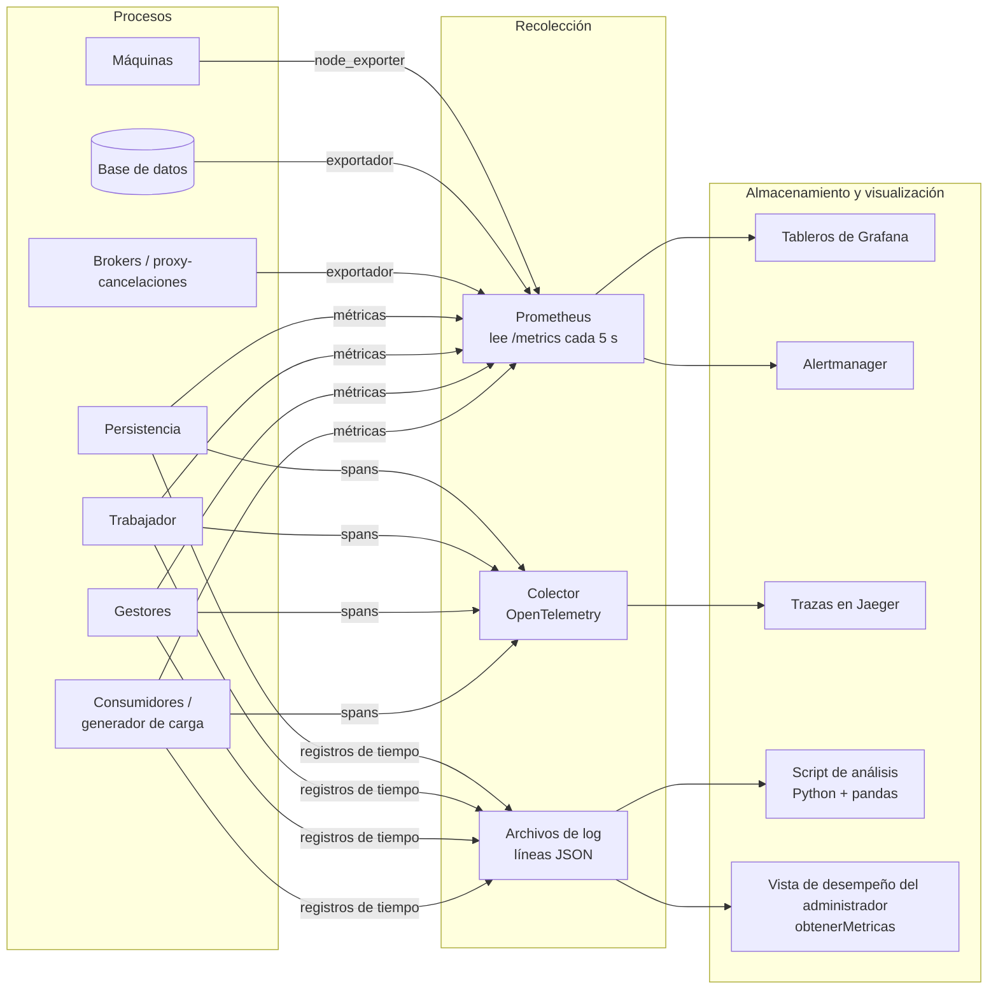

# Recolección de Métricas: Herramientas y Estrategias

Cómo vamos a **obtener** los indicadores definidos en
[indicadores-desempeno.md](indicadores-desempeno.md): qué registra cada proceso,
qué herramientas recogen y muestran los datos, y cómo se usan los resultados en
las pruebas de [plan-pruebas.md](plan-pruebas.md).

---

## 1. Visión general de la estrategia

Recogemos tres tipos de telemetría, todos unidos por el `idSolicitud`:

| Tipo | Qué responde | Ejemplo |
|---|---|---|
| **Métricas** (números en el tiempo) | ¿Qué tan rápido, cuántos, qué tan lleno? | p95 de `reservar`, solicitudes/s, cancelaciones pendientes, CPU |
| **Logs** (un registro por evento) | ¿Qué le pasó exactamente a esta solicitud? | `reservar r-123 estudiante=… resultado=CUPOS_INSUFICIENTES 412 ms` |
| **Trazas** (una solicitud a través de las capas) | ¿En qué se fue el tiempo? | consumidor 420 ms = red 60 + servicios 180 + persistencia 180 |



**Dos vías** (se elige en la decisión O16):

| Vía | Herramientas | Cuándo |
|---|---|---|
| **A – Liviana (mínimo, siempre)** | Registros de tiempo en archivos de líneas JSON + script de análisis en Python + verificaciones de consistencia en SQL + `obtenerMetricas` en el consumidor administrador | Obligatoria: alcanza para demostrar p95 < 1 s y producir las tablas de resultados |
| **B – Observabilidad completa (recomendada)** | Vía A + Prometheus + Grafana + Alertmanager + exportadores + OpenTelemetry/Jaeger | Tableros en vivo durante las pruebas de carga y de fallos; alertas; necesaria para las fases de tolerancia a fallos |

---

## 2. Instrumentación dentro de nuestro código

### 2.1 Un interceptor por capa

Cada proceso envuelve **toda** solicitud entrante (y toda llamada saliente) con un
pequeño interceptor/middleware, para que no se olvide ninguna operación y el
código de negocio quede limpio.

```
al recibir una solicitud:
    idSolicitud = solicitud.idSolicitud  (o uno nuevo para lecturas)
    inicio = reloj_monotonico()
    try:
        respuesta = atender(solicitud)
        resultado = respuesta.estado / código de error
    finally:
        duracion_ms = (reloj_monotonico() - inicio) * 1000
        escribir registro de tiempo
        actualizar métricas (histograma, contadores)
```

| Capa | Dónde va el interceptor |
|---|---|
| Consumidor / generador de carga | Alrededor de cada llamada a la capa de servicios (mide el tiempo **de extremo a extremo**) |
| Gestores (servicios) | Alrededor de cada operación de la API, de cada llamada a persistencia y de cada publicación |
| Trabajador de cancelaciones | Alrededor de cada toma + aplicación (+ tiempo desde `aceptadaEn`), marcando si vino de PUB/SUB o del barrido |
| Persistencia | Alrededor de cada operación de persistencia y de cada transacción de base de datos |

### 2.2 Formato del registro de tiempo

Una línea JSON por solicitud y por capa (escrita de forma asíncrona, ver 2.5):

```json
{"idSolicitud":"r-123","idTraza":"7f3a…","capa":"SERVICIOS","instancia":"gestor-transacciones-1",
 "operacion":"reservar","inicio":"2026-10-22T15:04:05.123Z","duracionMs":182.4,
 "resultado":"OK","idEstudiante":"20231234"}
```

- **Nunca** incluye número de documento, teléfono, correo ni nombres (modelo de seguridad 4.4).
- `inicio` es hora de reloj de pared (para ordenar la línea de tiempo);
  `duracionMs` se mide con el reloj **monotónico** (inmune a los ajustes de NTP).
- La misma estructura se guarda en la clase `RegistroTiempo`
  ([diagramas/clases.puml](diagramas/clases.puml)).

### 2.3 Propagar la solicitud entre capas

Todo mensaje entre capas lleva `idSolicitud` y, para las trazas, un campo
`traceparent` de W3C. La notificación PUB/SUB también lleva ambos, así el
procesamiento del trabajador queda unido a la `cancelarReserva` original.

### 2.4 Tipos y nombres de métricas

Siguiendo las convenciones de Prometheus:

| Métrica | Tipo | Etiquetas | Da los indicadores |
|---|---|---|---|
| `duracion_solicitud_segundos` | Histograma | `capa`, `operacion`, `resultado` | L-01…L-06, L-02 (% < 1 s), T-01 |
| `solicitudes_total` | Contador | `capa`, `operacion`, `resultado` | T-01, E-01, E-02 |
| `duracion_llamada_segundos` | Histograma | `desde`, `hacia`, `operacion` | L-03…L-05 (tiempo por salto) |
| `timeouts_total` | Contador | `desde`, `hacia` | E-03 |
| `reintentos_total` | Contador | `operacion` | E-04 |
| `solicitudes_duplicadas_total` | Contador | `operacion` | E-04, Q-04 |
| `duracion_cancelacion_segundos` | Histograma | `resultado` | L-07 |
| `cancelaciones_pendientes` | Gauge | — | Q-01 |
| `antiguedad_cancelacion_mas_vieja_segundos` | Gauge | — | Q-02 |
| `recuperaciones_barrido_total` | Contador | — | Q-03 |
| `broker_workers` / `broker_solicitudes_en_espera` | Gauge | `broker`, `servicio` | Capacidad por servicio, saturación |
| `estado_binary_star` | Gauge (activo/pasivo) | `broker` | Cambios de broker |
| `espera_bloqueo_segundos` / `reintentos_optimistas_total` | Histograma / Contador | `tabla` | C-01 |
| `estado_circuit_breaker` | Gauge (0/1/2) | `objetivo` | Tolerancia a fallos |
| `violaciones_consistencia` | Gauge | `verificacion` (K-01…K-05) | K-01…K-05 |
| `ocupacion_fecha_evento` | Gauge | `idFechaEvento` (solo próximas) | U-01 |

Los **buckets del histograma** se eligen alrededor de la meta de 1 s para que los
percentiles cerca de ella sean precisos: `0.05, 0.1, 0.25, 0.5, 0.75, 0.9, 1.0, 1.5, 2.5, 5` segundos.

### 2.5 Que medir salga barato

La instrumentación no debe hacer más lento lo que mide (meta: < 2 % de sobrecosto).

- Los registros de tiempo van a un buffer en memoria y un hilo en segundo plano
  los escribe a disco (logs asíncronos).
- Las métricas son contadores en memoria; Prometheus los lee cada 5 s.
- Las trazas se **muestrean**: 100 % en pruebas de escenarios puntuales, 10 % en
  pruebas de carga largas, siempre 100 % para los errores.
- El sobrecosto se verifica una vez: correr PERF-02 con y sin instrumentación y comparar.

### 2.6 Sincronización de relojes

Todas las máquinas del laboratorio corren **chrony/NTP** contra el mismo servidor.
Las duraciones nunca mezclan relojes de dos máquinas (cada duración se mide dentro
de un proceso); el `inicio` de reloj de pared solo se usa para dibujar líneas de
tiempo, donde unos pocos ms de desfase son aceptables. El tiempo de red por salto
se calcula como *duración de quien llama − duración de quien es llamado*, nunca
como resta de marcas de tiempo de dos máquinas.

---

## 3. Herramientas

### 3.1 Librerías (dentro de nuestros procesos)

| Propósito | Python | Java | Node.js |
|---|---|---|---|
| Exponer métricas Prometheus | `prometheus_client` | Micrometer + registro Prometheus | `prom-client` |
| Trazas | `opentelemetry-sdk` | Agente Java de OpenTelemetry | `@opentelemetry/sdk-node` |
| Logs JSON estructurados | `structlog` / `logging` + formateador JSON | Logback + encoder logstash | `pino` |

(La elección final depende del lenguaje, decisión O1.)

### 3.2 Herramientas de infraestructura

| Herramienta | Recoge | Indicadores |
|---|---|---|
| **Prometheus** | Lee `/metrics` de cada proceso y exportador; guarda series de tiempo | Todos los indicadores basados en métricas |
| **Grafana** | Tableros sobre Prometheus (y Jaeger/Loki) | Visualización |
| **Alertmanager** | Envía alertas a partir de reglas de Prometheus | Alertas de [tolerancia-fallos-escalabilidad.md](tolerancia-fallos-escalabilidad.md#310-monitoreo-detección-de-fallos-y-alertas) |
| **node_exporter** | CPU, memoria, disco, red por máquina | R-01, R-02, R-04 |
| **Métricas de CloudNativePG** | Exportador incluido: retraso de replicación, failovers, conexiones, bloqueos | R-03, C-01, C-02 |
| **Métricas de los brokers (nuestro código)** | Los brokers Majordomo exponen workers por servicio, solicitudes en espera, fallos de heartbeat y estado Binary Star en `/metrics` | T-03, E-05 |
| **kube-state-metrics** | Reinicios de pods, réplicas, estado de los HPA, estado de los nodos | E-05, decisiones de escalado |
| **Colector OpenTelemetry + Jaeger** | Trazas distribuidas | L-03…L-05, análisis de solicitudes lentas |
| **Loki** (opcional) o archivos planos | Almacenamiento central de logs | Buscar registros de tiempo |
| **Locust / k6 / JMeter** | Tiempos de extremo a extremo del lado del cliente, throughput, errores; exportación CSV/JSON | L-01, L-02, T-01, T-02 (verificación cruzada) |
| **Blackbox exporter** o script de health check | Consulta la salud de cada proceso cada 2 s | Disponibilidad E-05 |
| **`tc netem`, Toxiproxy** | (No son métricas) inyectan retardo/pérdida en las pruebas de fallos | Se usan con F5, F6 |
| **Wireshark / tcpdump** | Inspección del tráfico | SEC-07, depurar latencia |

Prometheus, Grafana y Alertmanager corren en el namespace `monitoreo`
(kube-prometheus-stack, [despliegue-kubernetes.md](despliegue-kubernetes.md)),
con límites de recursos pequeños; su sobrecosto forma parte de lo que se mide,
así que se mantiene igual en todas las corridas.

### 3.3 Script de análisis liviano (vía A)

`pruebas/desempeno/analizar.py` (planeado) lee los archivos de líneas JSON de
todas las capas y produce la tabla de resultados:

```
python analizar.py --logs resultados/2026-11-05/*.jsonl --desde 15:00 --hasta 15:15
```

Pasos:

1. Cargar todos los registros de tiempo en un DataFrame de pandas.
2. Quitar el periodo de calentamiento.
3. Por `operacion` y `capa`: conteo, p50, p95, p99, máx, % < 1000 ms.
4. Unir por `idSolicitud`: tiempo de red por salto = duración de quien llama − duración de quien es llamado.
5. Tasa de errores por código; throughput por segundo.
6. Salida: tabla Markdown (se pega en la plantilla de resultados), CSV y gráficas
   PNG (latencia en el tiempo con la línea de 1 s, histograma).

---

## 4. Indicador → fuente → herramienta

| Indicadores | Fuente | Vía A (mínimo) | Vía B (completa) |
|---|---|---|---|
| L-01, L-02 tiempo de extremo a extremo, % < 1 s | Interceptor del consumidor / generador de carga | Registros de tiempo + script; CSV de Locust | `duracion_solicitud_segundos{capa="consumidor"}` en Grafana |
| L-03…L-05 tiempo por capa y por salto | Interceptores en cada capa | El script une por `idSolicitud` | Histogramas por capa + trazas de Jaeger |
| L-06, L-07 tiempos de cancelación | Gestores (aceptación), trabajador (finalización) | Registros de tiempo | Histogramas |
| T-01…T-04 throughput | Contadores / generador de carga | Script (solicitudes por segundo) | `rate(solicitudes_total[1m])` |
| Q-01…Q-05 cancelaciones | Tabla `solicitud_cancelacion` + trabajador | Conteo SQL cada 5 s + logs del trabajador | Gauge `cancelaciones_pendientes`, contador del barrido |
| E-01…E-06 errores, disponibilidad | Interceptores, health checks | Script + log de health checks | Contadores + blackbox exporter |
| C-01…C-03 concurrencia | Persistencia + BD | Vistas de estadísticas de la BD después de cada corrida | Exportador de la BD |
| K-01…K-05 consistencia | Base de datos | Verificaciones SQL (sección 5) después de cada corrida | El mismo SQL cada 1 min → gauge `violaciones_consistencia` |
| R-01…R-04 recursos | SO, BD | `vmstat 1` / `pidstat 1` a un archivo | node_exporter, exportador de la BD |
| U-01…U-05 uso | Base de datos | Consultas SQL (sección 6) | Las mismas consultas como paneles de Grafana |

---

## 5. Verificaciones de consistencia (SQL)

Se corren después de cada prueba (y de forma periódica en la vía B). Cada
consulta debe devolver **0 filas**. (La tabla física de transacciones se llama
`transacciones`.)

```sql
-- K-01 Fechas con sobrecupo
SELECT fe.id
FROM fecha_evento fe
JOIN evento e     ON e.id = fe.id_evento
LEFT JOIN lugar l ON l.id = e.id_lugar
WHERE fe.reservas > COALESCE(l.capacidad, e.capacidad_externa);

-- K-02 El contador no coincide con las reservas activas
SELECT fe.id, fe.reservas, COALESCE(SUM(r.cupos), 0) AS cupos_activos
FROM fecha_evento fe
LEFT JOIN reserva r ON r.id_fecha_evento = fe.id AND r.estado = 'ACTIVA'
GROUP BY fe.id, fe.reservas
HAVING fe.reservas <> COALESCE(SUM(r.cupos), 0);

-- K-03 Saldos negativos
SELECT id_estudiante FROM estudiante WHERE saldo < 0;

-- K-04 Efectos duplicados para una misma solicitud
SELECT id_solicitud, COUNT(*) FROM transacciones
GROUP BY id_solicitud HAVING COUNT(*) > 1;

-- K-05 (parte en BD) Cancelaciones atascadas
SELECT id_solicitud FROM solicitud_cancelacion
WHERE estado IN ('PENDIENTE', 'EN_PROCESO') AND aceptada_en < now() - interval '60 seconds';
```

**K-05 Cancelaciones perdidas** también necesita datos de fuera de la base de datos:

1. De los registros de tiempo de los gestores: todos los `idSolicitud` de
   `cancelarReserva` con resultado `ACEPTADA`.
2. Quitar los que tienen una fila en `solicitud_cancelacion`.
3. Lo que quede, más las cancelaciones atascadas de la consulta de arriba, son
   cancelaciones perdidas → debe ser **0**.

El script de análisis implementa esta verificación.

---

## 6. Indicadores de uso (SQL)

```sql
-- U-01 Ocupación de las próximas fechas
SELECT e.nombre, fe.fecha, fe.reservas,
       COALESCE(l.capacidad, e.capacidad_externa) AS limite,
       ROUND(100.0 * fe.reservas / COALESCE(l.capacidad, e.capacidad_externa), 1) AS ocupacion_pct
FROM fecha_evento fe
JOIN evento e     ON e.id = fe.id_evento
LEFT JOIN lugar l ON l.id = e.id_lugar
WHERE fe.fecha >= CURRENT_DATE
ORDER BY ocupacion_pct DESC;

-- U-02 Reservas por mes
SELECT DATE_TRUNC('month', creado_en) AS mes, COUNT(*)
FROM transacciones WHERE tipo = 'RESERVA' AND estado = 'CONFIRMADA'
GROUP BY 1 ORDER BY 1;

-- U-03 / U-04 Tasas de cancelación y de modificación
SELECT
  SUM(CASE WHEN tipo = 'CANCELACION' THEN 1 ELSE 0 END) * 1.0
    / NULLIF(SUM(CASE WHEN tipo = 'RESERVA' THEN 1 ELSE 0 END), 0) AS tasa_cancelacion,
  SUM(CASE WHEN tipo = 'MODIFICACION' THEN 1 ELSE 0 END) * 1.0
    / NULLIF(SUM(CASE WHEN tipo = 'RESERVA' THEN 1 ELSE 0 END), 0) AS tasa_modificacion
FROM transacciones WHERE estado = 'CONFIRMADA';

-- U-05 Ingresos y reembolsos (monto < 0 = cobro)
SELECT SUM(CASE WHEN monto < 0 THEN -monto ELSE 0 END) AS cobrado,
       SUM(CASE WHEN monto > 0 AND tipo <> 'RECARGA' THEN monto ELSE 0 END) AS reembolsado
FROM transacciones WHERE estado = 'CONFIRMADA';
```

---

## 7. Tableros (vía B)

Un tablero de Grafana por público:

| Tablero | Paneles |
|---|---|
| **Desempeño** | p50/p95/p99 por operación con línea roja en 1 s · % < 1 s (panel de valor, verde ≥ 95 %) · throughput · tasa de errores por código · tiempo por capa (apilado) |
| **Cancelaciones** | Cancelaciones pendientes · antigüedad de la más vieja · recuperaciones del barrido · p95 de aceptación y de finalización · cancelaciones fallidas por motivo |
| **Infraestructura** | CPU / memoria por nodo y pod · reinicios de pods · réplicas de los HPA · workers por broker · estado Binary Star · conexiones, bloqueos, interbloqueos y retraso de replicación de la BD · salud de cada instancia |
| **Consistencia** | K-01…K-05 como números grandes en verde/rojo |
| **Uso** | Ocupación de las próximas fechas · reservas por mes · tasas de cancelación/modificación · ingresos |

Ejemplos de PromQL:

```promql
# p95 de extremo a extremo por operación (últimos 5 min)
histogram_quantile(0.95,
  sum by (le, operacion) (rate(duracion_solicitud_segundos_bucket{capa="consumidor"}[5m])))

# % de transacciones por debajo de 1 s
sum(rate(duracion_solicitud_segundos_bucket{capa="consumidor", le="1.0"}[5m]))
  / sum(rate(duracion_solicitud_segundos_count{capa="consumidor"}[5m]))

# tasa de errores técnicos (excluye errores de negocio como CUPOS_INSUFICIENTES)
sum(rate(solicitudes_total{capa="servicios", resultado=~"PERSISTENCIA_NO_DISPONIBLE|TIMEOUT|INTERNO"}[5m]))
  / sum(rate(solicitudes_total{capa="servicios"}[5m]))
```

Ejemplo de regla de alerta:

```yaml
- alert: TiempoTransaccionSobreMeta
  expr: histogram_quantile(0.95, sum by (le) (rate(duracion_solicitud_segundos_bucket{capa="servicios"}[1m]))) > 1
  for: 1m
  labels: { severity: warning }
  annotations: { summary: "El p95 del tiempo de transacción supera 1 s" }
```

Los tableros y las reglas de alerta se guardan como archivos en el repositorio
(`monitoreo/grafana/*.json`, `monitoreo/prometheus/*.yml`) para poder desplegar
todo el monitoreo junto con el resto de manifiestos.

---

## 8. Vista de desempeño del administrador (`obtenerMetricas`)

RNF-08 exige que el propio sistema muestre su desempeño. El consumidor
administrador llama a `obtenerMetricas(desde, hasta, operacion?)` en la capa de servicios:

- **Vía A:** el Gestor de Métricas lee los registros de tiempo (del
  `RepositorioTiempos` en persistencia o de los archivos de log) y calcula los
  mismos números que el script de análisis.
- **Vía B:** el Gestor de Métricas consulta la API HTTP de Prometheus y devuelve
  los resultados.

En ambos casos el administrador ve p50/p95/p99/máx por operación, % < 1 s,
throughput, tasa de errores, cancelaciones pendientes y K-01…K-05, sin necesitar
acceso a Grafana.

---

## 9. Proceso durante las pruebas

| Paso | Acción |
|---|---|
| Antes | Sincronizar relojes; reiniciar la BD a los datos semilla; levantar el monitoreo; anotar versiones/hash del commit y configuración |
| Durante | Mirar Grafana (vía B) o seguir los logs con `tail`; tomar notas para la evaluación cualitativa |
| Después | Detener la carga; exportar registros de tiempo, CSV de la herramienta de carga, snapshot de Prometheus (o archivos de `vmstat`), cancelaciones pendientes; correr las verificaciones SQL K-01…K-05; correr `analizar.py` |
| Guardar | `pruebas/desempeno/resultados/<fecha>-<escenario>/` con datos crudos, tablas/gráficas generadas y un `notas.md` corto |
| Comparar | Un script compara con la corrida anterior del mismo escenario; un empeoramiento de p95 > 20 % debe explicarse |

### Retención

| Datos | Se guardan |
|---|---|
| Series de tiempo de Prometheus | 15 días (por defecto) |
| Registros de tiempo crudos de las pruebas | Hasta el final del proyecto (en `resultados/`) |
| Trazas | 2 días |
| Reportes generados | Siempre (en el repositorio) |

---

## 10. Recomendación

- **Implementar la vía A desde el inicio:** interceptores + registros de tiempo
  JSON + script de análisis + verificaciones SQL. Es simple, no necesita
  infraestructura extra y alcanza para demostrar p95 < 1 s.
- **Agregar la vía B antes de las pruebas de fallos y de tolerancia a fallos**,
  porque los tableros en vivo y los exportadores hacen mucho más fácil ver qué
  pasa durante un failover o un pico.
- Usar **Locust** (si es Python) o **k6** como generador de carga, y comparar sus
  números con los registros de tiempo del lado del consumidor.
