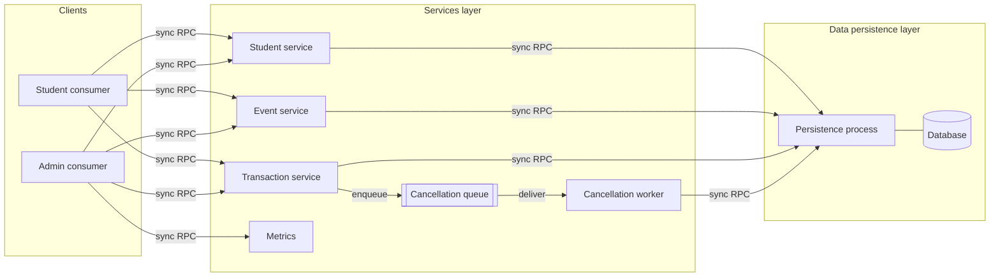

# System Models

This document describes the system using the classic models of distributed
systems and shows how each one applies to the university events project:

1. [Architectural model](#1-architectural-model): which entities exist, how they communicate, where they run.
2. [Interaction model](#2-interaction-model): timing, message delays, ordering and invocation semantics.
3. [Failure model](#3-failure-model): what can fail, how it fails and how the system masks it.
4. [Security model](#4-security-model): what must be protected, from whom, and how.

---

## 1. Architectural model

### 1.1 Architectural style

| Concept | How it applies to the project |
|---|---|
| **Client–server** | Consumers are clients; the services layer is the server for them. The services layer is in turn a client of the persistence layer. |
| **Layered (3 tiers)** | Consumers → Services → Data Persistence. Each layer only calls the layer directly below it ([architecture.md](architecture.md)). |
| **Stateless services** | Services keep no session state in memory; all state lives in persistence or in the cancellation queue. This lets services be restarted or replicated without losing data. |
| **Message queue (indirect communication)** | Cancellations go through a durable queue. The sender (transaction service) and the receiver (cancellation worker) are decoupled in **time** (the worker may run later) and in **space** (they don't need to know each other's address). |
| **Single authoritative store** | Persistence is the only source of truth for spots, balances and transactions, which keeps consistency simple. |

### 1.2 Entities (processes)

| Entity | Role | State it holds |
|---|---|---|
| Student consumer | Client for students | Only the pending `requestId`s it may need to retry |
| Admin consumer | Client for event/place/student admins and performance view | None |
| Student / Event / Transaction services | Business logic | None (stateless) |
| Cancellation queue | Durable buffer of accepted cancellations | Pending `CancellationRequest`s |
| Cancellation worker | Applies queued cancellations | None |
| Metrics | Aggregates timing records into indicators | Timing records (or reads them from logs) |
| Persistence | Atomic reads/writes, constraints | All business data |

### 1.3 Communication paradigms

| Paradigm | Used for | Properties |
|---|---|---|
| **Remote invocation (request–reply)** | Every synchronous operation: consult, reserve, modify, CRUD, status, metrics | Caller blocks; coupled in time; result in the reply |
| **Indirect communication (message queue)** | Cancellation: transaction service → worker | Caller does not wait for the effect; decoupled in time and space; durable |

### 1.4 Placement (physical mapping)

| Deployment | Machines | Use |
|---|---|---|
| Development | All processes on one machine, different ports | Coding and unit tests |
| Distributed (target) | Machine A: consumers · Machine B: services + queue + worker · Machine C: persistence + database | Demonstration and load tests |
| Scaled (extension) | Several service instances behind a load balancer; several workers; primary/backup persistence | Only if O9 is accepted |

Addresses and ports always come from configuration.

---

## 2. Interaction model

### 2.1 Synchronous vs asynchronous system

In distributed systems theory a system is **synchronous** if there are known
upper bounds on process execution time, message delay and clock drift, and
**asynchronous** if there are no such bounds.

- The university network and the Internet give **no guaranteed bound** on
  message delay, so the project runs on an **asynchronous system** in that
  theoretical sense.
- The project's "synchronous operations" (RNF-02) are about the **interaction
  style** (the caller waits for the reply), not about guaranteed timing.
- To be able to act anyway, the system **assumes practical bounds** with timeouts
  (1.5 s consumer→service, 700 ms service→persistence) and a performance target
  of p95 < 1 s ([performance-indicators.md](performance-indicators.md)). When a
  bound is exceeded the outcome is treated as **unknown**, never as "failed".

### 2.2 Performance of communication channels

| Characteristic | Meaning | How the project handles it |
|---|---|---|
| **Latency** | Time for a message to reach the other side | Measured per hop (L-05). Keep connections open (no new TCP/TLS handshake per request) to stay under 1 s. |
| **Bandwidth** | Data per second | Messages are small (JSON/RPC). Lists (events of a month, history) are paginated. |
| **Jitter** | Variation in delay | Visible as p99/max vs p50 (L-01). Timeouts are set above the expected p99. |

### 2.3 Clocks and event ordering

- Each machine has its own clock; clocks **drift** and are never perfectly equal.
- **Durations** (performance indicators) are always measured with one machine's
  clock (start and end on the same process).
- **Timestamps** stored in data (`createdAt`, `acceptedAt`) come from the
  persistence machine (or the service machine, consistently), synchronized with
  NTP. They are informative, not used to decide order.
- **Order of operations** on the same data is decided by the persistence layer:
  the order in which atomic commits happen on one `EventDate` row is the real
  order. Two students racing for the last spot are ordered by who commits first,
  not by whose clock says earlier.
- Requests for the same reservation from the async path are ordered by the queue
  (FIFO per `reservationId`).
- Every request carries a `requestId`, which links events across processes in
  the logs (a causal trace of one operation).

### 2.4 Interaction protocols

| Protocol | Messages | Used for |
|---|---|---|
| **Request–Reply (RR)** | request → reply | All synchronous operations |
| **Request–Reply–Acknowledge (RRA)** | worker gets message → applies → acknowledges | Cancellation queue: the message is deleted only after the ack |
| **One-way + status query** | `cancelReservation` → `ACCEPTED`; later `getRequestStatus` | Student view of an async cancellation |

### 2.5 Invocation semantics

| Semantics | Meaning | Where |
|---|---|---|
| **Maybe** | No retries; may run once or not at all | Not used for writes |
| **At-least-once** | Retries until a reply; may run more than once | Consumer retries after timeout; queue redelivers after worker crash |
| **At-most-once** | Retries, but duplicates are detected and the stored result is returned | Achieved with `requestId` + unique constraint + stored result |
| **Effectively exactly-once** | At-least-once delivery + idempotent processing | Reserve, modify, top-up and cancellation (RNF-04, RNF-06) |

| Operation | Style | Retries | Semantics |
|---|---|---|---|
| Reads (events of a month, reservations, history) | Sync | Free to retry | At-least-once (harmless, read-only) |
| `reserve`, `modifyReservation`, `topUp`, CRUD writes | Sync | Same `requestId` | Exactly-once effect |
| `cancelReservation` (accept) | Sync, short | Same `requestId` | Exactly one queue message |
| Cancellation apply (worker) | Async | Queue redelivery | Exactly-once effect |

---

## 3. Failure model

### 3.1 Failure classes

| Class | Definition | Possible in the project? | Example |
|---|---|---|---|
| **Crash (fail-stop)** | A process stops and does nothing more | Yes | Services process killed; persistence machine shuts down |
| **Omission – process** | A process fails to send or receive a message | Yes | Worker crashes after commit, before ack |
| **Omission – channel** | A message is lost on the network | Yes | Reply to `reserve` lost; consumer times out |
| **Timing / performance** | A response arrives, but later than the bound | Yes | Persistence takes 2 s under load; p95 > 1 s |
| **Arbitrary (Byzantine)** | A process or channel behaves incorrectly or maliciously | Out of scope for correctness; covered partly by the [security model](#4-security-model) | Tampered message, buggy client sending wrong data |

**Assumptions** (the failure model the design relies on):

1. Processes fail by **crashing** (no arbitrary behavior from our own processes).
2. Channels may **lose, delay or duplicate** messages but do not corrupt them
   undetected (TCP checksums + TLS integrity).
3. The database and the queue are **durable**: what they confirm as written
   survives a crash.
4. Crashes are **not distinguishable from slowness** from the outside; a timeout
   only means "unknown".

### 3.2 Failures per component and how they are masked

| Component | Failure | Detected by | Effect without handling | Handling (masking) |
|---|---|---|---|---|
| Network consumer→service | Lost request or reply | Consumer timeout | Student doesn't know if reservation happened; retry could reserve twice | Retry with same `requestId` → same result, no duplicate |
| Student consumer | Crash mid-operation | — | Pending request unknown | On restart, `getRequestStatus` / `listStudentReservations` show the real state |
| Services process | Crash before commit | Consumer timeout | Nothing applied | Retry; nothing to undo |
| Services process | Crash after commit, before reply | Consumer timeout | Applied, but student not told | Retry with same `requestId` returns stored result |
| Services process | Crash after `ACCEPTED` | — | Accepted cancellation lost | Queue is durable; worker processes it after restart |
| Cancellation queue | Down | Enqueue fails | — | Reply `QUEUE_UNAVAILABLE`; nothing accepted |
| Cancellation worker | Crash before commit | Message not acked | — | Redelivered; applied once |
| Cancellation worker | Crash after commit, before ack | Message not acked | Applied twice | Redelivered; `applyCancellation` sees existing `requestId` and skips |
| Persistence | Crash mid-commit | Service timeout / error | Half-written reservation | Atomic commit (all-or-nothing); service returns `PERSISTENCE_UNAVAILABLE` |
| Persistence | Down for a while | Health check, errors | System cannot write | Sync ops fail fast with an error; queued cancellations wait and retry with backoff |
| Persistence | Slow (timing failure) | Latency indicators | p95 > 1 s | Alert from indicators; optimize queries, indexes, locking (O4) |
| Clocks | Drift between machines | — | Wrong durations / ordering | Durations measured on one clock; ordering by commit, not timestamps |

### 3.3 Single points of failure

| Component | Why it is a SPOF | Mitigation (in scope) | Mitigation (extension, O9) |
|---|---|---|---|
| Persistence / database | Only source of truth | Durable storage, backups, atomic commits | Primary/backup replication with failover |
| Cancellation queue | Holds accepted cancellations | Durable (on disk) | Replicated queue (e.g. RabbitMQ quorum queues) |
| Services process | Only entry point | Stateless → fast restart | Several instances behind a load balancer |

### 3.4 Failure detection and recovery

- **Health checks:** each process exposes a `ping`; the admin view and the
  metrics show availability per layer (E-05).
- **Timeouts** convert silence into "unknown" so the caller can retry or report.
- **Backoff:** retries wait 100 ms, 200 ms, 400 ms… (proposal) to avoid
  overloading a recovering layer.
- **Recovery on restart:**
  - Persistence: the database recovers its committed state from its log.
  - Worker: continues with any un-acknowledged messages.
  - Services: nothing to recover (stateless).
- **Consistency checks** (K-01 … K-05) run after recovery to confirm no
  overbooking, no counter mismatch, no lost or duplicated cancellation.

### 3.5 Failure scenarios to test

These match the load-test scenarios S5 and S6 in
[performance-indicators.md](performance-indicators.md), plus:

| # | Scenario | Expected result |
|---|---|---|
| F1 | Kill services during a `reserve` burst, restart, consumers retry | No duplicate reservations; K-01…K-04 = 0 |
| F2 | Drop the reply of `modifyReservation` (simulated) and retry | Modification applied once |
| F3 | Kill worker after commit, before ack | Cancellation applied once (Q-04 > 0) |
| F4 | Stop persistence 30 s while cancellations are accepted | All accepted cancellations applied after restart (K-05 = 0) |
| F5 | Add 500 ms artificial network delay | Timeouts and p95 behave as predicted |

---

## 4. Security model

### 4.1 Objects to protect

| Object | Why it matters |
|---|---|
| Student personal data: name, government ID type and number, phone, email, career, department, semester | Personal data protected by law (Colombia: Ley 1581 de 2012, habeas data) |
| Student `balance` | Money |
| Reservations and spots | Limited resource; could be stolen or blocked |
| Transactions | Audit record of everything that happened |
| Events and places | Wrong data misleads all students |
| Performance metrics and logs | Can reveal internal structure and personal data |

### 4.2 Principals and access rights

| Principal | Authenticated how (proposal) |
|---|---|
| Student | University credentials (login) → session token |
| Admin / organizer | University credentials with admin role → session token |
| Internal processes (services, worker, persistence) | Mutual TLS certificates or a shared secret per process |

| Operation | Student | Admin | Services | Worker |
|---|---|---|---|---|
| Consult events of a month, event spots | ✔ | ✔ | | |
| Create/update **own** student data | ✔ (own only) | ✔ | | |
| Reserve / modify / cancel | ✔ (own only) | ✔ | | |
| Consult reservations, history, request status | ✔ (own only) | ✔ (all) | | |
| CRUD events, dates, places | | ✔ | | |
| Top up balance | | ✔ | | |
| View performance indicators | | ✔ | | |
| Read/write persistence | | | ✔ | ✔ (cancellations only) |
| Enqueue / dequeue cancellations | | | ✔ enqueue | ✔ dequeue |

**Ownership rule:** the `studentId` used for an operation always comes from the
authenticated token, never from the request body. Acting on another student's
reservation returns `RESERVATION_NOT_OWNED`.

### 4.3 Threats (the enemy)

The enemy can send any message to any process, and read, copy, modify or replay
messages on the network.

| Threat | Target | Example in the project |
|---|---|---|
| **Spoofing** | Processes | Someone calls `cancelReservation` pretending to be another student; a fake persistence process answers the services |
| **Eavesdropping** | Channels | Reading government IDs or phone numbers from network traffic |
| **Tampering** | Channels | Changing `spots: 1` to `spots: 50` or the price in transit |
| **Replay** | Channels | Re-sending a captured `reserve` or `topUp` request |
| **Denial of service** | Processes | Flooding `reserve` or `listEventsByMonth`, or filling the cancellation queue |
| **Elevation of privilege** | Processes | A student calling admin operations (CRUD events, top-up) |
| **Injection** | Persistence | SQL injection through event names or student fields |
| **Data leakage** | Logs, metrics | Government IDs written to logs |
| **Repudiation** | Transactions | A student claims they never cancelled |

### 4.4 Defenses

| Defense | Mitigates | How it applies |
|---|---|---|
| **TLS on every channel** (consumer↔services, services↔persistence, services/worker↔queue) | Eavesdropping, tampering | Encryption + integrity on all network hops |
| **Authentication** of users (token) and of internal processes (mutual TLS / secret) | Spoofing | Persistence and queue accept connections only from services and worker |
| **Authorization** (role + ownership checks) in the services layer | Elevation of privilege, acting on others' data | Table in 4.2; errors `UNAUTHENTICATED`, `FORBIDDEN`, `RESERVATION_NOT_OWNED` |
| **Replay protection** | Replay | `requestId` is unique per request (a replay returns the stored result, no new effect) + token expiry + request timestamp window (proposal: 5 min) |
| **Network isolation** | Direct attacks on data | Persistence and queue are not reachable from consumers' network; only services/worker |
| **Input validation** + parameterized queries | Injection, tampering by a buggy/malicious client | Validate types, ranges (`spots ≥ 1`), lengths; never build SQL from strings |
| **Rate limiting and quotas** | DoS | Per-student limit of requests per minute; max queue size; max page size |
| **Data minimization and masking** | Data leakage | Show government ID masked (`****5678`) except to admins; never log it; logs carry `requestId` and `studentId` only |
| **Encryption at rest** (proposal) | Stolen database/backups | Encrypt the government ID column or the whole database disk |
| **Immutable transaction log** | Repudiation | Every change is a `Transaction` with `studentId`, `requestId`, time; never edited or deleted |
| **Secrets management** | Leaked credentials | DB passwords and certificates in config/env files outside the repo (never committed) |

### 4.5 Security vs performance

Security adds cost to every request, which matters for the < 1 s target:

- TLS handshakes are expensive → keep **persistent connections** / connection
  pools between layers.
- Token validation should be local (signed token) instead of calling an auth
  server on every request.
- Measure security overhead in load tests (compare runs with and without TLS
  during development).

---

## Summary: how each model shapes the design

| Model | Main consequences in the project |
|---|---|
| Architectural | 3 layers, stateless services, sync RPC for everything except cancellation, durable queue + worker for cancellation, single authoritative store |
| Interaction | Asynchronous network → timeouts and "unknown" outcomes; ordering by commit in persistence; `requestId` everywhere; effectively exactly-once semantics |
| Failure | Crash and omission failures masked by retries + idempotency + atomic commits + durable queue; SPOFs identified; failure scenarios F1–F5 |
| Security | Authentication of users and processes, ownership-based authorization, TLS, replay protection, personal data protection, immutable audit log |
