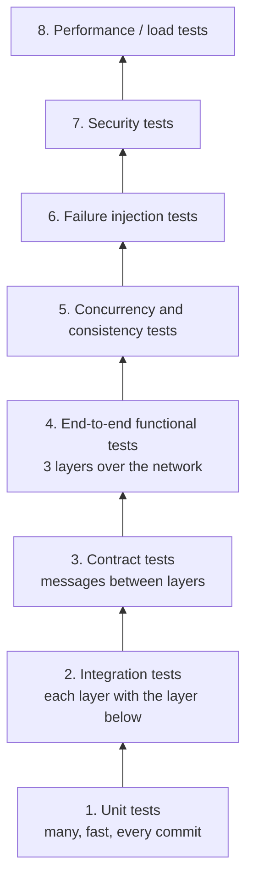

# Test Plan

How we will verify that the system **works** (functional requirements),
**performs** (transaction time < 1 s and the indicators in
[performance-indicators.md](performance-indicators.md)), and **survives
failures** ([system-models.md](system-models.md#3-failure-model),
[fault-tolerance-scalability.md](fault-tolerance-scalability.md)).

---

## 1. Strategy

| Level | What it proves | When it runs | Environment |
|---|---|---|---|
| 1. Unit | Business rules are correct in isolation | Every commit (CI) | Developer machine / CI |
| 2. Integration | Services ↔ persistence and persistence ↔ database work | Every commit (CI) | Real database in a container |
| 3. Contract | Each layer sends/accepts exactly the agreed messages | Every commit (CI) | CI |
| 4. End-to-end | Every functional requirement works through the 3 layers | Every merge to `main` | Local distributed setup (one machine, 3 processes) |
| 5. Concurrency | No overbooking, no double charge, no deadlocks | Every merge to `main` | Same as 4 |
| 6. Failure injection | Crashes and lost messages are masked | Before each delivery | Distributed setup (3 machines) |
| 7. Security | Authentication, authorization, data protection | Before each delivery | Same as 6 |
| 8. Performance | p95 < 1 s, throughput, scalability | Before each delivery and after big changes | Distributed setup (3 machines), same each time |

**Rule:** a feature is "done" when it has unit + end-to-end tests and does not
break the concurrency and performance baselines.

---

## 2. Environments

| Name | Machines | Use |
|---|---|---|
| **local** | 1 machine, 3 processes on different ports, DB and queue in containers | Development, levels 1–5 |
| **ci** | CI runner with containers | Levels 1–3 automatically on every push |
| **lab** | 3 lab machines: A consumers + load generator · B services + queue + worker · C persistence + DB | Levels 6–8; **always the same machines** so results are comparable |
| **lab-ft** | lab + extra instances from the chosen fault-tolerance phase (2 services instances, LB, DB standby…) | Fault-tolerance tests FT1–FT6 |

Configuration (addresses, ports, timeouts) comes from files per environment,
never hard-coded.

### Test data

A **seed script** creates the same data set every time:

| Data | Amount (proposal) |
|---|---|
| Places | 10 (buildings and theaters, capacities 30–500) |
| Events | 200 over 6 months (mix of free/paid, university/external, 1–5 dates each) |
| Students | 5 000 (generated, fake names/IDs – never real personal data) |
| Balances | Random 0–200 000 |
| Special events | 1 "hot" event with a date of capacity 100 (for rush tests); 1 event with a past date |

The database is reset to the seed before each end-to-end, concurrency, failure
and performance run.

---

## 3. Unit tests

Test the business logic in the services layer with persistence replaced by a
fake/mock.

| Area | Cases |
|---|---|
| `Event.limit()` | University place → place capacity; external → `externalCapacity`; both/neither set → `INVALID_SPOT` |
| `EventDate.available()` / `hasRoomFor` | Exactly full, one spot left, more spots than available |
| Reserve validation | Inactive student, past date, `spots < 1`, already has a reservation for the event, insufficient balance, free event with 0 balance (allowed) |
| Modify validation | Not owner, cancelled reservation, date of another event, no change, more spots without room, fewer spots (refund), date change with same spots (no balance change) |
| Cost calculation | `(M − N) × price` for increase, decrease, date change; free events always 0 |
| Cancel acceptance | Not owner, already cancelled, past date, cancellation already pending |
| Idempotency | Same `requestId` returns stored result and does not call the commit again |
| Authorization | `studentId` taken from token; student calling admin operations → `FORBIDDEN` |
| Masking | Government ID shown as `****5678` to non-admins |
| Metrics | Percentile calculation (p50/p95/p99) on known samples |

Coverage goal (proposal): **≥ 80 %** of the services layer business logic.

---

## 4. Integration tests

Run each layer against the real layer below (real database in a container).

| ID | Test | Expected |
|---|---|---|
| IT-01 | `applyReservationChange` with room | Reservation, counter, balance and transaction all written |
| IT-02 | `applyReservationChange` when the conditional update fails (no room) | **Nothing** written (rollback) |
| IT-03 | Same with insufficient balance | Nothing written |
| IT-04 | Modify across two dates with no room on the new date | Original reservation, both counters and balance unchanged |
| IT-05 | Insert two transactions with the same `requestId` | Second fails with unique constraint |
| IT-06 | `applyCancellation` twice with the same `requestId` | Applied once; second returns "already applied" |
| IT-07 | Delete a place used by an event | Fails (`PLACE_IN_USE`) |
| IT-08 | Lower a place's capacity below a date's reservations | Fails (`LIMIT_BELOW_RESERVATIONS`) |
| IT-09 | `listEventDatesBetween` for a month | Only dates inside the month; boundary days included |
| IT-10 | Transaction service → queue: enqueue, then broker restart | Message still there (durable) |
| IT-11 | Worker → persistence with persistence stopped | Message not acked; processed after restart |

---

## 5. Contract tests

Each layer's API is described once (e.g. an OpenAPI / `.proto` / JSON schema
file). Tests check that:

- the consumer sends requests that match the services contract;
- the services layer answers with the agreed fields, statuses (`OK`, `ERROR`,
  `ACCEPTED`) and error codes ([layers.md](layers.md#error-codes));
- the services layer calls persistence with the agreed operations.

A change that breaks a contract fails CI, so the three layers can be developed
in parallel by different team members.

---

## 6. End-to-end functional tests

Run through the real consumer API against the 3 running layers. Each test maps
to a requirement in [requirements.md](requirements.md).

| ID | Requirement | Scenario | Expected |
|---|---|---|---|
| E2E-01 | RF-01, RF-02 | Admin creates, reads, updates and deletes an event with 2 dates | All operations succeed; listing reflects each change |
| E2E-02 | RF-05 | Create event at a university theater (capacity 300) | `limit = 300` on every date |
| E2E-03 | RF-06 | Create external event with `externalCapacity = 40` | `limit = 40` |
| E2E-04 | RF-04 | Create event with both place and external address | `INVALID_SPOT` |
| E2E-05 | RF-08, RF-09 | CRUD a place; try to delete a place in use | CRUD works; delete in use → `PLACE_IN_USE` |
| E2E-06 | RF-10, RF-11 | New student registers all fields, then reserves | Student stored; duplicate email/government ID rejected |
| E2E-07 | RF-12 | Consult events of a month | Only dates of that month, with spot, price, available |
| E2E-08 | RF-13 | Consult spots of an event | Correct reservations / limit / available per date |
| E2E-09 | RF-14, RF-03 | Reserve 3 spots on a paid event | Reservation with 3 spots; balance −3 × price; date +3 |
| E2E-10 | RF-15 | Reserve in 3 different events; try a second reservation in one of them | 3 succeed; 4th → `ALREADY_RESERVED` |
| E2E-11 | RF-16 | Consult my reservations | Lists the 3 with event, date, spot, spots |
| E2E-12 | RF-17, RF-18 | Modify spots 3 → 5 | Date +2; balance −2 × price |
| E2E-13 | RF-17, RF-18 | Modify spots 5 → 2 | Date −3; refund 3 × price |
| E2E-14 | RF-17 | Move reservation to another date of the same event | Old date −N, new date +N, balance unchanged |
| E2E-15 | RF-18 | Move to a full date | `NOT_ENOUGH_SPOTS`; reservation unchanged |
| E2E-16 | RF-17 | Move to a date of another event | `DATE_NOT_OF_EVENT` |
| E2E-17 | RF-19, RF-19a | Cancel a reservation | Immediate `ACCEPTED` with "in progress" message; later status `COMMITTED`; spots released; refund |
| E2E-18 | RF-19b | Query status right after accepting (worker paused) | `PENDING`; after resuming worker → `COMMITTED` |
| E2E-19 | RF-19 | Modify a reservation with a cancellation pending | `CANCELLATION_PENDING` |
| E2E-20 | RF-20, RF-21 | Consult transaction history after reserve, modify, cancel | 3 transactions with correct types, spots and amounts |
| E2E-21 | RF-07 | Reserve exactly the remaining spots, then one more | First succeeds; second → `NOT_ENOUGH_SPOTS` |
| E2E-22 | — | Reserve on a past date | `EVENT_DATE_PAST` |

After every end-to-end run, the **consistency checks K-01 … K-05** must be 0.

---

## 7. Concurrency and consistency tests

Run many clients in parallel against one shared date or reservation.

| ID | Scenario | Expected |
|---|---|---|
| CC-01 | 1 000 students try to reserve 1 spot on a date with 100 available | Exactly 100 succeed, 900 get `NOT_ENOUGH_SPOTS`; K-01 = K-02 = 0 |
| CC-02 | 200 students reserve 1–5 spots randomly on a date with 300 available | Sum of successful spots ≤ 300 and equals the date counter |
| CC-03 | 100 students move reservations D1 → D2 while 100 others move D2 → D1 | No deadlock (C-02 = 0); counters match reservations |
| CC-04 | One student sends 10 different `reserve` requests for the same event at once | Exactly 1 succeeds; others `ALREADY_RESERVED` |
| CC-05 | One student with balance for 1 paid spot sends 5 reservations for different paid events at once | Balance never negative (K-03 = 0) |
| CC-06 | Same `requestId` sent 20 times in parallel | 1 transaction, 20 identical answers (K-04 = 0) |
| CC-07 | Cancel and modify the same reservation at the same time | Either modify then cancel, or cancel accepted and modify rejected; never both half-applied |
| CC-08 | Admin lowers capacity while students are reserving | Never below current reservations; no overbooking |

Each scenario is repeated **10 times** (concurrency bugs are not deterministic).

---

## 8. Failure injection tests

Kill processes, drop or delay messages, and check the system masks the failure.
Tools: `kill -9`, stopping containers, `tc netem` (delay/loss), a proxy that
drops replies (e.g. Toxiproxy).

| ID | Injected failure | Expected |
|---|---|---|
| F1 | Kill services during a `reserve` burst; consumers retry | No duplicates; K-01…K-04 = 0 |
| F2 | Drop the reply of `modifyReservation`; consumer retries | Applied once |
| F3 | Kill the worker after commit, before ack | Cancellation applied once (Q-04 > 0) |
| F4 | Stop persistence 30 s while cancellations are accepted | All applied after restart (K-05 = 0) |
| F5 | Add 500 ms network delay services ↔ persistence | Timeouts and p95 behave as predicted; no data errors |
| F6 | 10 % packet loss consumer ↔ services | Retries succeed; no duplicates |
| F7 | Stop the queue; students try to cancel | `QUEUE_UNAVAILABLE`; reserve/modify still work |
| F8 | Kill persistence in the middle of a commit | Either fully applied or not at all |
| FT1–FT6 | From [fault-tolerance-scalability.md](fault-tolerance-scalability.md#verification-for-each-phase) (only for the chosen phase) | As defined there |

Each test records: time to detect, time to recover (RTO), data lost (must be 0),
and indicators during the failure.

---

## 9. Security tests

| ID | Test | Expected |
|---|---|---|
| SEC-01 | Call any operation without a token / with an expired token | `UNAUTHENTICATED` |
| SEC-02 | Student calls admin operations (CRUD event, top-up, metrics) | `FORBIDDEN` |
| SEC-03 | Student A modifies/cancels/reads student B's reservation | `RESERVATION_NOT_OWNED` / `FORBIDDEN` |
| SEC-04 | Put another `studentId` in the request body | Ignored; token's `studentId` is used |
| SEC-05 | SQL injection strings in event name, student fields | Stored as text or rejected; no query change |
| SEC-06 | Out-of-range values (`spots = -1`, `spots = 10⁶`, negative price) | Validation error |
| SEC-07 | Capture traffic between layers (Wireshark) | Encrypted (TLS); no personal data visible |
| SEC-08 | Connect directly to persistence / DB / queue from the consumer machine | Connection refused |
| SEC-09 | Replay a captured `reserve` request | No second effect |
| SEC-10 | Flood one operation from one student | `RATE_LIMITED`; other students unaffected |
| SEC-11 | Search logs for government IDs | Not found |
| SEC-12 | Non-admin reads a student profile | Government ID masked |

---

## 10. Performance tests

### 10.1 Tools

| Need | Tool (proposal, decision O17) |
|---|---|
| Load generation | Locust (Python) or k6 / JMeter |
| Server metrics | Timing records per layer ([performance-indicators.md](performance-indicators.md#how-times-are-measured)) + CPU/memory (`top`, `vmstat`, or Prometheus) |
| Analysis | Script that joins timing records by `requestId` and computes p50/p95/p99/max per operation and per layer |

The load generator runs on machine A (consumers), never on the machines
being measured.

### 10.2 Workload mix

Based on expected student behavior (proposal):

| Operation | % of requests |
|---|---|
| `listEventsByMonth` | 40 % |
| `getEvent` (spots per date) | 25 % |
| `listStudentReservations` / history | 10 % |
| `reserve` | 12 % |
| `modifyReservation` | 6 % |
| `cancelReservation` + `getRequestStatus` | 5 % |
| Admin CRUD | 2 % |

Each virtual user waits 1–5 s ("think time") between actions.

### 10.3 Test types

| ID | Type | Profile | Duration | Purpose |
|---|---|---|---|---|
| PERF-01 | **Baseline** | 1 user, sequential | 5 min | Best possible time per operation (no contention) |
| PERF-02 | **Load** | Expected peak: ramp to 200 users over 2 min | 15 min | Verify **p95 < 1 s** at normal peak (S1) |
| PERF-03 | **Stress** | +50 users every 2 min until p95 > 1 s or errors > 1 % | Until break | Max sustained throughput T-02 (S7) and which layer saturates first |
| PERF-04 | **Spike** | 0 → 1 000 users in 10 s on the hot event | 5 min | Registration opening for a popular event (S2) |
| PERF-05 | **Soak** | 100 users | 2 h | Memory leaks (R-02), degradation over time |
| PERF-06 | **Cancellation burst** | 500 cancellations in 30 s | 5 min | Queue depth, acceptance < 1 s, completion time (S4, L-06, L-07) |
| PERF-07 | **Scalability** | PERF-02 with 1, 2 and 3 services instances | 15 min each | Throughput gain per instance (FT5) |
| PERF-08 | **Under failure** | PERF-02 while running F1 / FT1 / FT2 | 15 min | p95 recovery time after a failure |

### 10.4 Procedure for every run

1. Reset database to the seed; restart all processes.
2. Warm-up: 2 minutes at low load (excluded from results).
3. Run the profile; collect timing records from all layers and resource usage.
4. Run consistency checks K-01 … K-05.
5. Compute indicators; fill the results table
   ([performance-indicators.md](performance-indicators.md#results-template)).
6. Write the qualitative assessment (responsiveness, stability, behavior under
   load, recovery, clarity of errors).
7. Compare with the previous run; any regression > 20 % in p95 must be explained.

### 10.5 Pass criteria

| Criterion | Threshold |
|---|---|
| p95 end-to-end per operation in PERF-02 | **< 1 s** |
| % transactions < 1 s in PERF-02 | ≥ 95 % |
| Cancellation acceptance p95 | < 1 s |
| Cancellation completion p95 / max | < 1 s / < 10 s |
| Technical error rate (not business errors) | < 1 % |
| Consistency checks K-01 … K-05 | **0** in every run |
| Memory growth in PERF-05 | No continuous growth |
| PERF-07 | ≥ 1.6× throughput with 2 instances vs 1 |

---

## 11. Traceability matrix

| Requirement | Tests |
|---|---|
| RF-01 … RF-09 (events, places) | Unit; IT-07, IT-08; E2E-01 … E2E-05 |
| RF-10, RF-11 (students) | E2E-06 |
| RF-12, RF-13 (consult) | IT-09; E2E-07, E2E-08 |
| RF-14 … RF-18 (reserve, modify) | Unit; IT-01 … IT-04; E2E-09 … E2E-16, E2E-21, E2E-22 |
| RF-19 (cancel, async) | IT-06, IT-10, IT-11; E2E-17 … E2E-19 |
| RF-20, RF-21 (transactions) | E2E-20 |
| RNF-01 (3 layers) | Contract tests; deployment on lab |
| RNF-02 (synchronous) | E2E (result in the same call) |
| RNF-03 (no overbooking) | CC-01, CC-02, CC-08; PERF-04 |
| RNF-04 (idempotent retries) | Unit; IT-05; CC-06; F1, F2, F6; SEC-09 |
| RNF-05 (atomicity) | IT-02 … IT-04; CC-03, CC-07; F8 |
| RNF-06 (async cancellation durable, exactly once) | IT-06, IT-10, IT-11; F3, F4, F7; PERF-06 |
| RNF-07 (< 1 s) | PERF-01 … PERF-08 |
| RNF-08 (performance visibility) | Metrics unit tests; `getMetrics` checked after each PERF run |
| RNF-09 (performance evaluation) | Section 10.4 procedure + qualitative assessment |
| RNF-10, RNF-11 (security) | SEC-01 … SEC-12 |
| RNF-12 (fault tolerance) | F1 … F8; FT1 … FT6 |

---

## 12. Organization

| Item | Plan |
|---|---|
| Location in repo | `tests/unit`, `tests/integration`, `tests/contract`, `tests/e2e`, `tests/concurrency`, `tests/failure`, `tests/security`, `tests/performance` (scripts + results) |
| CI | Levels 1–3 on every push; build fails if any test fails |
| Before each delivery | Run levels 4–8 on the lab; store reports in `tests/performance/results/<date>/` |
| Bugs found | Every bug gets a test that reproduces it before it is fixed |
| Entry criteria for performance tests | All E2E and concurrency tests pass |
| Exit criteria for a delivery | All E2E, concurrency, failure and security tests pass; performance pass criteria met; K-01 … K-05 = 0 |
