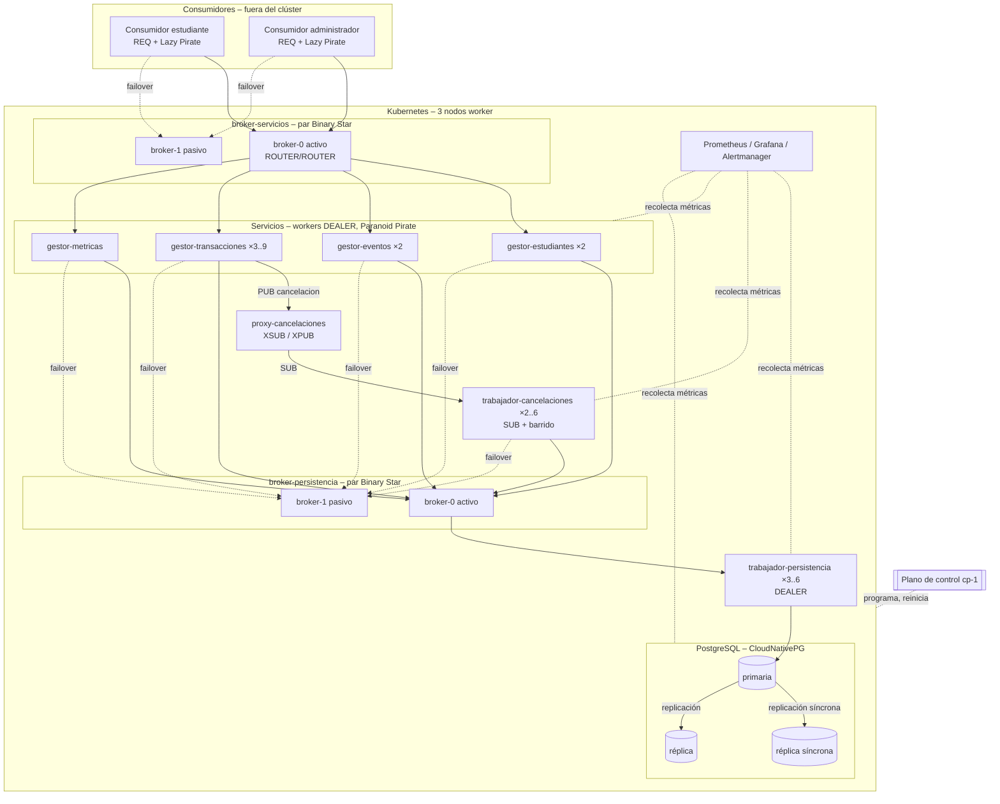

# Diseño de Tolerancia a Fallos y Escalabilidad

Este documento describe los componentes que usamos para que el sistema:

- **tolere fallos:** si un proceso o una máquina falla, el sistema sigue
  funcionando, o se recupera rápido, sin perder ni duplicar datos;
- **escale:** pueda atender más estudiantes, eventos y solicitudes agregando
  pods o máquinas, manteniendo el tiempo de transacción por debajo de 1 s (RNF-07).

Decisiones de tecnología:

- **Comunicación:** ZeroMQ, con los **patrones de confiabilidad** de la Guía de
  ZeroMQ (Lazy Pirate, Paranoid Pirate, Majordomo, Binary Star) para
  petición–respuesta y **PUB/SUB con "guardar primero y luego publicar"** para las
  cancelaciones. Detalles en [comunicacion-zeromq.md](comunicacion-zeromq.md).
- **Despliegue:** Kubernetes en 4 máquinas (1 plano de control + 3 workers).
  Detalles en [despliegue-kubernetes.md](despliegue-kubernetes.md).

Se apoya en el modelo de fallos de [modelos-sistema.md](modelos-sistema.md#3-modelo-de-fallos)
y en los indicadores de [indicadores-desempeno.md](indicadores-desempeno.md).

---

## 1. Metas

| Meta | Objetivo (propuesta) |
|---|---|
| Disponibilidad | ≥ 99 % durante las pruebas; la falla de un pod o de un nodo worker no detiene el sistema |
| RPO (datos que se pueden perder en un fallo) | **0** transacciones confirmadas, **0** cancelaciones aceptadas |
| RTO (tiempo de recuperación) | Pod de servicio: < 5 s · Cambio de broker: < 5 s · Failover de la BD: < 30 s · Nodo worker: < 60 s |
| Desempeño durante un fallo | p95 < 1 s de nuevo antes de 1 minuto después del fallo |
| Escalabilidad | El throughput crece de forma casi lineal al agregar pods de servicio, hasta que la base de datos se vuelve el límite |

---

## 2. Arquitectura objetivo

Las tres capas siguen iguales (Consumidores → Servicios → Persistencia de Datos).
La tolerancia a fallos y la escalabilidad se agregan **dentro** de cada capa
replicando sus procesos; las reglas "solo se llama a la capa de abajo" y "los
servicios no tienen estado" no cambian.

---

## 3. Componentes

### 3.1 Brokers Majordomo (balanceo de carga y descubrimiento de servicios)

| | |
|---|---|
| **Qué** | Dos brokers Majordomo: `broker-servicios` (consumidores → servicios) y `broker-persistencia` (servicios → persistencia). Frontend `ROUTER` para los clientes, backend `ROUTER` para los workers `DEALER`. |
| **Escalabilidad** | Balanceo de carga por solicitud (el usado hace más tiempo) entre todos los workers de un servicio. Un pod nuevo se registra con `READY` y recibe trabajo de inmediato; no hay que cambiar configuración. |
| **Tolerancia a fallos** | Los workers caídos se detectan por heartbeats (3 s) y se sacan del grupo. |
| **Aplicado al proyecto** | Reemplaza un balanceador de carga y un registro de servicios separados. Los consumidores solo necesitan los dos endpoints del broker. |

### 3.2 Pares de brokers Binary Star

| | |
|---|---|
| **Qué** | Cada broker corre como un par primario/respaldo (StatefulSet con 2 pods en nodos distintos). |
| **Tolerancia a fallos** | Si el broker activo se cae, los clientes (después de los reintentos Lazy Pirate) y los workers cambian al respaldo, que solo se activa si también perdió el heartbeat del primario **y** ve tráfico de clientes (evita el cerebro dividido). |
| **Estado** | Los brokers no guardan datos de negocio; los clientes reintentan las solicitudes en curso. |
| **Fase 1 más simple** | Una réplica del broker que Kubernetes reinicia; los clientes reintentan hasta que vuelva. |

### 3.3 Clientes Lazy Pirate

| | |
|---|---|
| **Qué** | Todo cliente (consumidor, servicios llamando a persistencia) envía con un timeout; si se vence, cierra el socket `REQ`, lo reabre y reenvía la **misma** solicitud (mismo `idSolicitud`); tras N fallos cambia al broker de respaldo. |
| **Tolerancia a fallos** | Enmascara solicitudes/respuestas perdidas, workers caídos y el cambio de broker. |
| **Requisito** | Todas las escrituras idempotentes por `idSolicitud` (ya está en el diseño, RNF-04). |

### 3.4 Workers Paranoid Pirate (heartbeats)

| | |
|---|---|
| **Qué** | Broker y workers intercambian heartbeats cada 1 s; 3 perdidos → el par está caído. Los workers reconectan con espera exponencial. |
| **Tolerancia a fallos** | Detección rápida de fallos en ambos sentidos, incluso sin tráfico. |

### 3.5 Gestores y trabajadores de persistencia sin estado

| | |
|---|---|
| **Qué** | Deployments de Kubernetes separados por servicio (`gestor-estudiantes`, `gestor-eventos`, `gestor-transacciones`, `gestor-metricas`, `trabajador-persistencia`). |
| **Tolerancia a fallos** | Cualquier réplica atiende cualquier solicitud; Kubernetes reinicia los pods caídos; la anti-afinidad reparte las réplicas entre los 3 nodos. |
| **Escalabilidad** | HorizontalPodAutoscaler (CPU 70 % o latencia p95). |

### 3.6 Patrones de resiliencia dentro del código

| Patrón | Cómo lo usamos | Protege contra |
|---|---|---|
| **Timeouts por intento** | 1 000 ms consumidor → servicios, 300 ms servicios → persistencia | Esperar indefinidamente |
| **Reintentos (Lazy Pirate)** | Mismo `idSolicitud`; 3 intentos del lado del consumidor, 2 del lado de servicios | Mensajes perdidos, workers caídos, cambio de broker |
| **Circuit breaker** | Si > 50 % de las llamadas a persistencia fallan en 10 s, fallar rápido con `PERSISTENCIA_NO_DISPONIBLE` durante 5 s | Fallos en cascada |
| **Bulkhead (compartimentos)** | Grupos de workers separados para listados y para escrituras (p. ej. `gestor-transacciones` vs `gestor-eventos`), y pools de conexiones a BD separados | Que una avalancha de listados bloquee las reservas |
| **High-water marks** | Colas de ZeroMQ acotadas | Agotar la memoria por sobrecarga |
| **Límite de solicitudes** | Por estudiante en la capa de servicios (`LIMITE_SOLICITUDES`) | Sobrecarga, denegación de servicio |
| **Degradación controlada** | Si fallan las réplicas de solo lectura, leer de la primaria; si falla el proxy-cancelaciones, el barrido sigue aplicando cancelaciones | Que una caída parcial se vuelva total |
| **Apagado ordenado** | `DISCONNECT` de MDP + terminar las solicitudes en curso al terminar el pod | Errores durante los despliegues |

### 3.7 Cancelaciones: guardar primero y luego publicar (PUB/SUB)

| | |
|---|---|
| **Qué** | `gestor-transacciones` guarda una `solicitud_cancelacion` (`PENDIENTE`) en la base de datos, responde `ACEPTADA` y luego **publica** una notificación a través del `proxy-cancelaciones` (`XSUB`/`XPUB`). Los trabajadores de cancelaciones se **suscriben**, **toman** la solicitud en la base de datos (solo uno gana) y la aplican de forma atómica. |
| **Tolerancia a fallos** | ZeroMQ PUB/SUB puede perder mensajes, así que cada trabajador corre un **barrido** cada 2 s que toma las solicitudes `PENDIENTE` con más de 2 s y las `EN_PROCESO` cuyo bloqueo de 30 s venció. Nada aceptado se pierde; la toma + la aplicación idempotente lo hacen exactamente una vez. |
| **Escalabilidad** | Agregar pods de trabajadores de cancelaciones (HPA por cantidad de solicitudes pendientes); las tomas reparten el trabajo. |
| **Aplicado al proyecto** | Reemplaza el broker de mensajes durable separado del diseño anterior: la base de datos es el almacenamiento durable y PUB/SUB es el camino rápido. |

### 3.8 Clúster PostgreSQL (CloudNativePG)

| | |
|---|---|
| **Qué** | 3 instancias, una por nodo worker: 1 primaria + 2 réplicas en espera con **replicación síncrona por quórum** (una confirmación se da por hecha cuando al menos una réplica la tiene). |
| **Tolerancia a fallos** | RPO = 0. Si la primaria falla, el operador promueve la réplica más actualizada (~10–30 s) y actualiza el Service `postgres-rw`; los trabajadores de persistencia reconectan. La primaria anterior queda aislada (fencing) cuando vuelve. |
| **Escalabilidad** | Los listados pueden leer de `postgres-ro` (réplicas); toda verificación que decide una reserva corre en la primaria dentro de la confirmación atómica. |
| **Copias de seguridad** | Copia base diaria + archivado continuo de WAL (`ScheduledBackup` de CloudNativePG); la restauración se prueba al menos una vez. |
| **Compromiso** | La replicación síncrona agrega ~1–5 ms por confirmación en la LAN; aceptable dentro de 1 s. |

### 3.9 Auto-reparación de Kubernetes

| Mecanismo | Efecto |
|---|---|
| Política de reinicio + sondas de liveness | Los pods caídos o colgados se reinician |
| Sondas de readiness | Solo los workers registrados y el broker Binary Star **activo** reciben tráfico |
| Anti-afinidad | Réplicas en nodos distintos; brokers e instancias de BD estrictamente separados |
| `tolerationSeconds: 30` | Los pods de un nodo caído se reubican a los 30 s (en lugar de 5 min) |
| PodDisruptionBudgets | El mantenimiento nunca apaga todas las réplicas |
| Actualizaciones progresivas (`maxUnavailable: 0`) | Despliegues sin tiempo fuera de servicio |

### 3.10 Monitoreo, detección de fallos y alertas

| | |
|---|---|
| **Qué** | kube-prometheus-stack (Prometheus, Grafana, Alertmanager, node-exporter) + los indicadores de [recoleccion-metricas.md](recoleccion-metricas.md). |
| **Detectores de fallos** | Heartbeats de ZeroMQ (entre procesos, 3 s), sondas de Kubernetes (pods), CloudNativePG (base de datos). |
| **Alertas** | p95 > 1 s durante 1 min · tasa de errores técnicos > 1 % · cancelación pendiente más antigua > 10 s · retraso de replicación de la BD > 1 s · cualquier K-01…K-05 ≠ 0 · pods reiniciándose en bucle · nodo no listo · ocurrió un cambio de broker. |

---

## 4. Cómo se maneja cada fallo

| Fallo | Detección | Reacción automática | Impacto en los estudiantes | RTO | Datos perdidos |
|---|---|---|---|---|---|
| Se cae un pod de un gestor | Heartbeats del broker (3 s); sonda de liveness | Se saca del grupo del broker; Kubernetes lo reinicia; los clientes reintentan | Un reintento en las solicitudes afectadas | < 5 s | Ninguno |
| Se cae el broker activo | Heartbeats Binary Star; timeouts de los clientes | El respaldo se activa; clientes/workers cambian; Kubernetes reinicia el pod como nuevo respaldo | 2–3 s de reintentos | < 5 s | Ninguno |
| Se cae un trabajador de persistencia | Heartbeats del broker-persistencia | Los otros trabajadores atienden; reinicio | Un reintento | < 5 s | Ninguno |
| Se cae el proxy-cancelaciones | Sonda de liveness | Se reinicia; mientras tanto el barrido aplica las cancelaciones pendientes | Cancelaciones unos segundos más lentas | < 5 s | Ninguno |
| Se cae un trabajador de cancelaciones | Vencimiento del bloqueo / sonda | Otro trabajador la toma con el barrido | Demora ≤ 30 s en el peor caso | ≤ 30 s | Ninguno |
| Falla la primaria de PostgreSQL | CloudNativePG | Se promueve una réplica; se mueve `postgres-rw` | Las escrituras fallan con `PERSISTENCIA_NO_DISPONIBLE` durante el failover; las cancelaciones esperan | 10–30 s | Ninguno (replicación síncrona) |
| Falla una réplica de PostgreSQL | CloudNativePG | La primaria sigue con la otra réplica síncrona | Ninguno | — | Ninguno |
| Falla un nodo worker completo | Nodo no listo | Las réplicas de otros nodos siguen atendiendo; los pods se reubican a los 30 s; los brokers cambian si hace falta | Reintentos cortos; menos capacidad hasta la reubicación | < 60 s | Ninguno |
| Partición de red entre nodos | Heartbeats, timeouts | La regla Binary Star impide dos brokers activos; circuit breaker | Errores en el lado aislado | Lo que dure la partición | Ninguno |
| Falla el plano de control | — | Nada (no hay reubicación) | **Ninguno mientras no falle nada más**; los pods en ejecución siguen | Restauración manual de `cp-1` | Ninguno (copia de etcd) |
| Se pierde todo el clúster | — | Reconstruir el clúster, restaurar la BD desde la copia de seguridad | Sistema caído | Horas | Desde el último archivado de WAL |

---

## 5. Escalabilidad

### 5.1 Estrategias por componente

| Componente | Estrategia | Disparador |
|---|---|---|
| Gestores (workers de servicio) | **Horizontal** (HPA) | CPU > 70 %, p95 en aumento |
| Trabajadores de persistencia | Horizontal (HPA) | CPU; conexiones a la BD |
| Trabajadores de cancelaciones | Horizontal (HPA) | Cancelaciones pendientes / antigüedad de la más vieja |
| Brokers | Con uno activo por par alcanza (decenas de miles de msg/s); repartir servicios en más brokers solo si hace falta | CPU del broker > 70 % |
| Lecturas de la BD | Leer de las réplicas (`postgres-ro`) | Latencia de los listados |
| Escrituras de la BD | Vertical primero | Latencia de escritura p95 > 300 ms |
| Clúster | Agregar nodos worker | CPU/memoria de los nodos > 70 % |

### 5.2 Punto caliente: un evento muy popular

Cuando abren las reservas de un evento popular, muchos estudiantes escriben en la
**misma fila de `fecha_evento`**. Agregar pods no ayuda porque todas las
solicitudes compiten por una sola fila.

1. **Actualización condicional** (`reservas + N <= limite`) en lugar de bloqueos
   leer-y-luego-escribir: bloqueo de fila corto, sin interbloqueos (decisión O4).
2. **Fallar rápido cuando está lleno:** cuando `disponibles = 0`, rechazar en la
   capa de servicios sin escribir (con un contador en caché de vida corta; la base
   de datos igual hace la verificación final).
3. **Control de admisión (extensión):** enviar todas las reservas de un evento
   popular a un nombre de servicio Majordomo dedicado (p. ej. `transacciones.popular`)
   atendido por un solo worker, serializándolas sin contención.

### 5.3 Particionamiento de datos (futuro)

Si algún día una sola primaria no alcanza, los datos se pueden particionar
**por `idEvento`**: todas las fechas, reservas y transacciones de un evento en la
misma partición, así una reserva o modificación sigue siendo una operación
atómica en una sola partición. Los saldos necesitarían entonces una saga o 2PC
para los eventos pagos, así que solo vale la pena muy por encima de la escala de
una universidad.

### 5.4 Estimación de capacidad (a validar con pruebas de carga)

| Supuesto (propuesta) | Valor |
|---|---|
| Estudiantes | 20 000 |
| Usuarios concurrentes en el pico | 2 000 |
| Solicitudes por usuario por minuto en el pico | 6 |
| Carga en el pico | ~200 sol/s (≈ 80 % lecturas) |
| Por pod de gestor-transacciones (a medir, T-02) | ~100 sol/s con p95 < 1 s |
| Pods necesarios en el pico | 3 gestor-transacciones + 2 gestor-eventos (+1 de reserva cada uno) |
| Escrituras a la BD en el pico | ~40 escrituras/s → una primaria alcanza |
| Clúster | 3 nodos worker × 4 vCPU / 8 GB cubren el pico con un nodo caído |

---

## 6. Fases de implementación

| Fase | Componentes | Resultado |
|---|---|---|
| **0 – Base** | Una réplica de todo en Kubernetes; idempotencia; confirmaciones atómicas; cancelaciones guardar-primero + barrido; clientes Lazy Pirate | Correcto ante reintentos y caídas; Kubernetes reinicia los pods |
| **1 – Tolerancia mínima** (propuesta para el curso) | Brokers Majordomo (1 réplica cada uno) + heartbeats Paranoid Pirate · ≥ 2 réplicas de cada worker con anti-afinidad · CloudNativePG con 2 instancias · sondas, PDBs, `tolerationSeconds: 30` | Sobrevive a cualquier pod de servicio/worker o a un nodo worker; failover de BD automático |
| **2 – Sin punto único de fallo en el camino de datos** | Pares de brokers Binary Star · PostgreSQL con 3 instancias y quórum síncrono · HPAs · alertas | Sobrevive a la pérdida de un broker o de la primaria de la BD en segundos |
| **3 – Escalar lecturas** | Listados desde las réplicas · contador de disponibilidad en caché · bulkheads | Mayor throughput en las consultas |
| **4 – Gran escala** (solo si hace falta) | Particionamiento por `idEvento`, admisión para eventos populares | Más allá de la escala de una universidad |

### Verificación de cada fase

Correr los escenarios de fallo F1–F10 y los escenarios de carga de
[plan-pruebas.md](plan-pruebas.md), más:

| # | Escenario | Esperado |
|---|---|---|
| FT1 | `kubectl delete pod` de 1 pod de gestor-transacciones durante la carga | p95 vuelve a < 1 s en menos de 1 min; sin errores después de los reintentos |
| FT2 | Borrar el pod de la primaria de PostgreSQL durante la carga | Réplica promovida; K-01…K-05 = 0; ninguna transacción confirmada perdida |
| FT3 | Borrar el pod del broker-servicios activo durante la carga | Los clientes cambian al respaldo; sin duplicados (K-04 = 0) |
| FT4 | Borrar repetidamente el proxy-cancelaciones y los trabajadores de cancelaciones mientras se cancela | Todas las cancelaciones aplicadas exactamente una vez (K-05 = 0) |
| FT5 | Duplicar la carga y escalar gestor-transacciones de 3 → 6 | El throughput ~se duplica, p95 < 1 s |
| FT6 | 1 000 estudiantes reservando los últimos 100 cupos de una fecha | Exactamente 100 ocupados, K-01 = 0, p95 < 1 s |
| FT7 | Apagar un nodo worker durante la carga | El servicio continúa; pods reubicados en < 60 s; sin pérdida de datos |
| FT8 | Detener el plano de control 10 min durante la carga | Sin impacto en las solicitudes |

---

## 7. Resumen

| Necesidad | Componente(s) |
|---|---|
| Balanceo de carga y descubrimiento | Brokers Majordomo (ROUTER/DEALER) |
| Sin punto único de fallo en los brokers | Pares Binary Star |
| Sobrevivir a mensajes perdidos y workers caídos | Reintentos Lazy Pirate + `idSolicitud` idempotente + heartbeats Paranoid Pirate |
| Sobrevivir a la caída de un pod o un nodo | Reinicios de Kubernetes, réplicas con anti-afinidad, reubicación rápida |
| Sobrevivir a la caída de la BD sin perder datos | Primaria CloudNativePG + réplicas síncronas + failover automático + copias de seguridad |
| Nunca perder una cancelación aceptada | Guardar primero (BD), luego PUB/SUB, toma + bloqueo + barrido |
| Evitar fallos en cascada | Timeouts, circuit breaker, bulkheads, high-water marks, límite de solicitudes |
| Escalar | HPA para todos los workers, réplicas de lectura, más nodos |
| Saber cuándo algo falla | Heartbeats, sondas, métricas de Prometheus y alertas |
