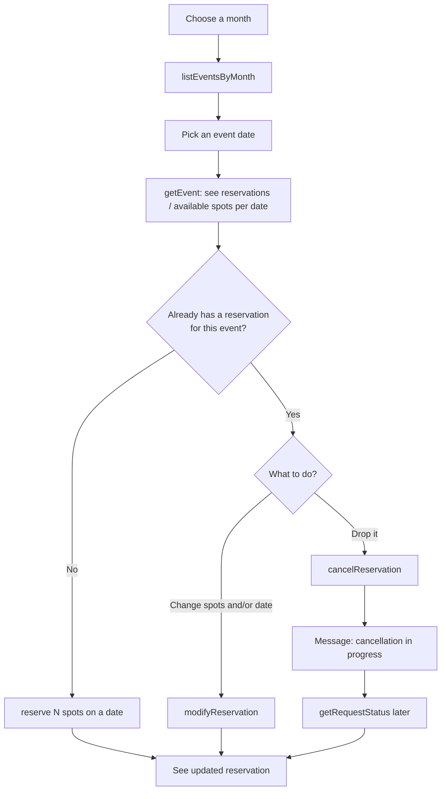
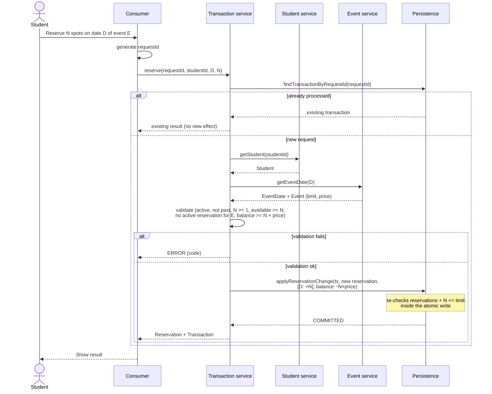
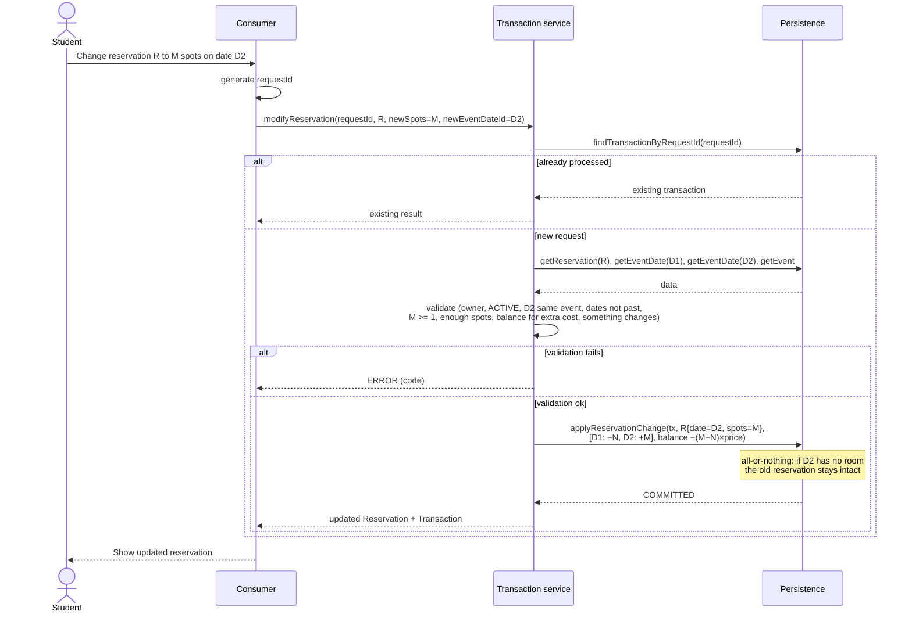
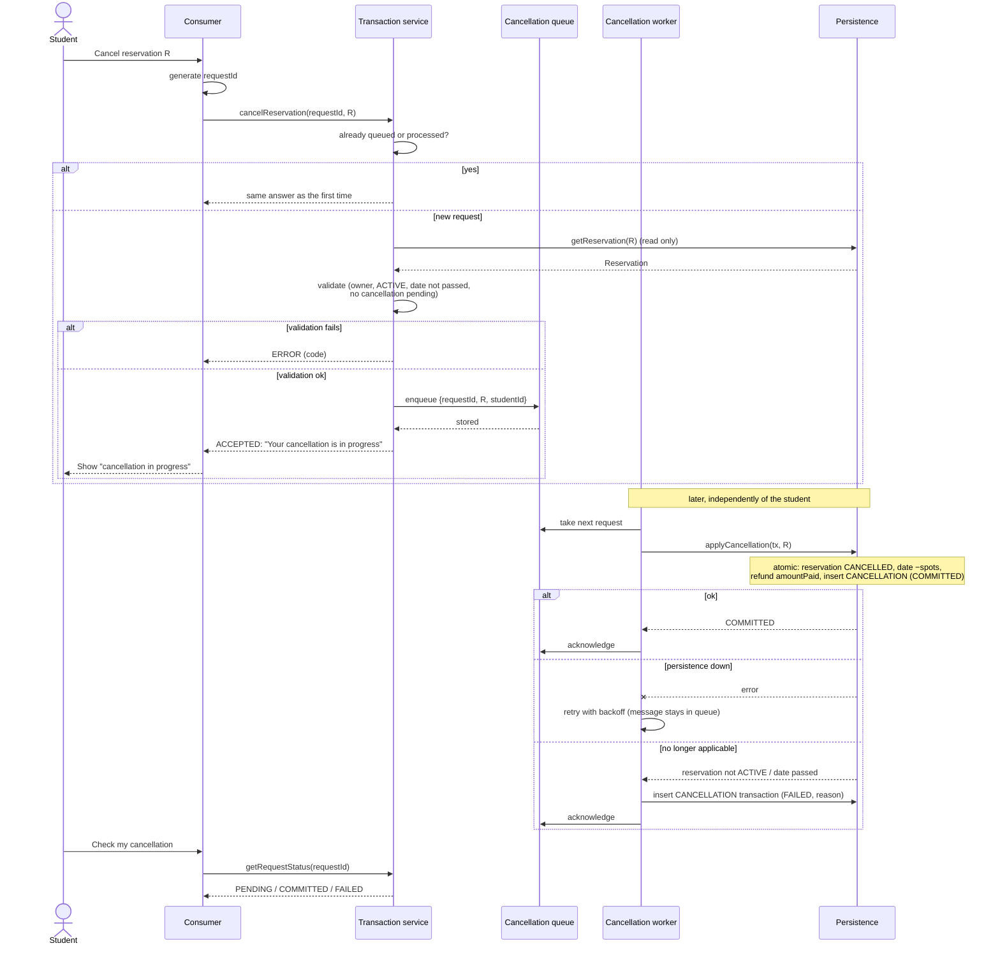

# Flows

All flows are **synchronous** except **cancel a reservation**: each arrow is a
blocking request, and the consumer gets the final result in the response. A
write is only reported as successful after persistence has committed it.

Cancellation is **asynchronous**: the system accepts it, answers right away
that the cancellation is in progress, and applies it to the data layer
afterwards.

## Student workflow

## Consult events of a month

1. Consumer sends `listEventsByMonth(year, month)`.
2. Event service asks persistence for all `EventDate`s between the first and the
   last day of the month (`listEventDatesBetween`), joined with their event and
   place.
3. Response: one row per date with event name, date, spot (place name or external
   address), price, `reservations`, `limit` and `available`.

Read-only, no `requestId` needed.

## Consult the reservations of spots

`getEvent(eventId)` returns every date of the event with:

| Field | Meaning |
|---|---|
| `date` | Date and time of this occurrence |
| `reservations` | Spots already taken |
| `limit` | Place capacity or `externalCapacity` |
| `available` | `limit − reservations` |

The student's own reservations come from `listStudentReservations(studentId)`.

## Reserve spots

If the student is not yet in the system, the consumer first calls
`createStudent` with their information. Then:

## Modify a reservation

The student can change the number of spots, the date, or both. The new date
must belong to the same event.

Cases:

| Change | Date deltas | Balance |
|---|---|---|
| Only spots, N → M on D | D: `+(M − N)` | `−(M − N) × price` (refund when M < N) |
| Only date, D1 → D2 | D1: `−N`, D2: `+N` | no change |
| Both | D1: `−N`, D2: `+M` | `−(M − N) × price` |

If the change fails for any reason, the original reservation (date, spots,
amount paid) remains exactly as it was.

## Cancel a reservation (asynchronous)

Steps:

1. **Accept.** The service does quick checks and puts the request in the durable
   queue. Nothing is written to the data layer yet.
2. **Reply.** The student immediately gets `ACCEPTED` with the message that the
   cancellation is in progress. The reservation is still shown, marked as
   "cancellation pending".
3. **Create the cancellation.** The worker applies it to the data layer in one
   atomic step: reservation `CANCELLED`, spots released on the date, refund for
   paid events, `CANCELLATION` transaction stored as `COMMITTED`.
4. **Result.** `getRequestStatus(requestId)` returns `COMMITTED`, or `FAILED`
   with the reason.

While the cancellation is pending, the spots are still taken, and modifying or
cancelling the same reservation again is rejected with `CANCELLATION_PENDING`.

## Event CRUD

| Operation | Flow |
|---|---|
| Create | Validate spot (exactly one of `placeId` / `externalAddress`; place exists; `externalCapacity > 0` if external) and at least one date; create event and its dates with `reservations = 0`. |
| Read | Return event plus each date's `reservations`, `limit` and `available`. |
| Update | If the spot changes, the new limit must be `>= reservations` of every date. Changing `price` does not affect existing reservations' `amountPaid`. |
| Add / change a date | Insert a date, or move a date that has no reservations (proposal). |
| Delete a date | Cancel and refund its reservations; the event must keep at least one date. |
| Delete event | Cancel and refund every active reservation atomically, then delete the event and its dates. |

## Top up balance

1. Admin consumer sends `topUp(requestId, studentId, amount)`.
2. Service validates `amount > 0` and that the student exists.
3. Persistence atomically inserts a `TOP_UP` transaction and increments `balance`.

## Query history

`listTransactions(studentId)` or `listTransactions(reservationId)` is
read-only: Consumer → Transaction service → Persistence.
